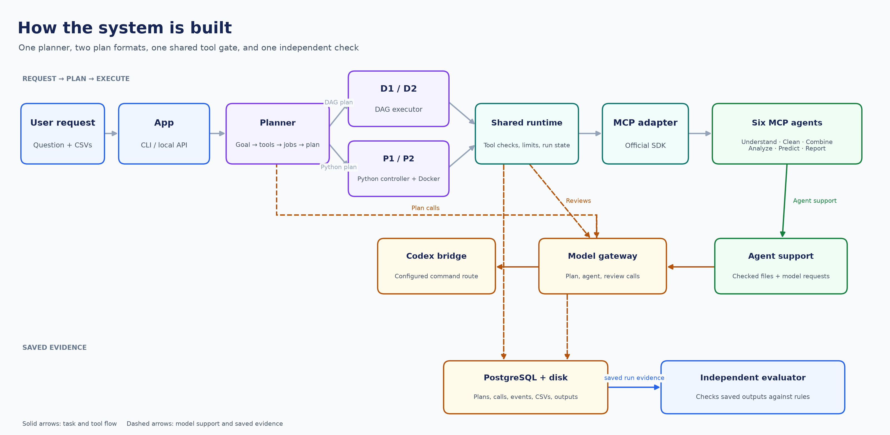
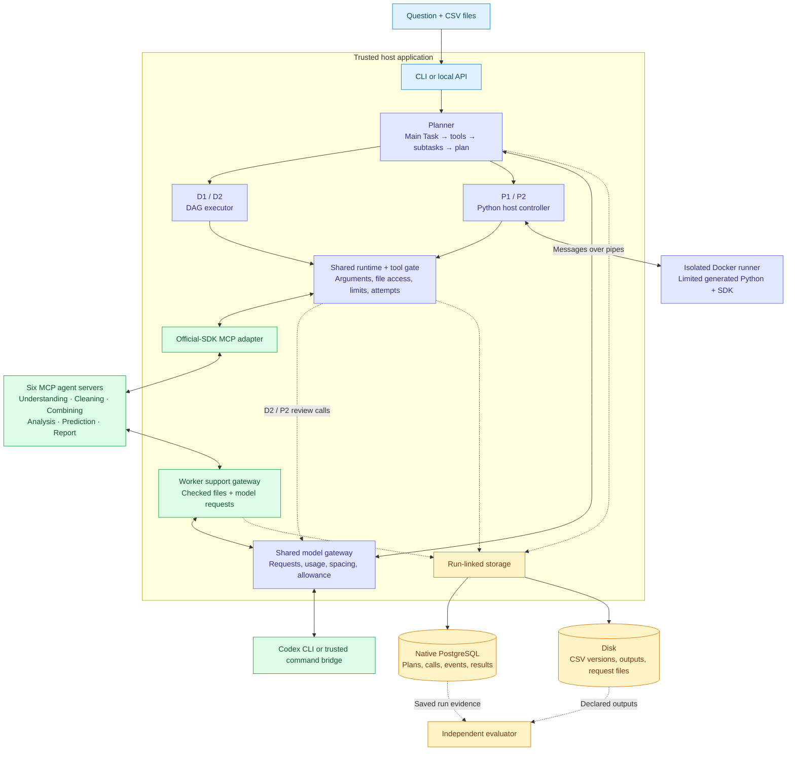
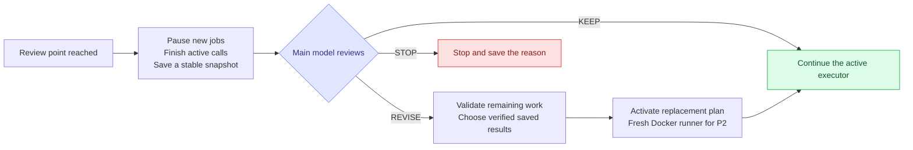
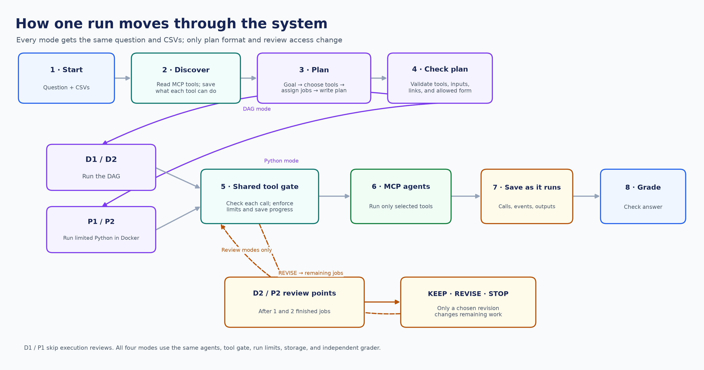
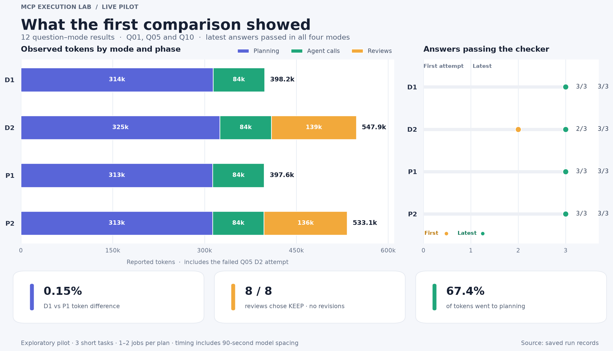

# MCP Execution Lab

<p align="center">
  <strong>Graph plans · Python plans · MCP agents · One shared runtime</strong><br/>
  A small research project on how an LLM plans and runs CSV data-analysis work.
</p>

Give the app a question and one or more CSV files. It discovers the available tools,
chooses the jobs it needs, writes a plan, runs it, and saves the evidence as it goes.
An independent checker then checks the answer.

The question we study is simple: **what changes when the same task uses a graph plan
or a Python plan, with or without a chance to revise that plan?** The goal is to build,
measure, explain failures, and report the limits of what the results show.

[Four modes](#the-four-modes) · [Architecture](#architecture) · [Run flow](#how-a-run-works) ·
[Design choices](#why-we-made-these-choices) · [Run locally](#run-locally) ·
[Results and insights](#results-findings-and-insights)

## The four modes

A **DAG** is a graph of jobs and their dependencies, with no loop. A job can start once
its required earlier jobs have finished. **Replanning** means letting the main model
change the remaining work after seeing results.

| | One initial plan | Execution reviews enabled |
|---|---|---|
| **Graph** | **D1** — model creates a DAG; the graph executor runs it. | **D2** — the same path, with model reviews at the task's review points. |
| **Python** | **P1** — model writes a limited Python program; Docker runs it. | **P2** — the same path, with the same review rule as D2. |

Every mode makes **its own fresh plan** from the same question and declared input files.
P1/P2 generate Python directly; they do not translate a DAG into Python. D1/P1 still
use model calls for planning and inside agents. They omit main-planner calls during
execution.

All four share the tools, calculations, model route, run limits, storage and answer
checks. The comparison changes how the plan is written and whether execution can ask
the main planner to revise it.

## Architecture

**MCP** is the common protocol used to discover and call tools in separate server
processes. The app uses the official MCP SDK through its own adapter. Agent choice
and order come from the user request and discovered capabilities; the main prompt
does not prescribe a sequence.



The editable Mermaid source for this diagram follows.



The Docker runner sends tool requests back to the host. The **host** checks and invokes
the MCP agent. Generated Python has no direct network or host-file access. The agents
are trusted local processes; their calculations run outside the generated-code container.

### Planner

The planner discovers MCP tools and saves a per-run cache of names, descriptions,
capabilities and input/output rules. It registers the CSVs, then makes four model stages:

1. **Main Task:** turn the question and CSV details into a clear goal and required outputs.
2. **Tool selection:** choose supported tools from the saved cache.
3. **Subtasks:** assign each selected tool a specific job.
4. **Plan:** write either the DAG and dependencies or the limited Python program.

Each stage checks its response. Final checks cover tool names, required arguments,
references, graph structure or the allowed Python syntax. Invalid supported cases can
use a bounded correction attempt. The executor receives an accepted, saved handoff.
Checks establish valid structure; they do not prove that the model understood every
business rule correctly.

Source: [planner](src/mcp_execution_lab/orchestration/planner.py),
[graph checks](src/mcp_execution_lab/orchestration/graph.py),
[Python checks](src/mcp_execution_lab/orchestration/programs.py).

### Executor and reviews

The graph executor checks for cycles and starts ready jobs as their dependencies finish.
Independent jobs can run together within the shared concurrency limit. The Python path
runs one `async def run(sdk, inputs)` program, supporting tool calls, conditions and
parallel work. Imports, loops, helper functions, arithmetic and direct file/network
access are blocked. Data calculations stay in the same agents used by the DAG path.

Both paths use one tool gate for checked arguments, run-owned files, time/call/token
limits, recorded attempts and results. An uncertain tool outcome stops the run rather
than being silently retried.

D2/P2 have two task-defined review opportunities. Current settings count one and two
finished attempted jobs, including confirmed failures. They are not tied to agent names.
Short plans can leave a review unreached; active work is drained before review.



Revisions keep the original run allowance and failure history. P2 starts a fresh
container with selected verified results; it does not retain arbitrary Python variables.
A replacement must explicitly resolve earlier failures before the run can succeed.

Source: [shared runtime](src/mcp_execution_lab/orchestration/runtime.py),
[DAG executor](src/mcp_execution_lab/orchestration/executor.py),
[Python executor](src/mcp_execution_lab/orchestration/program_executor.py),
[review support](src/mcp_execution_lab/orchestration/reviews.py).

### Six agents

Each agent is a separate MCP server. Its model chooses a supported recipe and writes an
explanation; trusted handwritten Python performs the calculations. These are bounded
data-analysis tools, rather than unrestricted programs written by the model.

| Agent | What it does |
|---|---|
| **Understanding** | Checks columns, types, missing values, duplicates and data quality. |
| **Cleaning** | Applies explicit rules and produces a new CSV with a change log. |
| **Combining** | Joins CSVs using stated keys and checks unexpected row growth. |
| **Analysis** | Filters, groups, calculates totals and comparisons, checks correlation, and creates charts. |
| **Prediction** | Runs simple regression, classification or last-value forecasts, with held-back checks and references. |
| **Report** | Builds Markdown reports linked to saved facts and source files. |

Only tools needed for the question are called. See the [agent guide](docs/Agents/Running.md)
for methods, inputs and limits.

### Storage and evaluation

PostgreSQL records the run, plans, model calls, reviews, attempts, events and grades
**during the run**. CSVs and generated files stay on disk, with hashes, versions and
parent links in the database. Each record belongs to its run, and earlier attempts stay
visible. Backups need both PostgreSQL and the file root.

Execution completion and answer correctness are separate. The evaluator reads declared
outputs and calculates expected answers independently. It checks tables, cleaning/change
logs and forecast outputs; stated chart/report/clarification checks require human review.
Expected answers and evaluator-only information are kept out of model context.

Tokens are saved per model call and grouped by planning, agent and review work. Failed
calls, corrections and retries count. Missing usage stays unknown. Cached and reasoning
counts, when supplied, are subsets and are not added to totals again. USD cost remains
unknown.

## How a run works



The editable Mermaid source for this flow follows.

```mermaid
flowchart LR
    subgraph PLAN["1 · Plan"]
        direction TB
        A["Question + declared CSVs"] --> B["Create run ID<br/>Discover tools + register files"]
        B --> C["Model: Main Task → selection → subtasks"]
        C --> D["Model: DAG or Python directly<br/>Validate + save accepted handoff"]
    end
    subgraph RUN["2 · Execute"]
        direction TB
        E["Activate the chosen executor"] --> F["Call needed agents through shared gate"]
        F --> G["Save progress during the run<br/>Apply D2 / P2 reviews if reached"]
        G --> H["Publish outputs + terminal run state"]
    end
    subgraph CHECK["3 · Evaluate"]
        direction TB
        I["Independent checks on saved outputs"] --> J["Link grade to run<br/>Compare answers, calls, tokens and time"]
    end
    D --> E
    H --> I
    style PLAN fill:#eff6ff,stroke:#60a5fa,color:#1e3a8a
    style RUN fill:#f0fdf4,stroke:#4ade80,color:#14532d
    style CHECK fill:#fffbeb,stroke:#fbbf24,color:#78350f
```



A batch runs approved question/mode pairs sequentially. A file-based monitor checks
saved status without making model calls, records failures and continues without an
automatic whole-run retry. See the [batch guide](docs/evaluation/Small_Automatic_Batch.md).

## Why we made these choices

| Choice | Reason | Cost or limit |
|---|---|---|
| **CSV data analysis** | Gives each run clear input files and outputs we can check independently. | Does not cover every kind of agent task. |
| **Model chooses tools and order** | Lets each mode plan from the question and the tools that actually exist. | Meaning can still be wrong even when a plan passes structural checks. |
| **One shared runtime and agents** | Keeps calculations, tool checks and run limits consistent across modes. | The study measures orchestration, not unrestricted Python analysis versus tools. |
| **Limited Python in Docker** | Tests code as a plan format while keeping calculations in shared agents and generated code off the host. | Limits Python's freedom; the Docker daemon and kernel remain trusted. |
| **Same two review rules for D2/P2** | Gives both representations the same review opportunities. | A short task may finish before a useful change is needed. |
| **Native PostgreSQL + disk files** | Saves linked evidence while a run is active, without storing large CSVs as database rows. | Database and disk writes are not one atomic transaction; both need backup. |
| **Independent answer checks** | Separates finishing execution from producing the correct answer. | New tasks need their own checks; some outputs still need a person. |
| **Count failed attempts and unknown usage** | Keeps reliability and token comparisons honest. | A provider reply without usage cannot be assigned an invented token count. |
| **90-second model spacing in the pilot** | A chosen response to earlier rate-limit errors on the local model route. | Adds substantial waiting; it does not establish an engine speed advantage. |

The model bridge currently invokes the signed-in Codex CLI, or a configured trusted
command. Authentication stays with that route; the app does not extract an API key
from the CLI login. See the [bridge contract](docs/planner_bridge.md).

## Run locally

### Requirements

- Python **3.12** and `uv` for the locked project environment.
- **Native PostgreSQL**, configured in local `.env`.
- A working model bridge and access to the model chosen in configuration.
- **Docker with Linux containers** for P1/P2. D1/D2 do not require Docker.

On a fresh setup:

```powershell
uv sync --locked --python 3.12
Copy-Item .env.example .env
# Edit .env locally with your PostgreSQL connection. Keep it out of Git.
.\scripts\lab.ps1 analysis db-init
```

For a CLI run that owns its MCP subprocesses:

```powershell
.\scripts\lab.ps1 analysis run --query "Calculate total amount" --csv fixtures/data_analysis/example.csv --config configs/agents_stdio.yaml --mode D1
.\scripts\lab.ps1 analysis inspect --run RUN_ID
```

Build the shared Python runner image before P1/P2, then select the desired mode:

```powershell
.\scripts\lab.ps1 analysis runner-build --config configs/agents_stdio.yaml
.\scripts\lab.ps1 analysis run --query "Calculate total amount" --csv fixtures/data_analysis/example.csv --config configs/agents_stdio.yaml --mode P1
```

For persistent HTTP services, `start_agents.ps1` starts the local orchestrator API and
all six agents using `configs/agents.yaml`. `stop_agents.ps1` checks saved process
identities before stopping their PIDs and process trees. Starting services does not
submit a model request; a live run uses the configured model allowance.

```powershell
.\start_agents.ps1
.\stop_agents.ps1
```

The generated-code image uses a pinned official Python 3.12 slim base, a non-root user,
no network or host mounts, a read-only root, **1 CPU, 512 MiB memory, 64 processes and
16 MiB temporary space**. Rebuild after changing `program_sdk`; the executor checks
image/SDK identity. Docker is the isolation boundary, not the Python syntax checks.

The experiment uses [separate shared settings](configs/experiments/csv_gap90_300k.yaml).
The [evaluation guide](docs/evaluation/Running.md) explains preparing and comparing runs.
User CSVs in `Input/`, `.env`, raw runs and detailed reports remain local and ignored.
Public synthetic fixtures and aggregate results are included in the repo.

### Engineering checks

When no run is active, stop managed services before the lifecycle test starts its own
instance on test ports:

```powershell
.\stop_agents.ps1
.\scripts\check.ps1
# Optional checks need native PostgreSQL and the prebuilt Docker image:
$env:MCP_LAB_POSTGRES_TEST = '1'
$env:MCP_LAB_DOCKER_TEST = '1'
.\scripts\check.ps1
```

Normal checks use fixed model replies with real MCP processes and calculations.
Live model tests are separately opt-in. The 2026-10-27 full integration validation
passed **360 non-live tests with one live-test skip**, including real Docker, MCP and
temporary native PostgreSQL. The later cleanup check verified 309 distinct passing
cases across its main check and a service-test rerun, with 59 optional skips.
These are software checks, separate from the live answer results below.

### Code and further reading

| Area | Location |
|---|---|
| Planner, executors, shared runtime, model bridge and storage | [orchestration/](src/mcp_execution_lab/orchestration/) |
| Six MCP agents and worker support | [agents/](src/mcp_execution_lab/agents/) |
| Suites, independent checks, batch comparisons and tokens | [evaluation/](src/mcp_execution_lab/evaluation/) |
| Generated Python's small SDK and image | [program_sdk/](src/mcp_execution_lab/program_sdk/) · [Dockerfile](containers/csv_python/Dockerfile) |
| Detailed contracts | [Planner](docs/Planner%20and%20Executor/Planner.md) · [Executor](docs/Planner%20and%20Executor/Executor.md) · [P1](docs/Planner%20and%20Executor/P1.md) · [P2](docs/Planner%20and%20Executor/P2.md) |
| Research record | [Controls](docs/experiment_protocol.md) · [Progress](docs/progress.md) · [Limitations](docs/limitations.md) · [Original guide](docs/reference/Execution_Engine_Research_App_Build_Guide.md) |

## Results, findings and insights

**Pilot completed: 27 October 2026. Documentation updated: 29 October 2026.**

Three approved questions were run in all four modes: **3 questions × 4 modes = 12
question/mode results**. Each question uses its own declared CSV, rather than being
applied to every input file.

| Question | Input | Checked work |
|---|---|---|
| **Q01** | Orders | 365 completed orders; total **₹314,620.81**. |
| **Q05** | Messy orders | 506 → 486 rows; 20 removed, 36 edit operations. Final completed sales: East ₹76,378.95, North ₹61,491.98, South ₹85,828.44, West ₹85,975.44. |
| **Q10** | Daily sales | 181 rows; 144 train, 37 test, and 44 test-plus-future forecast rows. Test MAE **2.135** and RMSE **2.342**, equal to the requested last-value baseline. |

All main attempts share the same application source, configuration, suite and grader.
Settings were `gpt-6.1-sol`, low reasoning, a **300,000-observed-token guard**, at most
**32 model calls**, a **30-minute run limit**, **90-second model spacing**, and the same
review thresholds after one and two finished attempted jobs. The guard is checked
after responses; it is not a hard billing cap.

### Answers and total usage

| Mode | Latest answers passed | First attempts passed | Attempts counted | Model calls | Tokens | Recorded minutes |
|---|---|---|---|---|---|---|
| **D1** | 3/3 | 3/3 | 3 | 20 | 398,162 | 29.91 |
| **D2** | 3/3 | 2/3 | 4 | 25 | 547,927 | 37.15 |
| **P1** | 3/3 | 3/3 | 3 | 20 | 397,568 | 30.05 |
| **P2** | 3/3 | 3/3 | 3 | 24 | 533,091 | 36.66 |

**Q05 D2 passed on its second attempt with unchanged code and settings.** Both attempts'
time, calls and tokens are included. The failed attempt stopped at Main Task creation,
before any tool or execution review: it requested tool details that this early stage
had not received. A successful retry does not fix that planning issue.

The main comparison therefore includes **13 attempts, 89 model calls and 1,876,748
reported tokens**. All current calls have usage counts. All 34 historical attempts remain
saved locally; 21 older attempts are outside the main comparison. Eight older calls
have unknown usage and are kept as unknown.



*Totals include the failed Q05 D2 attempt. Chart values come from the
[aggregate data](docs/assets/pilot_results.json) ([vector chart](docs/assets/pilot_results.svg)); full controls and recorded hashes are in
[the results summary](docs/evaluation/Results.md).*

### Findings and what they mean

| Observation | What we can say |
|---|---|
| **D1/P1 differed by 594 tokens — 0.15%.** | Neither plan format showed a convincing advantage on these three short tasks. |
| **D2 used 37.6% more tokens than D1; P2 used 34.1% more than P1.** | Reviews explain almost all the extra use; the D2 total also includes its failed planning attempt. |
| **All eight completed reviews chose KEEP; zero accepted revisions.** | We measured review cost, without demonstrating a benefit from changing a plan. |
| **Six reviews occurred after all original jobs had finished.** | Most checks assessed completed work. A review could still request follow-up work, but none did. |
| **Planning used 67.4% of tokens; 98.7% of tokens were input.** | Repeated planning context is a more useful area to investigate than shortening answer text alone. |
| **Model-spacing waits occupied 84.5% of recorded run time.** | These times mainly reflect deliberate waiting and cannot establish which executor is faster. |

Only **Analysis, Cleaning and Prediction** were exercised, with one or two jobs per plan.
The pilot did not test larger parallel plans or useful live recovery, and it was not a
repeated study on unseen data. Passing Q10 means following the requested simple forecast,
not discovering a stronger forecasting method. General-purpose Python analysis, automatic
host-crash recovery and a dashboard are outside the current application.

The concrete outcome is a working comparison system and a small, traceable set of
results. Both plan formats completed these tasks; planning input and review calls were
the main token expenses. The evidence supports those observations and leaves broader
claims open.
