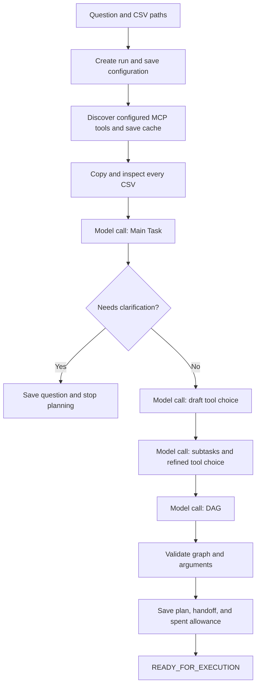

# Planner: from a question and CSVs to an accepted DAG

The planner decides **what work is needed and how the jobs depend on each other**.
It does not perform the requested analysis while planning. `Application.plan()` builds
a shared budget, file manager, and model-call manager, then calls `Planner.plan()`.
Evidence: [Application.components (service.py:20)](C:/Learning/R-Project/src/mcp_execution_lab/orchestration/service.py:20),
[Application.plan (service.py:26)](C:/Learning/R-Project/src/mcp_execution_lab/orchestration/service.py:26),
[Planner.plan (planner.py:88)](C:/Learning/R-Project/src/mcp_execution_lab/orchestration/planner.py:88).

## Actual order of work



The successful normal route makes **four main-planning requests**, before worker model
calls. Each stage can use its configured correction allowance. Discovery and CSV reading
make no model requests. This is visible in `Planner._prepare()` and checked by the test
that asserts exactly `main_task`, `tool_selection`, `subtasks`, and `dag`.
Evidence: [Planner._prepare (planner.py:148)](C:/Learning/R-Project/src/mcp_execution_lab/orchestration/planner.py:148),
[test_real_mcp_discovery_and_planning_never_execute_workers (test_planner.py:14)](C:/Learning/R-Project/tests/orchestration/test_planner.py:14).

## 1. Input and run creation

`Planner.plan(request, sources, mode, rules, encoding, delimiter)` currently accepts
only D1 or D2. D2 needs two configured review rules. Empty questions and missing CSVs
are rejected. Before discovery/model work, it creates the run and saves the question,
mode, task rules, limits, provider/model labels, development labels, source hash, and lock
hash. Settings and CSV-reading choices are saved in a separate configuration record.
Evidence: [Planner.plan (planner.py:88)](C:/Learning/R-Project/src/mcp_execution_lab/orchestration/planner.py:88),
[TaskRules (models.py:80)](C:/Learning/R-Project/src/mcp_execution_lab/orchestration/models.py:80), [source_identity (provenance.py:9)](C:/Learning/R-Project/src/mcp_execution_lab/orchestration/provenance.py:9).

The HTTP request also limits a question to 10,000 characters and supplies one to eight
CSV paths. Those particular field limits belong to `RunRequest`; the CLI does not impose
the same one-to-eight source count through that record. All paths still undergo actual
file registration checks. Evidence: [RunRequest (server.py:25)](C:/Learning/R-Project/src/mcp_execution_lab/orchestration/server.py:25),
[main (cli.py:48)](C:/Learning/R-Project/src/mcp_execution_lab/orchestration/cli.py:48), [Files.register_csv (files.py:160)](C:/Learning/R-Project/src/mcp_execution_lab/orchestration/files.py:160).

## 2. Tool discovery and the cache

The tool universe is the configured `servers` list. The code does not scan the computer
or network for unknown agents. `Connections` opens each configured discovery session,
initializes the official MCP SDK client, reads paginated `list_tools` replies, validates
schemas, and builds a `ToolCache`. Tools are identified by `server/name`, so identical
tool names on different servers remain distinct.
Evidence: [Connections (mcp.py:34)](C:/Learning/R-Project/src/mcp_execution_lab/orchestration/mcp.py:34),
[Connections.discover (mcp.py:120)](C:/Learning/R-Project/src/mcp_execution_lab/orchestration/mcp.py:120),
[ToolDefinition (models.py:94)](C:/Learning/R-Project/src/mcp_execution_lab/orchestration/models.py:94), [ToolCache (models.py:117)](C:/Learning/R-Project/src/mcp_execution_lab/orchestration/models.py:117).

The cache includes descriptions, schemas, annotations, raw definitions, protocol version,
and server information. **`plain_description` is a copy of `description`, and
`capabilities` is a one-item list containing that description.** No independent model
summarizes capabilities at discovery time. The cache is saved for this run, not maintained
as a global intelligent catalogue. Sorting cache entries by key gives stable fingerprints;
it is not a requested tool-execution order.
Evidence: [Connections.discover (mcp.py:120)](C:/Learning/R-Project/src/mcp_execution_lab/orchestration/mcp.py:120),
[Planner._prepare (planner.py:148)](C:/Learning/R-Project/src/mcp_execution_lab/orchestration/planner.py:148).

Discovery starts all configured stdio servers even when only one tool will later be
selected. That does not invoke their analysis tools. For persistent HTTP services,
discovery connects to already running processes. Planner connections close after discovery;
execution creates its own selected connections. Evidence:
[Connections.__init__ (mcp.py:35)](C:/Learning/R-Project/src/mcp_execution_lab/orchestration/mcp.py:35),
[Connections._own_session (mcp.py:45)](C:/Learning/R-Project/src/mcp_execution_lab/orchestration/mcp.py:45),
[Planner._prepare (planner.py:148)](C:/Learning/R-Project/src/mcp_execution_lab/orchestration/planner.py:148),
[Executor.run (executor.py:27)](C:/Learning/R-Project/src/mcp_execution_lab/orchestration/executor.py:27).

External JSON-schema references are refused. Duplicate tool names within one server,
repeated page cursors, empty catalogues, and more than 100 discovery pages are errors.
For project workers, the planner also compares their loaded source hash with the current
package hash; stale persistent workers require a restart.
Evidence: [check_schema (mcp.py:16)](C:/Learning/R-Project/src/mcp_execution_lab/orchestration/mcp.py:16),
[Connections.discover (mcp.py:120)](C:/Learning/R-Project/src/mcp_execution_lab/orchestration/mcp.py:120),
[Planner._prepare (planner.py:148)](C:/Learning/R-Project/src/mcp_execution_lab/orchestration/planner.py:148).

## 3. CSV reading and what the model sees

Registration copies the original file into the run's directory, calculates its SHA-256
hash, and scans the full file. It records columns, row count, missing counts, observed
numeric/text types, encoding, delimiter, and a preview. Duplicate/empty column names,
inconsistent row widths, invalid encoding, and oversized files are rejected.
The default preview is the first five data rows; each preview cell is cut to 512 characters.
The model does not receive the entire CSV at this stage.
Evidence: [Files.register_csv (files.py:160)](C:/Learning/R-Project/src/mcp_execution_lab/orchestration/files.py:160),
[Dataset (models.py:139)](C:/Learning/R-Project/src/mcp_execution_lab/orchestration/models.py:139), [Limits (models.py:57)](C:/Learning/R-Project/src/mcp_execution_lab/orchestration/models.py:57).

These observations are descriptive, not business definitions. A numeric-looking ID may
be reported as an observed integer while its actual stored CSV text still preserves
zeros. The header strings are checked but not automatically trimmed or renamed.
Evidence: [Files.register_csv (files.py:160)](C:/Learning/R-Project/src/mcp_execution_lab/orchestration/files.py:160).

## 4. Main Task, draft choice, and subtasks

| Model response | Actual fields and checks |
|---|---|
| `MainTask` | Goal, dataset IDs, requested outputs, constraints, assumptions, clarification questions. Referenced dataset IDs must exist and be nonempty. |
| `Selection` | Exact tool keys, one reason per selected tool, missing capabilities. The selected keys must exist in the run cache. |
| `Breakdown` | A refined selection plus subtasks. Every subtask has a distinct ID, one tool key, actual job text, and expected-output descriptions. |

Evidence: [MainTask (models.py:151)](C:/Learning/R-Project/src/mcp_execution_lab/orchestration/models.py:151),
[Selection (models.py:160)](C:/Learning/R-Project/src/mcp_execution_lab/orchestration/models.py:160), [Subtask (models.py:174)](C:/Learning/R-Project/src/mcp_execution_lab/orchestration/models.py:174),
[Breakdown (models.py:181)](C:/Learning/R-Project/src/mcp_execution_lab/orchestration/models.py:181),
[validate_breakdown (graph.py:59)](C:/Learning/R-Project/src/mcp_execution_lab/orchestration/graph.py:59).

Main Task generation receives the question, dataset descriptions, and task rules; it
does **not** receive the tool cache in its context. The following selection/subtask/DAG
calls do receive it. A clarification question ends planning after saving the Main Task.
A missing capability also stops planning. There is no built-in conversational continuation
that attaches an answer and resumes the same stopped plan; the API exposes new planning
and execution, not a clarification-resume route.
Evidence: [Planner._prepare (planner.py:148)](C:/Learning/R-Project/src/mcp_execution_lab/orchestration/planner.py:148),
[Planner.plan (planner.py:88)](C:/Learning/R-Project/src/mcp_execution_lab/orchestration/planner.py:88), [create_app (server.py:34)](C:/Learning/R-Project/src/mcp_execution_lab/orchestration/server.py:34).

The draft selection is not final. The subtask stage may refine it using any available
cached tool. The code validates the refined selection against the cache, not as a strict
subset of the draft. One tool may have multiple distinct jobs. Evidence:
[validate_breakdown (graph.py:59)](C:/Learning/R-Project/src/mcp_execution_lab/orchestration/graph.py:59),
[test_subtasks_can_refine_the_draft_selection (test_planner.py:48)](C:/Learning/R-Project/tests/orchestration/test_planner.py:48).

## 5. What a DAG contains

A step has `id`, `subtask_id`, `server`, `tool`, `depends_on`, argument bindings, an
optional condition, and `dependency_policy`. The plan also declares final output bindings.
This is a typed JSON graph, not generated Python. The main prompt does not name the six
agents or prescribe a domain sequence. Binding instructions do specify how to express
valid references and jobs. Evidence: [Step (models.py:225)](C:/Learning/R-Project/src/mcp_execution_lab/orchestration/models.py:225),
[Plan (models.py:236)](C:/Learning/R-Project/src/mcp_execution_lab/orchestration/models.py:236), [SYSTEM_PROMPT (model.py:12)](C:/Learning/R-Project/src/mcp_execution_lab/orchestration/model.py:12),
[BINDING_RULES (model.py:23)](C:/Learning/R-Project/src/mcp_execution_lab/orchestration/model.py:23).

Example shape only—the actual model chooses the jobs:

```json
{
  "id": "analyse",
  "subtask_id": "analyse_job",
  "server": "data_analysis",
  "tool": "analyze_data",
  "depends_on": ["prepare"],
  "arguments": {
    "job": {"kind": "literal", "value": "Calculate the requested total"},
    "datasets": {
      "kind": "list",
      "items": [{"kind": "step", "key": "prepare", "path": ["datasets", 0]}]
    }
  }
}
```

This example is an explanatory shape, not a required cleaning-before-analysis workflow.
See the actual `Binding` definition for the supported language:
[Binding (models.py:186)](C:/Learning/R-Project/src/mcp_execution_lab/orchestration/models.py:186).

## 6. Validation and bounded correction

`validate_plan()` checks duplicate IDs, unknown dependencies, cycles, maximum steps,
subtask/step agreement, cached tool identity, required arguments, literal JSON-schema
values, reference ownership in the plan, dependency paths, conditional producers, and
definite linked type mismatches. It uses `graphlib.TopologicalSorter` to check acyclicity
and calculate ancestors. Current worker tools must receive `job` as a literal exact copy
of their saved subtask job. Evidence: [validate_plan (graph.py:77)](C:/Learning/R-Project/src/mcp_execution_lab/orchestration/graph.py:77).

Type checking is conservative. Unknown schemas remain unknown; overlapping union types
are not a proof that every possible runtime value will fit. Fully resolved arguments
are checked again by the broker before an MCP call. Evidence:
[incompatible (schemas.py:41)](C:/Learning/R-Project/src/mcp_execution_lab/orchestration/schemas.py:41),
[at_path (schemas.py:18)](C:/Learning/R-Project/src/mcp_execution_lab/orchestration/schemas.py:18), [ToolBroker.call (broker.py:21)](C:/Learning/R-Project/src/mcp_execution_lab/orchestration/broker.py:21).

`MODEL_FORMAT`, `PLAN_INVALID`, and `UNKNOWN_TOOL` can trigger a correction request,
up to `correction_attempts`. The next request receives errors and the previous validly
parsed candidate. Requests, candidates, errors, and stages are saved along the way.
Other errors stop the stage. Defaults allow one correction per main stage.
Evidence: [Planner._generate (planner.py:41)](C:/Learning/R-Project/src/mcp_execution_lab/orchestration/planner.py:41),
[ModelCalls.ask (model.py:48)](C:/Learning/R-Project/src/mcp_execution_lab/orchestration/model.py:48), [Limits (models.py:57)](C:/Learning/R-Project/src/mcp_execution_lab/orchestration/models.py:57).

Structural validity does not prove the goal was understood. The validator does not
independently translate the original sentence into a mathematical requirement. For
example, it can check that a filter is a valid tool argument without proving that the
model picked the user's intended filter. Supported development tasks get a separate
post-run grader. Evidence: [validate_plan (graph.py:77)](C:/Learning/R-Project/src/mcp_execution_lab/orchestration/graph.py:77),
[evaluate (grading.py:160)](C:/Learning/R-Project/src/mcp_execution_lab/evaluation/grading.py:160).

## 7. The handoff and tests

The saved `Handoff` contains run ID, D1/D2 mode, Main Task, original dataset descriptions,
tool cache, record IDs, refined subtasks, plan, version, and task rules. Its record also
stores spent planning allowance. Only after saving this does planning mark the run
`READY_FOR_EXECUTION`. A plan alone makes no selected analysis-tool call.
Evidence: [Handoff (models.py:257)](C:/Learning/R-Project/src/mcp_execution_lab/orchestration/models.py:257),
[Planner._prepare (planner.py:148)](C:/Learning/R-Project/src/mcp_execution_lab/orchestration/planner.py:148).

Freshly passing tests cover discovery without execution, four stages, selection
refinement, invalid-plan correction, saved failed planning, clarification, invalid CSVs,
neutral prompts, and graph controls. Evidence:
[test_real_mcp_discovery_and_planning_never_execute_workers (test_planner.py:14)](C:/Learning/R-Project/tests/orchestration/test_planner.py:14),
[test_bad_plan_is_recorded_and_corrected_by_model (test_planner.py:65)](C:/Learning/R-Project/tests/orchestration/test_planner.py:65),
[test_main_task_clarification_is_saved_without_selecting_tools (test_planner.py:105)](C:/Learning/R-Project/tests/orchestration/test_planner.py:105),
[test_neutral_system_prompt_contains_no_agent_names_or_domain_sequence (test_planner.py:148)](C:/Learning/R-Project/tests/orchestration/test_planner.py:148),
[test_literal_argument_type_is_checked_before_execution (test_graph_controls.py:9)](C:/Learning/R-Project/tests/orchestration/test_graph_controls.py:9).
