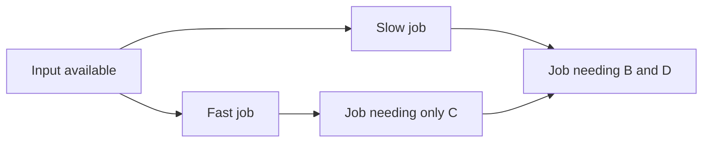

# Executor: run the accepted graph and keep evidence

The executor takes a saved, accepted plan and starts jobs when their required inputs
are ready. It does not ask a model which job to start next during ordinary D1 execution.
D2 adds model reviews at the configured review opportunities. Both use this same new
data-analysis executor and `ToolBroker`.
Evidence: [Application.execute (service.py:46)](C:/Learning/R-Project/src/mcp_execution_lab/orchestration/service.py:46),
[Executor.run (executor.py:27)](C:/Learning/R-Project/src/mcp_execution_lab/orchestration/executor.py:27),
[ToolBroker (broker.py:11)](C:/Learning/R-Project/src/mcp_execution_lab/orchestration/broker.py:11).

## 1. Admission: what must match before work starts

`Application.execute(run_id)` checks the complete settings fingerprint, loads the latest
saved handoff, and restores its spent planning allowance. `Executor.run()` checks that
the supplied handoff equals the stored one, the run is `READY_FOR_EXECUTION`, source and
lock hashes match, planned servers are configured, and D2 has a model client. A database transition with an expected previous state
claims the run. Two executors cannot both claim the same ready run through this API.
Evidence: [Application.execute (service.py:46)](C:/Learning/R-Project/src/mcp_execution_lab/orchestration/service.py:46),
[Executor.run (executor.py:27)](C:/Learning/R-Project/src/mcp_execution_lab/orchestration/executor.py:27),
[Store.transition (storage.py:170)](C:/Learning/R-Project/src/mcp_execution_lab/orchestration/storage.py:170).

It opens a temporary worker support service, creates MCP connections for the servers
needed by the accepted plan, and checks live tool definitions against the frozen cache.
Sessions stay open and can serve several calls during that execution. A revised plan
may open another configured server session when needed; it cannot invent a new tool
outside the frozen catalogue. Evidence: [Executor.run (executor.py:27)](C:/Learning/R-Project/src/mcp_execution_lab/orchestration/executor.py:27),
[Executor._activate (executor.py:135)](C:/Learning/R-Project/src/mcp_execution_lab/orchestration/executor.py:135),
[Connections.ensure (mcp.py:81)](C:/Learning/R-Project/src/mcp_execution_lab/orchestration/mcp.py:81),
[Connections.verify (mcp.py:165)](C:/Learning/R-Project/src/mcp_execution_lab/orchestration/mcp.py:165).

This is a dynamic client over known configuration. There is no generated client source,
network search for agents, or new process for every individual tool call. Stdio MCP
sessions start their configured subprocess; HTTP sessions connect to an existing service.
Evidence: [Connections._own_session (mcp.py:45)](C:/Learning/R-Project/src/mcp_execution_lab/orchestration/mcp.py:45).

## 2. Graph validation versus actual scheduling

The graph validator uses `graphlib.TopologicalSorter` to reject cycles and establish
dependency ancestry. The executor does **not** take one sorted list and run it serially.
It repeatedly scans `plan.steps`, finds eligible work, and starts asynchronous tasks up
to the concurrency limit. After the first active task finishes, it collects that result
and scans again. Evidence: [validate_plan (graph.py:77)](C:/Learning/R-Project/src/mcp_execution_lab/orchestration/graph.py:77),
[Executor._schedule (executor.py:213)](C:/Learning/R-Project/src/mcp_execution_lab/orchestration/executor.py:213).

With capacity two, B and C can run together. D can begin after C finishes even while B
is still running. E waits for both inputs. The test below verifies this behavior using
a genuine MCP server and controlled delays. When several ready jobs compete for limited
capacity, the order in the model's `plan.steps` list decides dispatch order; there is no
critical-path optimizer or separate fairness policy.
Evidence: [Executor._schedule (executor.py:213)](C:/Learning/R-Project/src/mcp_execution_lab/orchestration/executor.py:213),
[test_parallel_readiness_does_not_wait_for_unrelated_slow_step (test_executor.py:93)](C:/Learning/R-Project/tests/orchestration/test_executor.py:93).

The internal `DISPATCHING` reservation prevents the same step from being launched twice
within the scheduler. Database step records describe durable states such as `WAITING`,
`READY`, `RUNNING`, `SUCCEEDED`, `FAILED`, `SKIPPED`, `BLOCKED`, `UNCERTAIN`, `CANCELLED`,
and `REPLACED`. Evidence: [Executor._schedule (executor.py:213)](C:/Learning/R-Project/src/mcp_execution_lab/orchestration/executor.py:213),
[Executor._state (executor.py:158)](C:/Learning/R-Project/src/mcp_execution_lab/orchestration/executor.py:158),
[Store.step_state (storage.py:293)](C:/Learning/R-Project/src/mcp_execution_lab/orchestration/storage.py:293).

## 3. Dependencies, conditions, and argument values

Before dispatch, the resolver turns bindings into actual arguments: literal values,
original dataset references, earlier step output fields, saved snapshots, lists,
objects, and explicit choices. Conditions decide whether a branch runs. A skipped job
makes no MCP tool call. Conditional producers need suitable guarded consumers or an
explicit alternative; the validator checks those graph relationships.
Evidence: [Resolver (bindings.py:18)](C:/Learning/R-Project/src/mcp_execution_lab/orchestration/bindings.py:18),
[Binding (models.py:186)](C:/Learning/R-Project/src/mcp_execution_lab/orchestration/models.py:186), [Condition (models.py:215)](C:/Learning/R-Project/src/mcp_execution_lab/orchestration/models.py:215),
[validate_plan (graph.py:77)](C:/Learning/R-Project/src/mcp_execution_lab/orchestration/graph.py:77),
[test_skip_uses_explicit_alternative_and_makes_no_call (test_executor.py:121)](C:/Learning/R-Project/tests/orchestration/test_executor.py:121).

The default dependency policy waits for successful or skipped dependencies. A known
failure blocks ordinary consumers. `settled` dependencies allow explicitly checked
failure-handling branches; they do not authorize continuing past an unknown or cancelled
outcome. An argument-resolution error fails that step before invocation. It does not
count as an attempted completed tool step for review thresholds.
Evidence: [Executor._schedule (executor.py:213)](C:/Learning/R-Project/src/mcp_execution_lab/orchestration/executor.py:213),
[Executor._collect (executor.py:171)](C:/Learning/R-Project/src/mcp_execution_lab/orchestration/executor.py:171).

## 4. The broker: one checked route into MCP

`ToolBroker.call()` validates the resolved arguments against the cached input schema,
checks nested file references against this run and their saved hashes, and makes an
operation ID from the run, step, tool definition, arguments, and assigned job. The exact
job comes from the saved subtask. It is not newly chosen by the worker.
Evidence: [ToolBroker.call (broker.py:21)](C:/Learning/R-Project/src/mcp_execution_lab/orchestration/broker.py:21),
[ToolBroker._check_references (broker.py:57)](C:/Learning/R-Project/src/mcp_execution_lab/orchestration/broker.py:57),
[Files.checked_path (files.py:99)](C:/Learning/R-Project/src/mcp_execution_lab/orchestration/files.py:99).

The important saving order is:

1. Save a `tool_attempt` marked `RUNNING`.
2. For a project agent, open a scoped `worker_call` and attach its private context in MCP metadata.
3. Invoke the tool through the official MCP SDK adapter.
4. Check response size, JSON shape, output schema, references, and the worker's saved receipt.
5. Save accepted output, finish the attempt, then allow dependent jobs to use it.

Evidence: [ToolBroker._perform (broker.py:76)](C:/Learning/R-Project/src/mcp_execution_lab/orchestration/broker.py:76),
[Connections.call (mcp.py:177)](C:/Learning/R-Project/src/mcp_execution_lab/orchestration/mcp.py:177),
[WorkerGateway.open (gateway.py:87)](C:/Learning/R-Project/src/mcp_execution_lab/agents/common/gateway.py:87),
[WorkerGateway.accept (gateway.py:125)](C:/Learning/R-Project/src/mcp_execution_lab/agents/common/gateway.py:125).

The broker is deliberately stricter than accepting any text an MCP server returns.
Project agents must return the same result they already saved through the worker support
service. `AgentResult.outcome` must be `COMPLETED` for the engine to treat the assigned
job as successful. A saved worker receipt with status `SUCCEEDED` can still contain
`NEEDS_INPUT`, `UNSUPPORTED`, or another non-completed outcome.
Evidence: [ToolBroker._perform (broker.py:76)](C:/Learning/R-Project/src/mcp_execution_lab/orchestration/broker.py:76),
[AgentResult (models.py:18)](C:/Learning/R-Project/src/mcp_execution_lab/agents/common/models.py:18),
[WorkerGateway.dispatch (gateway.py:162)](C:/Learning/R-Project/src/mcp_execution_lab/agents/common/gateway.py:162).

## 5. Retry and uncertainty rules

The broker has per-operation locks and an in-memory accepted-result cache. Within one
executor instance, a repeated accepted operation can reuse its result. These structures
do not provide restart-safe exactly-once execution after a machine/process crash.
Evidence: [ToolBroker.__init__ (broker.py:12)](C:/Learning/R-Project/src/mcp_execution_lab/orchestration/broker.py:12),
[ToolBroker.call (broker.py:21)](C:/Learning/R-Project/src/mcp_execution_lab/orchestration/broker.py:21).

Transport retries are permitted only when tool annotations indicate a read-only or
idempotent tool. A retry becomes another saved attempt of the same operation. All six
current project agents advertise both hints as false: they may create files and spend
model allowance. Their lost responses are therefore not automatically retried.
Evidence: [ToolBroker._perform (broker.py:76)](C:/Learning/R-Project/src/mcp_execution_lab/orchestration/broker.py:76),
[serve (server.py:25)](C:/Learning/R-Project/src/mcp_execution_lab/agents/common/server.py:25),
[test_safe_transport_retry_is_another_attempt_of_same_operation (test_executor.py:160)](C:/Learning/R-Project/tests/orchestration/test_executor.py:160).

If the tool may have executed but confirmation is missing, the engine records
`UNCERTAIN` and stops. It does not treat this as a normal known failure and ask D2 to
repeat the side effect. Known failures and uncertain outcomes have separate tests.
Evidence: [Executor._collect (executor.py:171)](C:/Learning/R-Project/src/mcp_execution_lab/orchestration/executor.py:171),
[test_known_failure_blocks_consumers_without_retry (test_executor.py:143)](C:/Learning/R-Project/tests/orchestration/test_executor.py:143),
[test_unknown_outcome_is_saved_and_not_automatically_restarted (test_executor.py:180)](C:/Learning/R-Project/tests/orchestration/test_executor.py:180).

## 6. What the two review opportunities actually mean

`TaskRules` permits exactly two review entries when reviews are supplied. Each has an ID
and an increasing `after_completed_steps` threshold. The managed configurations use
thresholds **1 and 2**. These are completed-attempt counts, not named business phases
such as “after cleaning” and “after analysis.”
Evidence: [TaskRules (models.py:80)](C:/Learning/R-Project/src/mcp_execution_lab/orchestration/models.py:80),
[Executor._due (executor.py:206)](C:/Learning/R-Project/src/mcp_execution_lab/orchestration/executor.py:206), [agents.yaml:1](C:/Learning/R-Project/configs/agents.yaml:1).

Once a threshold is due, the scheduler drains active jobs before reviewing. Parallel
completion can cross both thresholds together. The two reviews may consequently happen
back to back with the same completed observations. A plan that never reaches a threshold
gets a saved unreached review marker; there are not necessarily two model requests.
D1 records the same reached opportunities as `PASSED_WITHOUT_MODEL`; D2 calls the reviewer.
Evidence: [Executor._schedule (executor.py:213)](C:/Learning/R-Project/src/mcp_execution_lab/orchestration/executor.py:213),
[Executor._review (executor.py:290)](C:/Learning/R-Project/src/mcp_execution_lab/orchestration/executor.py:290),
[Executor._finalize (executor.py:107)](C:/Learning/R-Project/src/mcp_execution_lab/orchestration/executor.py:107),
[test_same_task_review_rules_but_only_d2_calls_the_model (test_executor.py:198)](C:/Learning/R-Project/tests/orchestration/test_executor.py:198).

The D2 review sees the original question, Main Task, original dataset descriptions,
frozen tools, current plan/subtasks, step states, completed IDs, checked snapshot
references, bounded saved observations, public failed-attempt details, and remaining
allowance. It does not load evaluator answers, hidden fault schedules, or the old effect
ledger. The context is assembled explicitly rather than by passing the whole database.
Evidence: [Executor._review (executor.py:290)](C:/Learning/R-Project/src/mcp_execution_lab/orchestration/executor.py:290),
[ModelCalls.ask (model.py:48)](C:/Learning/R-Project/src/mcp_execution_lab/orchestration/model.py:48).

| Decision | Engine behavior |
|---|---|
| `KEEP` | Continue the accepted remaining graph. |
| `REVISE` | Validate replacement subtasks/graph; keep completed work as saved snapshots; save a new plan/handoff version. |
| `STOP` | Raise `PLANNER_STOPPED` and finalize the run as failed. |

Evidence: [ReviewDecision (models.py:241)](C:/Learning/R-Project/src/mcp_execution_lab/orchestration/models.py:241),
[Executor._review (executor.py:290)](C:/Learning/R-Project/src/mcp_execution_lab/orchestration/executor.py:290),
[Executor._replace (executor.py:406)](C:/Learning/R-Project/src/mcp_execution_lab/orchestration/executor.py:406).

Replacement does not erase previous plans or results. Pending old work is marked
`REPLACED`, and the new handoff is linked to its earlier version. Reusing a completed
output is tested with a real MCP server.
Evidence: [Executor._replace (executor.py:406)](C:/Learning/R-Project/src/mcp_execution_lab/orchestration/executor.py:406),
[test_d2_replaces_only_remaining_work_and_reuses_saved_output (test_executor.py:207)](C:/Learning/R-Project/tests/orchestration/test_executor.py:207).

## 7. End state and the boundary of “success”

The executor resolves declared final output bindings and saves JSON output wrappers.
It can complete after a handled known failure when an explicit successful recovery
branch accounts for that failed chain. It retains the original failed states. Unhandled
failed/blocked work or unresolved final outputs prevents normal completion.
Evidence: [Executor._schedule (executor.py:213)](C:/Learning/R-Project/src/mcp_execution_lab/orchestration/executor.py:213),
[Executor.run (executor.py:27)](C:/Learning/R-Project/src/mcp_execution_lab/orchestration/executor.py:27).

`execution_result` stores engine status, outputs, step states, allowance, and errors.
It deliberately sets `task_success` to null and evaluation status to `NOT_EVALUATED`.
`COMPLETED` proves that the engine's accepted work finished; a separate grader must check
the user's requested answer. Evidence: [Executor._finalize (executor.py:107)](C:/Learning/R-Project/src/mcp_execution_lab/orchestration/executor.py:107).

Normal exceptions and cancellation have cleanup/finalization paths. A hard kill or power
loss can interrupt those paths. There is no durable execution-resume service that
reconciles unfinished MCP/model calls and safely continues an interrupted graph.
Evidence: [Executor.run (executor.py:27)](C:/Learning/R-Project/src/mcp_execution_lab/orchestration/executor.py:27),
[Executor._settle (executor.py:197)](C:/Learning/R-Project/src/mcp_execution_lab/orchestration/executor.py:197),
[Application.execute (service.py:46)](C:/Learning/R-Project/src/mcp_execution_lab/orchestration/service.py:46).

Read next: [the six agents](03_Agents.md).
