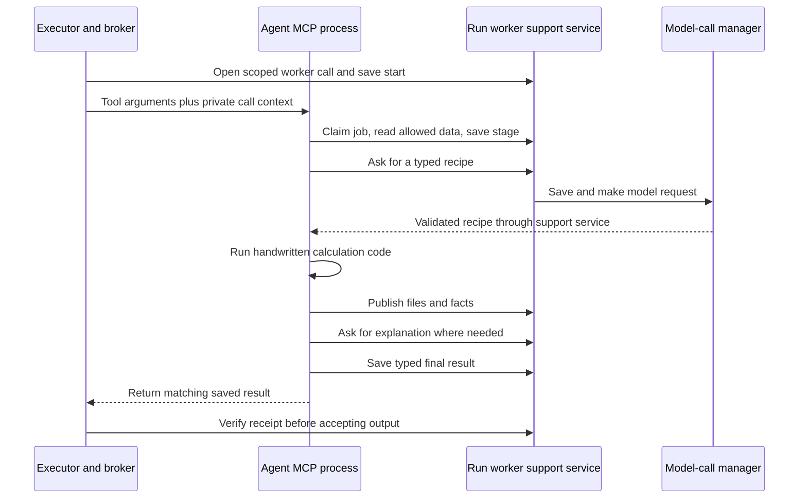

# Agents: six MCP services, bounded model choices, real calculations

All six agents are implemented. Each has four main files: `server.py` exposes its MCP
tool, `models.py` defines allowed requests/recipes/results, `worker.py` runs the job,
and `operations.py` performs the calculations. The common server registers one public
tool per agent using the official MCP SDK. Each can run over stdio or local HTTP.
Evidence: [serve (server.py:25)](C:/Learning/R-Project/src/mcp_execution_lab/agents/common/server.py:25),
[MODULES (registry.py:5)](C:/Learning/R-Project/src/mcp_execution_lab/agents/common/registry.py:5),
[analyze_data (server.py:12)](C:/Learning/R-Project/src/mcp_execution_lab/agents/analysis/server.py:12),
[execute (worker.py:10)](C:/Learning/R-Project/src/mcp_execution_lab/agents/analysis/worker.py:10),
[analyze (operations.py:16)](C:/Learning/R-Project/src/mcp_execution_lab/agents/analysis/operations.py:16).

| Agent role | MCP tool | Main input | Main saved outputs |
|---|---|---|---|
| `data_understanding` | `understand_data` | One to eight datasets | Profile JSON, checked facts, explanation |
| `data_cleaning` | `clean_data` | One dataset, stated cleaning rules, optional profile | New CSV if changed, before/after JSON, optional change-log CSV |
| `data_combining` | `combine_data` | Two to eight datasets, combining rules | Combined CSV, source/row maps, explanation |
| `data_analysis` | `analyze_data` | Exactly one dataset, definitions | Findings JSON, summary CSV, optional PNG |
| `prediction` | `predict_data` | Dataset, target, optional time and future inputs | Model-parameter JSON, split/scores JSON, prediction CSV |
| `report` | `create_report` | Saved evidence JSONs, optional charts, style | Markdown report, claim/source JSON |

Evidence: [understand_data (server.py:12)](C:/Learning/R-Project/src/mcp_execution_lab/agents/understanding/server.py:12),
[clean_data (server.py:9)](C:/Learning/R-Project/src/mcp_execution_lab/agents/cleaning/server.py:9),
[combine_data (server.py:12)](C:/Learning/R-Project/src/mcp_execution_lab/agents/combining/server.py:12),
[analyze_data (server.py:12)](C:/Learning/R-Project/src/mcp_execution_lab/agents/analysis/server.py:12),
[predict_data (server.py:9)](C:/Learning/R-Project/src/mcp_execution_lab/agents/prediction/server.py:9),
[create_report (server.py:12)](C:/Learning/R-Project/src/mcp_execution_lab/agents/report/server.py:12) and each worker linked below.

The planner can choose a subset or repeat a tool for distinct jobs. This registry is an
implementation lookup; it does not force an execution order. The worker model is told
to solve only its assigned job, ask about missing meaning, and avoid tools, code writing,
or changing the overall workflow. Evidence: [definition (registry.py:15)](C:/Learning/R-Project/src/mcp_execution_lab/agents/common/registry.py:15),
[WORKER_INSTRUCTIONS (registry.py:21)](C:/Learning/R-Project/src/mcp_execution_lab/agents/common/registry.py:21),
[validate_breakdown (graph.py:59)](C:/Learning/R-Project/src/mcp_execution_lab/orchestration/graph.py:59).

## Shared lifecycle: what makes these more than CSV functions

Evidence: [ToolBroker._perform (broker.py:76)](C:/Learning/R-Project/src/mcp_execution_lab/orchestration/broker.py:76),
[WorkerGateway (gateway.py:50)](C:/Learning/R-Project/src/mcp_execution_lab/agents/common/gateway.py:50),
[RunClient (client.py:13)](C:/Learning/R-Project/src/mcp_execution_lab/agents/common/client.py:13),
[choose (worker.py:11)](C:/Learning/R-Project/src/mcp_execution_lab/agents/common/worker.py:11), [explain (worker.py:25)](C:/Learning/R-Project/src/mcp_execution_lab/agents/common/worker.py:25).

The model chooses a typed recipe from supported operations; it does not produce Python
that is executed by these agents. Most successful worker paths ask once for a recipe
and once for an explanation. Report drafting normally uses one request. Format repair
can add requests, subject to the shared run budget and the worker limit of three.
This is the normal path, not a guarantee of exactly two requests per tool invocation.
Evidence: [choose (worker.py:11)](C:/Learning/R-Project/src/mcp_execution_lab/agents/common/worker.py:11),
[explain (worker.py:25)](C:/Learning/R-Project/src/mcp_execution_lab/agents/common/worker.py:25),
[WorkerGateway.dispatch (gateway.py:162)](C:/Learning/R-Project/src/mcp_execution_lab/agents/common/gateway.py:162),
[execute (worker.py:7)](C:/Learning/R-Project/src/mcp_execution_lab/agents/report/worker.py:7), [Limits (models.py:57)](C:/Learning/R-Project/src/mcp_execution_lab/orchestration/models.py:57).

The worker support service binds an ephemeral loopback port for the active run. A random
per-call token scopes the job, allowed file references, model purposes, and result type.
Workers use its narrow read/model/stage/publish/finish actions. They do not receive a
general SQL API or arbitrary path reader through that protocol.
Evidence: [WorkerGateway.__aenter__ (gateway.py:57)](C:/Learning/R-Project/src/mcp_execution_lab/agents/common/gateway.py:57),
[WorkerGateway.open (gateway.py:87)](C:/Learning/R-Project/src/mcp_execution_lab/agents/common/gateway.py:87),
[WorkerGateway.endpoint (gateway.py:132)](C:/Learning/R-Project/src/mcp_execution_lab/agents/common/gateway.py:132),
[WorkerGateway.dispatch (gateway.py:162)](C:/Learning/R-Project/src/mcp_execution_lab/agents/common/gateway.py:162).

This is an application access check, not an operating-system sandbox. Workers are trusted
local Python processes under the user's account. Their handwritten calculations run in
their own process, with heavier functions sent to threads; cancelling an await does not
forcibly stop a Python thread. No claim is made that a malicious worker could not read
other files allowed by Windows. Evidence: [start_agents.ps1:1](C:/Learning/R-Project/start_agents.ps1:1),
[Connections._own_session (mcp.py:45)](C:/Learning/R-Project/src/mcp_execution_lab/orchestration/mcp.py:45),
[execute (worker.py:10)](C:/Learning/R-Project/src/mcp_execution_lab/agents/analysis/worker.py:10),
[execute (worker.py:10)](C:/Learning/R-Project/src/mcp_execution_lab/agents/prediction/worker.py:10).

Full CSV data is read for actual operations, within worker caps of 16 MiB and the row
limit, normally 100,000. Recipe requests include the first five rows. Worker previews
do not use the planner's 512-character cell clipping; the central prompt-size limit can
instead reject a large request. This means successful initial registration of a 50 MiB
CSV does not imply that these workers can process it.
Evidence: [WorkerGateway.dispatch (gateway.py:162)](C:/Learning/R-Project/src/mcp_execution_lab/agents/common/gateway.py:162),
[execute (worker.py:10)](C:/Learning/R-Project/src/mcp_execution_lab/agents/analysis/worker.py:10),
[Files.register_csv (files.py:160)](C:/Learning/R-Project/src/mcp_execution_lab/orchestration/files.py:160),
[ModelCalls.ask (model.py:48)](C:/Learning/R-Project/src/mcp_execution_lab/orchestration/model.py:48).

## 1. Data Understanding

The model selects columns to inspect, whether to check exact duplicate rows, candidate
key columns, and suggested column meanings. Code then computes missing/distinct counts,
observed integer/number/text types, numeric ranges, whole-row duplicates, and whether
candidate keys are complete and unique. It scans loaded data, not just the preview.
Column meanings remain model suggestions; they are not independently proven business
definitions. Evidence: [Recipe (models.py:9)](C:/Learning/R-Project/src/mcp_execution_lab/agents/understanding/models.py:9),
[inspect_tables (operations.py:8)](C:/Learning/R-Project/src/mcp_execution_lab/agents/understanding/operations.py:8).

The agent saves a profile JSON and source-linked facts, then asks for a short explanation
using those facts. It does not clean or overwrite the dataset. Unknown requested columns
can produce a saved non-completed worker result. Tests cover full-data duplicate/missing
checks, preserved identifier text, real MCP execution, and live record visibility.
Evidence: [execute (worker.py:8)](C:/Learning/R-Project/src/mcp_execution_lab/agents/understanding/worker.py:8),
[test_full_profile_finds_duplicates_missing_values_and_preserves_identifiers (test_understanding.py:7)](C:/Learning/R-Project/tests/agents/test_understanding.py:7),
[test_understanding_through_real_mcp_and_live_run_records (test_understanding.py:23)](C:/Learning/R-Project/tests/agents/test_understanding.py:23),
[test_unknown_column_is_a_saved_non_completed_worker_outcome (test_understanding.py:61)](C:/Learning/R-Project/tests/agents/test_understanding.py:61).

## 2. Data Cleaning

Allowed operations are bounded: trim stated columns, fill stated missing values, replace
stated values, parse dates with a stated format, convert stated numeric columns, remove
exact duplicates, and drop rows missing stated required columns. The recipe has at most
64 operations with reasons. It must fit the supplied `Rules`; absent permission, it
cannot silently add a change. Evidence: [Rules (models.py:14)](C:/Learning/R-Project/src/mcp_execution_lab/agents/cleaning/models.py:14),
[Operation (models.py:24)](C:/Learning/R-Project/src/mcp_execution_lab/agents/cleaning/models.py:24),
[Recipe (models.py:38)](C:/Learning/R-Project/src/mcp_execution_lab/agents/cleaning/models.py:38), [clean (operations.py:8)](C:/Learning/R-Project/src/mcp_execution_lab/agents/cleaning/operations.py:8).

Those rules are tool arguments chosen by the planner. Code checks the worker recipe
against them, but does not independently prove that the planner translated the user's
permission correctly. A valid recipe can still reflect a misunderstood request.
Evidence: [clean_data (server.py:9)](C:/Learning/R-Project/src/mcp_execution_lab/agents/cleaning/server.py:9),
[clean (operations.py:8)](C:/Learning/R-Project/src/mcp_execution_lab/agents/cleaning/operations.py:8),
[validate_plan (graph.py:77)](C:/Learning/R-Project/src/mcp_execution_lab/orchestration/graph.py:77).

Operations run on copied rows in sequence. The agent records changed source cells and
removed source rows; row labels use CSV line numbers including the header. It bounds
the change log, writes a new registered CSV only when changes occurred, and otherwise
returns the original reference. Before/after evidence and the change log are separate
saved files. An optional profile must refer to the same dataset.
Evidence: [clean (operations.py:8)](C:/Learning/R-Project/src/mcp_execution_lab/agents/cleaning/operations.py:8),
[execute (worker.py:10)](C:/Learning/R-Project/src/mcp_execution_lab/agents/cleaning/worker.py:10),
[test_cleaning_preserves_source_and_explains_each_change (test_cleaning.py:11)](C:/Learning/R-Project/tests/agents/test_cleaning.py:11),
[test_cleaning_through_real_mcp_registers_a_new_dataset (test_cleaning.py:38)](C:/Learning/R-Project/tests/agents/test_cleaning.py:38).

## 3. Data Combining

`append` requires matching column-name sets; column order may differ. It keeps rows and
text values, with a row limit. It does not prove that two same-named columns use the
same units or business meaning. `join` supports left, inner, or outer joins using explicit
common key names and an expected relationship such as one-to-many. Missing keys do not
match each other. Many-to-many multiplication needs explicit permission.
Evidence: [Rules (models.py:14)](C:/Learning/R-Project/src/mcp_execution_lab/agents/combining/models.py:14),
[Recipe (models.py:22)](C:/Learning/R-Project/src/mcp_execution_lab/agents/combining/models.py:22),
[combine (operations.py:8)](C:/Learning/R-Project/src/mcp_execution_lab/agents/combining/operations.py:8).

**A single join call can use more than two files.** The implementation joins each later
table onto the accumulated result, using the same key names, join type, and relationship
rule at each stage. It checks relationship counts for each join, gives conflicting
non-key columns distinct names, and stops excessive row growth. A three-file audit probe
confirmed that all three contributed columns and that two join checks were recorded.
Evidence: [combine (operations.py:8)](C:/Learning/R-Project/src/mcp_execution_lab/agents/combining/operations.py:8),
[three-file probe](evidence/probes.json).

It saves the combined CSV and source-row/column mapping JSON. Unmatched rows are described
in the join evidence; there is no dedicated unmatched-row CSV export. Tests cover missing
keys, unapproved multiplication, and genuine MCP execution.
Evidence: [execute (worker.py:10)](C:/Learning/R-Project/src/mcp_execution_lab/agents/combining/worker.py:10),
[test_join_keeps_missing_keys_unmatched_and_rejects_unapproved_multiplication (test_combining.py:11)](C:/Learning/R-Project/tests/agents/test_combining.py:11),
[test_combining_through_real_mcp (test_combining.py:28)](C:/Learning/R-Project/tests/agents/test_combining.py:28).

## 4. Data Analysis

This tool accepts exactly one dataset per call. The recipe can choose up to 32 filters,
three grouping columns, and 16 measures. Measures are count, sum, mean, min, and max.
Filters combine with AND; supported comparisons include equality, membership, missing
values, and ordered numeric comparisons. Time grouping uses day/month/year with ISO or
explicit date formats. Evidence: [Filter (models.py:14)](C:/Learning/R-Project/src/mcp_execution_lab/agents/analysis/models.py:14),
[Measure (models.py:21)](C:/Learning/R-Project/src/mcp_execution_lab/agents/analysis/models.py:21), [Recipe (models.py:39)](C:/Learning/R-Project/src/mcp_execution_lab/agents/analysis/models.py:39),
[analyze (operations.py:16)](C:/Learning/R-Project/src/mcp_execution_lab/agents/analysis/operations.py:16).

Decimal arithmetic handles sums/means before public number conversion. Missing numeric
values are excluded and counted. No available numeric value produces null rather than
a made-up zero for those measures. Group count is capped at 100. One requested comparison
can give differences and percentage change; a zero reference produces a null percentage
and warning. Pearson correlation uses complete numeric pairs and requires varying data.
Evidence: [analyze (operations.py:16)](C:/Learning/R-Project/src/mcp_execution_lab/agents/analysis/operations.py:16),
[numeric_value (operations.py:22)](C:/Learning/R-Project/src/mcp_execution_lab/agents/common/operations.py:22),
[test_analysis_exact_totals_denominators_and_zero_reference (test_analysis.py:9)](C:/Learning/R-Project/tests/agents/test_analysis.py:9).

It produces findings JSON, a summary CSV, and optionally one bar/line PNG with up to 50
chart groups. Definitions supply units/date meanings. It does not support arbitrary
derived formulas, causal proof, or unlimited exploratory analysis in one call. For
example, calculating profit from a custom multi-column expression is not a general
recipe operation today. Evidence: [Recipe (models.py:39)](C:/Learning/R-Project/src/mcp_execution_lab/agents/analysis/models.py:39),
[chart (operations.py:183)](C:/Learning/R-Project/src/mcp_execution_lab/agents/analysis/operations.py:183),
[execute (worker.py:10)](C:/Learning/R-Project/src/mcp_execution_lab/agents/analysis/worker.py:10),
[test_analysis_through_real_mcp (test_analysis.py:34)](C:/Learning/R-Project/tests/agents/test_analysis.py:34).

## 5. Prediction

Three fixed methods exist: linear regression, nearest-centroid classification, and
last-value forecasting. The recipe selects up to 16 features and a forecast horizon of
one to twelve rows. Rules set the seed, test fraction, minimum rows, exclusions, allowed
features, and missing-value policy. This is a small set of handwritten methods, not
open-ended model search. Evidence: [Rules (models.py:14)](C:/Learning/R-Project/src/mcp_execution_lab/agents/prediction/models.py:14),
[Recipe (models.py:23)](C:/Learning/R-Project/src/mcp_execution_lab/agents/prediction/models.py:23),
[predict (operations.py:11)](C:/Learning/R-Project/src/mcp_execution_lab/agents/prediction/operations.py:11).

If a time column exists, code sorts parsed timestamps and holds later rows back for
testing. Equivalent timestamps cannot cross the split boundary. Otherwise it uses a
seeded shuffled split. Target and explicitly excluded columns cannot be features. These
checks do not discover every hidden form of future information in other columns.
Evidence: [predict (operations.py:11)](C:/Learning/R-Project/src/mcp_execution_lab/agents/prediction/operations.py:11),
[test_equivalent_timestamps_cannot_cross_the_time_split (test_prediction.py:56)](C:/Learning/R-Project/tests/agents/test_prediction.py:56).

| Method | Actual method and comparison |
|---|---|
| Linear regression | NumPy least squares with intercept; compared with the training-target mean. |
| Nearest centroid | Scale using training rows only, compute class centres, choose nearest centre; compare with the training majority class. |
| Last value | Use the last training value for held-back rows; this deliberately equals its simple reference. Future rows use the latest observed value. |

Evidence: [predict (operations.py:11)](C:/Learning/R-Project/src/mcp_execution_lab/agents/prediction/operations.py:11).

The agent saves JSON parameters, scores, train/test source rows, and prediction CSVs.
Future actual values remain blank. It does not invent future dates/frequency, generate
confidence intervals, tune a large model family, deploy models, or serialize executable
pickle objects. Tests verify separation of held-back/future rows, training-only scaling,
simple references, and actual MCP execution.
Evidence: [execute (worker.py:10)](C:/Learning/R-Project/src/mcp_execution_lab/agents/prediction/worker.py:10),
[test_prediction_separates_future_records_and_beats_a_reference (test_prediction.py:22)](C:/Learning/R-Project/tests/agents/test_prediction.py:22),
[test_last_value_preserves_weak_baseline_and_has_no_invented_future_actuals (test_prediction.py:36)](C:/Learning/R-Project/tests/agents/test_prediction.py:36),
[test_classification_uses_training_scaling_and_retains_class_counts (test_prediction.py:44)](C:/Learning/R-Project/tests/agents/test_prediction.py:44),
[test_prediction_through_real_mcp (test_prediction.py:66)](C:/Learning/R-Project/tests/agents/test_prediction.py:66).

## 6. Report

Report consumes one to eight saved evidence JSONs containing facts, plus optional PNG
references. It gives fact IDs a source-specific prefix, preserves warnings, asks for a
typed title/sections/paragraphs/limitations draft, and renders Markdown with claim/source
records. Each section must name known facts. It does not rerun calculations.
Evidence: [create_report (server.py:12)](C:/Learning/R-Project/src/mcp_execution_lab/agents/report/server.py:12),
[Recipe (models.py:24)](C:/Learning/R-Project/src/mcp_execution_lab/agents/report/models.py:24),
[evidence_facts (operations.py:9)](C:/Learning/R-Project/src/mcp_execution_lab/agents/report/operations.py:9),
[render (operations.py:33)](C:/Learning/R-Project/src/mcp_execution_lab/agents/report/operations.py:33),
[execute (worker.py:7)](C:/Learning/R-Project/src/mcp_execution_lab/agents/report/worker.py:7).

The renderer escapes active Markdown/HTML characters, checks chart references, and
rejects bare digit characters in generated prose. Numeric values should be inserted
through `{{fact:ID}}` placeholders. The common explanation helper uses the same rule.
This reduces one class of invented numbers; it is not a complete truth checker. The
audit probe accepted “twenty dollars” written in words. Known fact IDs also do not prove
that a sentence's causal or business claim follows from those facts.
Evidence: [render_text (operations.py:44)](C:/Learning/R-Project/src/mcp_execution_lab/agents/common/operations.py:44),
[render (operations.py:33)](C:/Learning/R-Project/src/mcp_execution_lab/agents/report/operations.py:33), [numeric-text probe](evidence/probes.json).

Outputs are Markdown and claim/source JSON, not Word/PDF or a published report. Chart
links use saved reference IDs with `.png`; there is no export step that bundles and
renames every attachment into a portable report directory.
Evidence: [render (operations.py:33)](C:/Learning/R-Project/src/mcp_execution_lab/agents/report/operations.py:33),
[execute (worker.py:7)](C:/Learning/R-Project/src/mcp_execution_lab/agents/report/worker.py:7),
[test_report_rejects_invented_numbers_and_escapes_active_content (test_report.py:10)](C:/Learning/R-Project/tests/agents/test_report.py:10),
[test_report_consumes_real_analysis_output_over_mcp (test_report.py:33)](C:/Learning/R-Project/tests/agents/test_report.py:33).

## Results, traces, and test scope across agents

Every result carries a contract version, outcome, summary, dataset/artifact references,
facts, warnings, questions, error information, and authoritative usage-record IDs. Each
role adds typed details. The support service records stages/model calls/files during
the job and checks final reference ownership and hashes. File parent links conservatively
record the references available to the worker, not exactly which cells influenced it.
Evidence: [AgentResult (models.py:18)](C:/Learning/R-Project/src/mcp_execution_lab/agents/common/models.py:18),
[WorkerGateway.dispatch (gateway.py:162)](C:/Learning/R-Project/src/mcp_execution_lab/agents/common/gateway.py:162).

Fresh tests exercised real stdio and HTTP MCP, all six worker paths, local files, and
native PostgreSQL visibility. Model answers were scripted by test clients. The tests
prove those specified calculations and boundaries; live recipe choice and explanation
quality still need a bounded real-model study.
Evidence: [AgentModel (workers.py:51)](C:/Learning/R-Project/tests/agents/workers.py:51),
[test_actual_worker_execution_over_official_http_mcp (test_http.py:19)](C:/Learning/R-Project/tests/agents/test_http.py:19),
[test_worker_calls_are_visible_during_execution_in_native_postgres (test_native_postgres.py:19)](C:/Learning/R-Project/tests/agents/test_native_postgres.py:19),
[fresh full check](evidence/full_checks_2026-10-23.xml).

Read next: [evaluation](04_Evaluation.md).
