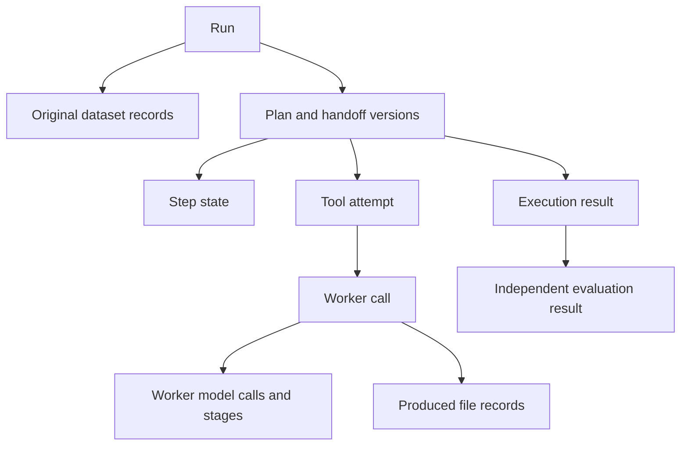

# Storage, file versions, model requests, and budgets

The new data-analysis path stores records in PostgreSQL and files on disk. It saves
starts and progress during execution, rather than waiting for the final answer. One
model-call manager and one budget are shared by the main planner, D2 reviewer, and
worker models. Evidence: [Application.components (service.py:20)](C:/Learning/R-Project/src/mcp_execution_lab/orchestration/service.py:20),
[ModelCalls (model.py:43)](C:/Learning/R-Project/src/mcp_execution_lab/orchestration/model.py:43), [Store (storage.py:89)](C:/Learning/R-Project/src/mcp_execution_lab/orchestration/storage.py:89).

## 1. Database schema and how a run owns its evidence

| Actual SQL table | Purpose and important keys |
|---|---|
| `lab_schema_versions` | Current supported schema version: 1. |
| `lab_runs` | One run ID, status, original/configuration identity payload, sequence, creation time. |
| `lab_records` | Typed JSON records such as dataset, stage, model call, plan, handoff, worker call, tool attempt, artifact, execution result, evaluation result. Each has `id`, `run_id`, `kind`, payload, timestamp. |
| `lab_record_links` | Child record to parent record, with a role. Both sides use composite `(run_id, id)` foreign keys. |
| `lab_events` | Per-run ordered events keyed by `(run_id, sequence)`. |
| `lab_plan_steps` | Step state keyed by `(run_id, plan_id, step_id)`, with the step definition payload. |

Evidence: [versions (storage.py:28)](C:/Learning/R-Project/src/mcp_execution_lab/orchestration/storage.py:28),
[runs (storage.py:29)](C:/Learning/R-Project/src/mcp_execution_lab/orchestration/storage.py:29), [records (storage.py:38)](C:/Learning/R-Project/src/mcp_execution_lab/orchestration/storage.py:38),
[links (storage.py:49)](C:/Learning/R-Project/src/mcp_execution_lab/orchestration/storage.py:49), [events (storage.py:59)](C:/Learning/R-Project/src/mcp_execution_lab/orchestration/storage.py:59),
[steps (storage.py:69)](C:/Learning/R-Project/src/mcp_execution_lab/orchestration/storage.py:69).

These are shared tables, not a new SQL table for every run or every agent. The composite
foreign keys prevent links across runs through the normal schema. A step ID alone is
not enough to identify a revised job; its run and plan IDs matter too.
Evidence: [links (storage.py:49)](C:/Learning/R-Project/src/mcp_execution_lab/orchestration/storage.py:49),
[steps (storage.py:69)](C:/Learning/R-Project/src/mcp_execution_lab/orchestration/storage.py:69), [Store.put (storage.py:182)](C:/Learning/R-Project/src/mcp_execution_lab/orchestration/storage.py:182).

The diagram shows ownership/conceptual flow. In the SQL links table, a new child record's
`source_id` points back to the parent `target_id`; the arrow convention here is not an
SQL edge direction. Actual links are created by the relevant `Store.put(..., parents=...)`
calls. Evidence: [Store.put (storage.py:182)](C:/Learning/R-Project/src/mcp_execution_lab/orchestration/storage.py:182),
[ToolBroker._perform (broker.py:76)](C:/Learning/R-Project/src/mcp_execution_lab/orchestration/broker.py:76),
[WorkerGateway.open (gateway.py:87)](C:/Learning/R-Project/src/mcp_execution_lab/agents/common/gateway.py:87),
[evaluate (grading.py:160)](C:/Learning/R-Project/src/mcp_execution_lab/evaluation/grading.py:160).

## 2. Transactions and live visibility

Every `Store.transact()` operation uses a short `engine.begin()` transaction. Synchronous
SQLAlchemy/psycopg work runs in a thread, so the Windows event loop can still manage MCP
subprocesses. A per-store async lock serializes those operations. Cancellation waits for
the transaction thread before releasing it. A record/state update and its associated
event are committed together; `_event()` atomically increments that run's sequence.
Evidence: [Store.transact (storage.py:112)](C:/Learning/R-Project/src/mcp_execution_lab/orchestration/storage.py:112),
[Store._event (storage.py:140)](C:/Learning/R-Project/src/mcp_execution_lab/orchestration/storage.py:140),
[Store.put (storage.py:182)](C:/Learning/R-Project/src/mcp_execution_lab/orchestration/storage.py:182),
[Store.step_state (storage.py:293)](C:/Learning/R-Project/src/mcp_execution_lab/orchestration/storage.py:293).

Stages, model calls, tool attempts, worker calls, and file writes get a saved `RUNNING`
record before the corresponding external/longer work. Their allowed records are later
finished with status/error/result information. This is directly tested from another
native PostgreSQL connection while a worker is still running.
Evidence: [ModelCalls.ask (model.py:48)](C:/Learning/R-Project/src/mcp_execution_lab/orchestration/model.py:48),
[ToolBroker._perform (broker.py:76)](C:/Learning/R-Project/src/mcp_execution_lab/orchestration/broker.py:76),
[WorkerGateway.open (gateway.py:87)](C:/Learning/R-Project/src/mcp_execution_lab/agents/common/gateway.py:87),
[Files._file_work (files.py:21)](C:/Learning/R-Project/src/mcp_execution_lab/orchestration/files.py:21),
[test_worker_calls_are_visible_during_execution_in_native_postgres (test_native_postgres.py:19)](C:/Learning/R-Project/tests/agents/test_native_postgres.py:19).

Saved plans/artifacts are not edited through `finish()`. That method permits only the
listed active record kinds. It does not independently check that their prior payload
still says `RUNNING`. Run-state changes support an optional expected state; step-state
changes have an explicit transition map. This is application-level discipline, not a
database trigger that makes all rows append-only against direct SQL edits.
Evidence: [Store.finish (storage.py:202)](C:/Learning/R-Project/src/mcp_execution_lab/orchestration/storage.py:202),
[Store.transition (storage.py:170)](C:/Learning/R-Project/src/mcp_execution_lab/orchestration/storage.py:170),
[Store.step_state (storage.py:293)](C:/Learning/R-Project/src/mcp_execution_lab/orchestration/storage.py:293).

`initialize()` takes a PostgreSQL advisory transaction lock, creates missing tables, and
checks schema version 1. It is not a complete upgrade/migration framework for future
schema changes. Production configuration requires a `postgresql+psycopg://` URL. SQLite
is available only with the explicit test flag; the old pilot's SQLite journal is separate.
Evidence: [Store.initialize (storage.py:127)](C:/Learning/R-Project/src/mcp_execution_lab/orchestration/storage.py:127),
[Store.__init__ (storage.py:96)](C:/Learning/R-Project/src/mcp_execution_lab/orchestration/storage.py:96),
[local_environment (config.py:33)](C:/Learning/R-Project/src/mcp_execution_lab/orchestration/config.py:33), [journal.py:1](C:/Learning/R-Project/src/mcp_execution_lab/journal.py:1).

## 3. Files, copies, versions, and source identity

`Files` creates a strict `run_<uuid>` directory under the configured disk root. CSV
registration copies the original bytes and stores their description and hash. Produced
CSVs become newly registered datasets; JSON, Markdown, PNG, and other allowed artifacts
get new IDs. Previous files are retained. A `FileRef` carries ID, run ID, kind, and SHA-256.
Version history is represented by new records plus parent links, not by overwriting a
single path or incrementing a universal file-version integer.
Evidence: [Files.directory (files.py:42)](C:/Learning/R-Project/src/mcp_execution_lab/orchestration/files.py:42),
[Files.register_csv (files.py:160)](C:/Learning/R-Project/src/mcp_execution_lab/orchestration/files.py:160),
[Files.put_bytes (files.py:70)](C:/Learning/R-Project/src/mcp_execution_lab/orchestration/files.py:70),
[FileRef (models.py:132)](C:/Learning/R-Project/src/mcp_execution_lab/orchestration/models.py:132), [Store.put (storage.py:182)](C:/Learning/R-Project/src/mcp_execution_lab/orchestration/storage.py:182).

Reads verify the exact registered reference, path containment within the run directory,
and actual file hash. This detects altered bytes or a foreign-run reference. The file
manager also records write starts and waits for its write thread to settle on cancellation.
Disk writes and SQL commits are not one atomic transaction, and there is no explicit
`fsync`/power-loss recovery protocol. A hard crash can leave partial/unregistered files
or a start record without its final record.
Evidence: [Files.checked_path (files.py:99)](C:/Learning/R-Project/src/mcp_execution_lab/orchestration/files.py:99),
[Files.read_json (files.py:127)](C:/Learning/R-Project/src/mcp_execution_lab/orchestration/files.py:127),
[Files._file_work (files.py:21)](C:/Learning/R-Project/src/mcp_execution_lab/orchestration/files.py:21),
[Files._write_new (files.py:122)](C:/Learning/R-Project/src/mcp_execution_lab/orchestration/files.py:122).

CSV publication stages bytes and then copies them through registration; the staged file
is retained too. There is no automatic artifact garbage collector in this path. Keep
retained evidence when cleaning the workspace; that is also a project instruction.
Evidence: [Files.put_bytes (files.py:70)](C:/Learning/R-Project/src/mcp_execution_lab/orchestration/files.py:70).

`source_identity()` hashes package Python source and `uv.lock`. It does not include tests,
PowerShell scripts, CSV fixtures, or YAML config in that one source hash. Config and suite
identities are saved separately by the relevant run/batch code. The report's own source
manifest adds per-file hashes and line numbers for inspection.
Evidence: [source_identity (provenance.py:9)](C:/Learning/R-Project/src/mcp_execution_lab/orchestration/provenance.py:9),
[Planner.plan (planner.py:88)](C:/Learning/R-Project/src/mcp_execution_lab/orchestration/planner.py:88),
[run_batch (batch.py:40)](C:/Learning/R-Project/src/mcp_execution_lab/evaluation/batch.py:40), [audit manifest](evidence/source_manifest.json).

## 4. Actual model request and saved trace

`ModelCalls.ask()` builds an `orchestration.v1` request containing role, stage,
instructions, outer response schema, inner record schema, binding/reference rules,
context, limits, and remaining allowance. The outer content contains `content_json`;
the inner JSON is validated into the requested Pydantic record. Unknown fields are
forbidden by `Record`. Frozen Pydantic records are shallowly frozen, not recursively
immutable dictionaries/lists. Evidence: [ModelCalls.ask (model.py:48)](C:/Learning/R-Project/src/mcp_execution_lab/orchestration/model.py:48),
[StructuredPayload (models.py:272)](C:/Learning/R-Project/src/mcp_execution_lab/orchestration/models.py:272),
[Record (models.py:21)](C:/Learning/R-Project/src/mcp_execution_lab/orchestration/models.py:21), [structured_schema (planner_clients.py:11)](C:/Learning/R-Project/src/mcp_execution_lab/planner_clients.py:11).

For a normal-sized request, it saves `model_call: RUNNING`, writes `request.json`, invokes
the provider with a timeout, observes usage, validates the response, and finishes the
record even on ordinary failure/cancellation. Worker call IDs are parent links for
worker model requests. Request/response records may contain data samples and generated
text; this is retained run evidence, not only aggregate counters.
Evidence: [ModelCalls.ask (model.py:48)](C:/Learning/R-Project/src/mcp_execution_lab/orchestration/model.py:48),
[WorkerGateway.dispatch (gateway.py:162)](C:/Learning/R-Project/src/mcp_execution_lab/agents/common/gateway.py:162).

**Accounting gap reproduced:** budget reservation happens before prompt-size validation.
An oversized prompt raised `PROMPT_SIZE`, with one reserved call, zero saved model-call
records, and zero provider requests. This can conservatively stop a run earlier or make
two counters differ; the probe does not show an unrecorded paid request.
Evidence: [ModelCalls.ask (model.py:48)](C:/Learning/R-Project/src/mcp_execution_lab/orchestration/model.py:48),
[Budget.model (budget.py:25)](C:/Learning/R-Project/src/mcp_execution_lab/orchestration/budget.py:25), [actual probe](evidence/probes.json).

## 5. Codex route and external command route

The configured `codex` route uses an installed CLI executable and its saved ChatGPT
login. The application does not extract a ChatGPT API key. For every model request,
`CodexPlanner.generate()` checks login status, requires an exact model ID, and starts a
fresh ephemeral `codex exec` process. Code supplies read-only mode, ignores user config,
disables project-document loading/search and a list of tool features, and requests
structured JSON output. Evidence: [CodexPlanner.__init__ (planner_clients.py:117)](C:/Learning/R-Project/src/mcp_execution_lab/planner_clients.py:117),
[CodexPlanner.generate (planner_clients.py:121)](C:/Learning/R-Project/src/mcp_execution_lab/planner_clients.py:121),
[CodexPlanner.disabled (planner_clients.py:98)](C:/Learning/R-Project/src/mcp_execution_lab/planner_clients.py:98).

It retains CLI JSON events/stderr, extracts the final message and usage, and flags item
types outside the allowed message/reasoning/error set as a planning tool violation.
The audit checked this implementation and executable presence, but did not validate live
CLI compatibility, login, model availability, subscription allowance, or quality.
Saved configuration says `gpt-6.1-sol`, low reasoning, 90-second request timeout; that is
a file value, not an audited availability guarantee.
Evidence: [CodexPlanner.generate (planner_clients.py:121)](C:/Learning/R-Project/src/mcp_execution_lab/planner_clients.py:121),
[agents.yaml:1](C:/Learning/R-Project/configs/agents.yaml:1), [workspace probe](evidence/probes.json).

The `command` provider is an adapter for a user-supplied local router command. It sends
the JSON request on stdin, expects `content`, `usage`, and `request_id` in stdout, and
saves stderr. A separate custom routing application is not implemented by this adapter.
Its class docstring still says `planner.v1`, while the new caller sends
`orchestration.v1`; custom router authors should follow the actual request payload.
Evidence: [CommandPlanner (planner_clients.py:62)](C:/Learning/R-Project/src/mcp_execution_lab/planner_clients.py:62),
[CommandPlanner.generate (planner_clients.py:71)](C:/Learning/R-Project/src/mcp_execution_lab/planner_clients.py:71),
[ModelCalls.ask (model.py:48)](C:/Learning/R-Project/src/mcp_execution_lab/orchestration/model.py:48).

`bounded_process()` caps stdout at 4 MiB and stderr at 64 KiB and kills its direct
subprocess on timeout/exit cleanup. It does not explicitly perform Windows process-tree
termination there. That is a different cleanup mechanism from `stop_agents.ps1`.
Evidence: [bounded_process (planner_clients.py:28)](C:/Learning/R-Project/src/mcp_execution_lab/planner_clients.py:28), [stop_agents.ps1:1](C:/Learning/R-Project/stop_agents.ps1:1).

## 6. Shared allowance and configured limits

| Limit | `Limits` default | Managed `agents.yaml` |
|---|---:|---:|
| Concurrent tool jobs | 2 | 2 |
| Plan steps | 32 | 32 |
| Total model requests, all roles | 16 | 32 |
| Model requests per worker | 3 | 3 |
| Observed tokens | 60,000 | 120,000 |
| Tool attempts | 64 | 64 |
| Main-stage correction allowance | 1 | 1 |
| Safe transport retry allowance | 1 | 1 |
| Run time | 600 s | 1,800 s |
| Tool time | 120 s | 300 s |
| CSV/file registration bytes | 100 MiB | 100 MiB |
| Structured-result bytes via `put_json` | 2 MiB | 2 MiB |
| Planner preview rows | 5 | 5 |
| Prompt characters | 100,000 | 100,000 |
| Worker loaded rows | 100,000 | 100,000 |

Evidence: [Limits (models.py:57)](C:/Learning/R-Project/src/mcp_execution_lab/orchestration/models.py:57), [agents.yaml:1](C:/Learning/R-Project/configs/agents.yaml:1),
[agents_stdio.yaml:1](C:/Learning/R-Project/configs/agents_stdio.yaml:1). Worker/evaluator reads have tighter 16 MiB caps;
not all file paths share the 2 MiB structured-result cap.
Evidence: [WorkerGateway.dispatch (gateway.py:162)](C:/Learning/R-Project/src/mcp_execution_lab/agents/common/gateway.py:162),
[collect (evidence.py:19)](C:/Learning/R-Project/src/mcp_execution_lab/evaluation/evidence.py:19), [Files.put_bytes (files.py:70)](C:/Learning/R-Project/src/mcp_execution_lab/orchestration/files.py:70).

Calls, attempts, observed tokens, and elapsed active time share one `Budget`. Planning
usage is saved and restored for execution. Unknown usage makes the full token total
unknown while keeping the known subtotal. Token usage is checked after responses, so
this is an observed-token stopping rule, not a guaranteed provider-side maximum output
or USD spending cap. Dollar cost remains unknown in the Codex route/evaluation.
Evidence: [Budget (budget.py:8)](C:/Learning/R-Project/src/mcp_execution_lab/orchestration/budget.py:8),
[Application.execute (service.py:46)](C:/Learning/R-Project/src/mcp_execution_lab/orchestration/service.py:46),
[CodexPlanner.generate (planner_clients.py:121)](C:/Learning/R-Project/src/mcp_execution_lab/planner_clients.py:121),
[measurements (grading.py:75)](C:/Learning/R-Project/src/mcp_execution_lab/evaluation/grading.py:75).

## 7. Credentials and present readiness

`.env.example` exists. `local_environment()` loads `.env` without replacing already set
environment variables and requires a non-placeholder PostgreSQL URL. No user `.env`
or process database URL was present during this audit. Thus the default data-analysis
run is **not yet configured to connect to the user's database**. Fresh tests instead
used isolated temporary native PostgreSQL clusters and did not set up user tables there.
Evidence: [.env.example:1](C:/Learning/R-Project/.env.example:1), [local_environment (config.py:33)](C:/Learning/R-Project/src/mcp_execution_lab/orchestration/config.py:33),
[verification](evidence/verification.json).

The worker protocol keeps DB credentials and admin/call tokens out of model context.
Managed processes inherit their parent process environment; stdio sessions use the SDK
environment plus explicitly configured names. These are trusted same-user processes,
so this is not a guarantee that a hostile process cannot access local credentials.
Evidence: [WorkerGateway.dispatch (gateway.py:162)](C:/Learning/R-Project/src/mcp_execution_lab/agents/common/gateway.py:162),
[ModelCalls.ask (model.py:48)](C:/Learning/R-Project/src/mcp_execution_lab/orchestration/model.py:48),
[Connections._own_session (mcp.py:45)](C:/Learning/R-Project/src/mcp_execution_lab/orchestration/mcp.py:45), [start_agents.ps1:1](C:/Learning/R-Project/start_agents.ps1:1).

Read next: [entry points and the retained pilot](06_Entry_Points_And_Legacy.md).
