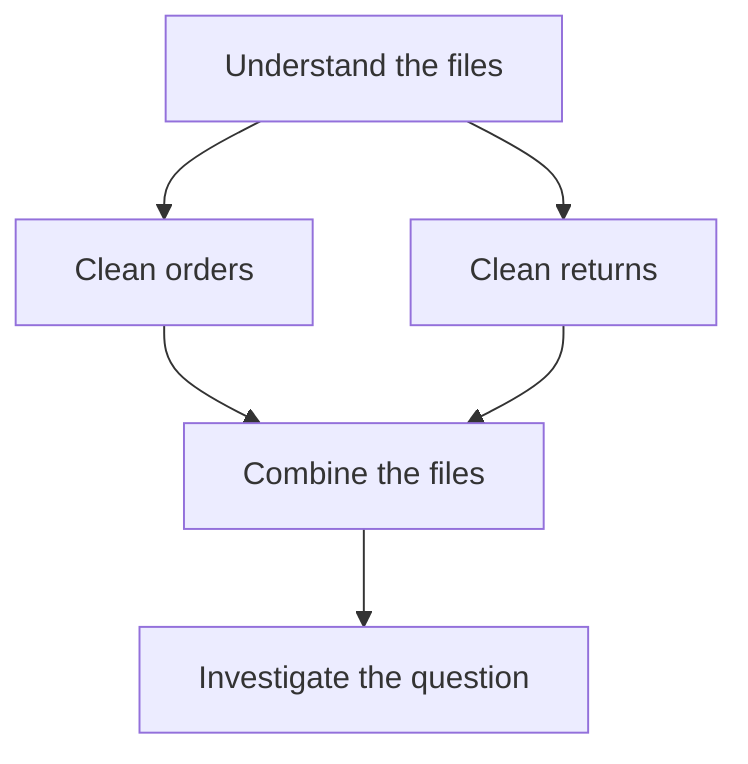

# Executor: design and implementation plan

Date: 2026-10-15

Implementation update, 2026-10-25: the D1/D2 engine, six agents, and CSV P1/P2 are implemented. Python modes share a Docker image and the DAG runtime's broker/records. D2/P2 share `reviews.py`; P2 revisions start fresh runners with checked saved results. The older pricing implementation and its container runner remain removed. See [Running.md](Running.md), [P1.md](P1.md), and [P2.md](P2.md).

Related document: [Planner.md](Planner.md).

## 1. Purpose and starting point

The executor takes an accepted plan and carries it out. The planner has already interpreted the user's question, selected tools, assigned subtasks, and decided the dependencies.

The executor is responsible for:

- Checking that the saved plan can be used for this run.
- Finding steps that are ready to start.
- Connecting to the required MCP servers and calling the exact planned tools.
- Resolving inputs and checking returned outputs.
- Saving progress in PostgreSQL throughout execution.
- Applying the shared limits, retry rules, and agreed pause points.
- Retaining enough evidence for a separate final evaluation.

The executor does not choose a new data-analysis workflow. Any allowed change to the overall plan is handled by the main planner at an agreed pause point.

## 2. The three main parts

| Part | Job |
|---|---|
| DAG scheduler | Decide which planned steps have their required inputs available and can start now |
| MCP connection manager | Open and manage connections to the configured servers needed by the plan |
| Step runner | Resolve inputs, request the planned action through the shared tool gate, and save its outcome |

The shared tool gate, called the broker in the code, remains responsible for common checks, work limits, operation identities, result reuse, and retry rules. DAG and Python runs use the same broker and MCP adapter.

## 3. Accepted input from the planner

The executor receives a saved handoff containing:

- Run ID and selected case, D1 or D2 for this DAG path.
- Accepted plan ID and version, with its validation result.
- Main Task and subtask references.
- The selected tools and their server identities.
- The exact saved tool-cache ID and content fingerprint.
- Registered input datasets and their versions.
- Each step's job, input references, dependencies, conditions, and expected outputs.
- Declared final outputs.
- Configured limits and the allowance remaining after planning.
- Agreed pause-point definitions.

Check ownership and references before starting. A plan from another run must not be attached accidentally. The same original dataset may be explicitly registered for several runs, while generated outputs and execution records remain scoped to their owning run.

The planner's `READY_FOR_EXECUTION` state means its handoff is available. The controller starts execution explicitly; saving a plan alone must not invoke worker agents.

## 4. Check the DAG and calculate a valid order

Validate the accepted graph again at the execution boundary. Check known steps and tools, input references, conditions, output rules, required pause points, and configured limits.

Topologically sort the DAG: calculate an order that places every required producer before its consumer. Reject a graph whose arrows form a circle.

The sorted order is useful for checking and displaying the plan. Actual execution uses a changing set of ready steps, so independent work can run together. One fixed list must not accidentally force every step to run one after another.

An illustrative plan is:



After A succeeds, B and C can run together. D waits for both. This example is not a required sequence for data-analysis tasks; the engine follows the actual accepted plan.

## 5. Schedule work as each step finishes

The scheduler repeatedly asks: which unfinished steps have their required inputs available now?

1. Find steps whose dependency conditions are satisfied.
2. Resolve their planned conditions and mark unnecessary steps as skipped.
3. Start ready work while execution slots and the shared allowance remain.
4. Wait for a step to finish or for a limit, cancellation, or pause to require attention.
5. Save the outcome, update affected steps, and check readiness again.

React to individual completions. Do not wait for an entire group of unrelated running steps before starting newly ready work.

Use a configured limit on simultaneous tool executions. Worker AI use also counts against the shared run limits. Recheck those limits at the relevant action boundaries rather than assuming that a worker gets unlimited internal calls.

There is no requirement to execute every available agent. The plan can omit tools, call one tool in several distinct steps, and use conditional branches.

## 6. Step states

| State | Meaning |
|---|---|
| `WAITING` | The step still needs an earlier result or decision |
| `READY` | Its required inputs are available and its condition allows execution |
| `RUNNING` | Its execution attempt has been saved and its tool is being called |
| `SUCCEEDED` | A successful result and its accepted outputs have been saved |
| `FAILED` | A known failure was saved and no further permitted attempt is active |
| `SKIPPED` | Its planned condition said the step was unnecessary |
| `BLOCKED` | A required input cannot be supplied, for example after an earlier failure |
| `UNCERTAIN` | The action may have completed, but its outcome is not yet confirmed |

Record cancellations and steps replaced by a later plan as explicit outcomes with reasons. Do not label them as successfully completed work.

A skipped step supplies no invented output. A planned input choice must select an available alternative, such as the original dataset when cleaning is skipped.

If a required earlier step fails, block consumers that cannot proceed. A fallback already expressed in the plan may handle the failure using permitted diagnostics or available inputs. Independent work may continue where the plan, run limits, and failure policy allow it.

## 7. Dynamic MCP connections

Build connections from the servers required by the accepted plan. Use the official MCP SDK through the existing adapter.

The connection manager should:

- Resolve each server ID through the project's configured server definitions.
- Open a connection when required and reuse it for the run where appropriate.
- Keep separate connections for separate servers.
- Confirm that the expected tools and input/output rules still match the saved planning cache.
- Record connection and discovery failures.
- Close connections and owned server processes when the run finishes or stops.

An agent is a role in this application. An MCP server exposes tools. One agent may have its own server with several tools, or several agents may share a server.

Therefore, every planned action identifies both a server and a tool. Do not create a new client for every step when the same server connection can serve them. Handle simultaneous use according to the server's supported behavior and the shared limits.

Server addresses, launch commands, and connection settings come from project configuration. The LLM selects discovered tools; it does not supply arbitrary server launch commands.

If tool definitions have changed since planning, save the mismatch and stop affected work for explicit handling. Do not silently switch tools or ask the LLM to make an unrecorded plan change.

## 8. Invoke the exact planned tool

An illustrative step might contain:

| Field | Example |
|---|---|
| Step ID | `clean_orders` |
| Subtask | Standardize dates without removing valid order rows |
| Server | `data_cleaning_server` |
| Tool | `clean_dataset` |
| Input | A registered orders dataset reference |
| Depends on | The plan's earlier file-understanding step |
| Expected output | A cleaned dataset and a change report |

These example names are not final worker definitions.

Before invocation, resolve the step's input references. If an input comes from an earlier step, use its exact saved output. Check that the output exists, has the expected kind, and matches the data version required by this plan.

Pass the assigned job and validated inputs through the worker's published input rules. A worker can use its own LLM calls to solve that job within its limits. It must not freely invoke other roles or change the overall workflow.

After the call, check the result format and output references before accepting the step as successful. An agent's claim that it finished is not sufficient evidence for the final research grade.

## 9. Save progress while execution is happening

Use PostgreSQL installed directly on the user's computer, as agreed. The executor must save progress during the run rather than collect everything in memory for an end-of-run upload.

For each step:

1. Save readiness and the selected input references.
2. Save the logical agent call and its attempt before dispatch; mark the step running.
3. Invoke the exact MCP tool through the shared broker.
4. Save the returned result, accepted output references, timing, and any errors.
5. Save the step outcome before allowing dependent steps to start.

Related state changes and history entries should be committed together. Do not hold one database transaction open for the full duration of a network or LLM call.

Worker LLM calls need their own saved requests, replies or errors, model settings, timing, and usage. Link them to the owning run and agent call. Main-planner calls and worker calls remain distinguishable, while both count toward total AI use.

Important connections are:

```text
Run
  -> Plan version
     -> Plan step and subtask
        -> Agent call
           -> Individual execution attempts
           -> Worker LLM calls
           -> Saved outputs
```

The database must enforce matching run ownership across these connections. Reused outputs retain their original producing step and plan version; later plans record their references without rewriting that history.

Save at least:

- Step states and their timestamps.
- Exact server, tool, assigned job, input references, and worker settings.
- Every attempt, retry reason, returned status, and diagnostic.
- Outputs, their content fingerprints, and the inputs used to produce them.
- Planned skips, blocked steps, pauses, cancellations, and uncertain outcomes.
- LLM usage when known, and unknown values when it is not reported.
- Run limits, consumed allowance, and final evaluation records.

If required records cannot be saved, stop launching new work. An already running external call may still finish; its outcome must be handled explicitly rather than assumed to have failed.

Whether CSV and chart contents themselves live inside PostgreSQL or on disk with database references remains a separate storage decision, as recorded in Planner.md.

## 10. Retries, reuse, and uncertain outcomes

Keep the same recovery rules for DAG and Python execution.

| Situation | Behavior |
|---|---|
| Known successful request with unchanged job, exact inputs, and relevant settings | Reuse its valid saved completion record |
| Temporary transport failure with a safe retry | Retry within the configured allowance and record another attempt |
| Invalid input or known task failure | Save the failure and follow only a permitted fallback or later plan change |
| Unavailable or outdated required output | Reject it and record the affected step |
| Outcome cannot be confirmed | Mark it uncertain and check available completion evidence before repeating it |
| Run allowance exhausted | Stop starting further work and record the reason |

Use one stable operation identity for retries of the same requested action. A different assigned job, input version, or relevant worker setting must not accidentally reuse an unrelated result. Planned repeated actions also need explicit identities so they are not confused with retries.

Saving a completion record can avoid repeating known completed work. It does not guarantee that an external LLM call is charged only once after a crash or lost reply. Retain known usage and unknown outcomes accurately.

## 11. D1 and D2 use the same executor

For D1, follow the starting DAG, including its written conditions and fallback paths. Do not call the main planner to invent a new strategy after execution starts.

For D2, use the same scheduler, workers, broker, connection manager, limits, and evidence rules. At agreed pause points, the main planner may keep the plan, revise the remaining work, or stop.

At a pause:

1. Stop launching further work across the pause boundary.
2. Settle already running calls or retain their unresolved status explicitly.
3. Save a consistent view of completed work, valid outputs, observed failures, and remaining allowance.
4. Make the permitted replanning request and save the decision.
5. Validate and save any replacement plan before activating it.

A revised DAG becomes a new plan version. Keep the previous graph, completed steps, and attempts. Reuse only outputs that remain valid for the new jobs and inputs. Do not replay successful actions just because a new plan version exists.

Do not revise around unresolved actions whose effects could change the planning state. Their outcomes need handling first.

Review rules are now supplied as two fixed finished-step thresholds in task configuration, independent of agent names. Counts include successful and known-failed attempted steps. Already running calls settle before review, so the recorded count can exceed a threshold. Unreached points are recorded without forcing extra tool calls. Matching DAG and later Python tasks must share these rules. See Running.md for the precise behavior.

## 12. Completion, interruption, and evaluation

Execution finishes when its declared required outputs are available and no required work remains, or when a failure, limit, cancellation, or unresolved outcome prevents completion.

Skipping optional work can be consistent with success. Completing all invoked steps does not by itself prove that the user's question was answered correctly.

Pass the final saved outputs to the separate evaluator. Keep the distinction between execution completion and evaluated task success. Private grading cases, fault schedules, and the effect ledger are unavailable to the planner and generated runner.

On process restart, old running records are not proof that calls failed. For the first extension, retain interrupted and uncertain work without automatically replaying it. Automatic restart and reconciliation require their own later design and tests.

Any generated analysis code continues to run inside the restricted execution environment. Worker requests use registered data references rather than unrestricted host paths.

## 13. Existing code and later implementation checklist

Current modules are `orchestration/graph.py` for graph checks, `executor.py` for scheduling/reviews, `mcp.py` for official-SDK connections, `broker.py` for checked calls, `storage.py` for records, and `service.py` for plan/execute composition under `src/mcp_execution_lab/`. The older top-level implementation was removed.

Planned work:

- [x] Define the accepted executor handoff together with the planner records.
- [x] Add PostgreSQL plan-step, call-attempt, output, and event records with run ownership checks.
- [x] Extend the DAG checks for data-analysis inputs, outputs, and conditional choices.
- [x] Schedule newly ready steps as individual calls finish, within the shared concurrency limit.
- [x] Add dynamic, reusable connections for the configured servers selected by the plan.
- [x] Route new DAG tool requests through the tool-independent broker and official MCP adapter.
- [x] Connect data-analysis Python execution to the same CSV broker with isolated execution.
- [x] Record worker AI calls and enforce the relevant run and worker allowances.
- [x] Add saved step states, retries, reuse, blocked paths, and uncertain outcomes.
- [x] Implement task-defined review points and D2 replacement plans without replaying valid work.
- [x] Add execution-completion records with an explicit unknown evaluation result, retaining interrupted runs.
- [x] Add independent data-analysis development evaluation cases.
- [x] Preserve historical SQLite records and retained run evidence after removing old pricing code/tests.

Verify the following with deterministic agents and genuine MCP integration before real model trials:

- Only agents required by the accepted plan are called.
- Independent steps overlap, while dependent steps wait for their inputs.
- A newly ready step starts without waiting for an unrelated slow step.
- One server can serve multiple planned tools through the managed connection.
- Multiple steps using the same tool retain separate jobs and records.
- Skipped steps provide no fake outputs, and planned alternatives resolve correctly.
- Required failures block affected consumers, with permitted independent work handled consistently.
- Invalid tool definitions, changed interfaces, and cross-run input references are rejected.
- Start records exist before dispatch and accepted results are saved before dependent work starts.
- Retries preserve operation identity and known completions are reused without another worker AI call.
- Unknown outcomes and database interruptions do not trigger silent replay.
- D1 adds no main-planner decisions during execution; D2 changes plans only at the agreed pause points.
- DAG and Python runs retain the same workers, recovery rules, limits, and evaluation boundaries.

Use the project `.venv` Python and Ruff, and run appropriate checks through `scripts/check.ps1`. The current engine and database adapter are implemented; the user's local database connection and the later worker implementation are separate setup and development steps.
