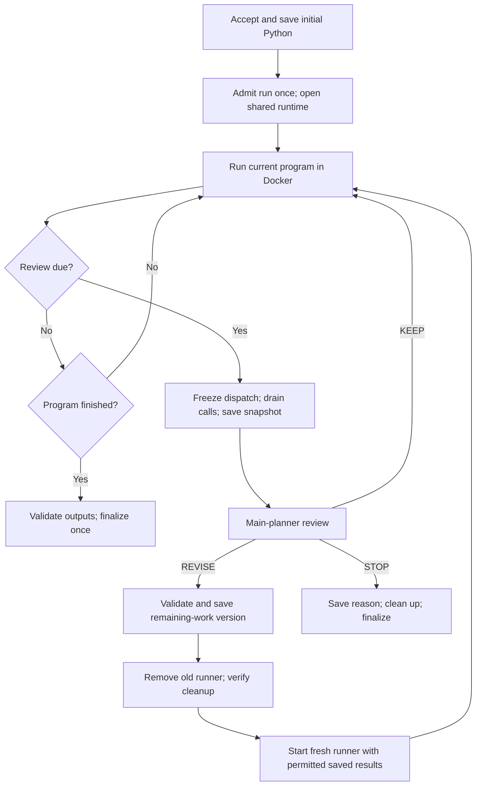

# P2 implementation plan

Created and implemented: 2026-10-25. Status: complete for deterministic validation.
All 221 non-live cases were verified; one live-model case remains opt-in. See
[P2 behavior](P2.md) and [validation evidence](../../reports/p2_validation_2026-10-25/README.md).

Build P2 from the existing CSV research harness: a model writes a limited Python
orchestration program, the host reviews execution at the same opportunities as D2,
and an accepted revision runs the remaining work in a fresh Docker runner. Use this
document as the implementation checklist. Complete each phase's exit gate before
moving to the next phase, and record evidence in the work log at the end.

"From scratch" here means implementing the missing P2 feature. Reuse the working
planner stages, agents, broker, runtime, storage, evaluator, and P1 isolation boundary.

## 1. Read the current contract

Read these before changing code:

1. [Project README](../../README.md), [progress](../progress.md), and
   [limitations](../limitations.md).
2. [Research controls](../experiment_protocol.md).
3. [P1 contract](P1.md), [planner](Planner.md), [executor](Executor.md), and
   [running guide](Running.md).
4. Sections 12 and 13 of the
   [original build guide](../reference/Execution_Engine_Research_App_Build_Guide.md).

The original guide contains historical domains and proposed interfaces. For this
feature, use the current CSV contract: reviews follow completed-attempt thresholds,
and the host owns scheduling. Do not introduce the historical named agent checkpoints,
`sdk.checkpoint`, or the broader Python operations sketched in that guide.

| Mode | Representation | Main-planner reviews during execution | Starting state |
|---|---|---|---|
| D1 | DAG | None | Implemented |
| D2 | DAG | Two configured opportunities, if reached | Implemented |
| P1 | Limited Python in Docker | None | Implemented |
| P2 | The same limited Python in Docker | The same opportunities as D2 | To build |

Worker model calls remain possible in all four modes. A deterministic scripted model
reply is engineering evidence, not a model-generated research episode.

## 2. Freeze the behavior before implementation

Treat these as acceptance requirements. If implementation reveals a necessary change
to a shared rule, document and test that change for both representations before using
the feature in a measured comparison.

| Area | Required P2 behavior |
|---|---|
| Initial planning | Reuse discovery, CSV registration, Main Task, tool selection, and breakdown. Generate Python directly, without an intermediate DAG. |
| Python language | Keep P1's restricted `async def run(sdk, inputs)`, `sdk.call`, and `sdk.parallel` contract. Calculations stay in the agents. |
| Review opportunities | Require the same two increasing task rules as D2. Current configurations use completed-attempt thresholds 1 and 2; read configuration rather than hard-coding them. |
| Counting | Use the shared runtime's completed-attempt accounting. Counters and reached review IDs survive revisions. Known failed attempts count as they do in D2; unknown outcomes stop execution. |
| Barrier | Freeze new tool dispatch, drain active calls, then build a stable public snapshot. Queued requests are not completed attempts. |
| Healthy execution | Call the main planner at every reached P2 review, including when `KEEP` is appropriate. Record unreached reviews for short programs. |
| `KEEP` | Resume the same runner and its local variables after the barrier. Do not rerun the program from its start. |
| `REVISE` | Validate a replacement breakdown and Python program for remaining work, save the new version and permitted snapshot, remove the old runner, and start a fresh runner. |
| `STOP` | Save the reason, stop dispatch, clean up the runner, and use the same terminal/error semantics as D2. A planner stop is not successful completion. |
| Result reuse | Supply verified saved results to the replacement. Do not replay earlier successful work just to reconstruct Python variables. |
| Failure handling | Preserve known failures and explicit recovery links. Replanning must not erase attempt evidence or silently convert an unresolved failure to success. Align the rule with D2. |
| Budgets | Keep one run allowance, deadline, tool-attempt budget, concurrency limit, and broker across all versions. Reviews and correction calls consume the shared model allowance. |
| Isolation | Execute generated source only in the Docker runner. Keep the P1 restrictions and record actual settings for every runner instance. |
| Information | Give D2/P2 the same logical public review information. Never provide evaluator fixtures, private fault schedules, expected answers, or the private effect ledger. |
| Evidence | Save every candidate, rejection, review, accepted source/hash, snapshot, version link, tool attempt, runner identity, and cleanup result. |
| Evaluation | Grade declared final outputs independently. Execution `COMPLETED` does not establish task success. |

Do not add provider calls, direct MCP access, filesystem access, imports, loops,
arithmetic, helper functions, or a generic thinking tool to generated Python. No
agent order is prescribed. Durable host-crash resume, new worker capabilities,
a dashboard, and a private failure benchmark are outside this feature.

## 3. Implementation map

All paths below are relative to the repository root. New names are proposals.

| Existing location | Work to perform |
|---|---|
| `src/mcp_execution_lab/orchestration/models.py` | Add P2 handoffs, a strict Python review decision, and explicit continuation metadata. Preserve DAG decision compatibility. |
| `orchestration/planner.py`, `orchestration/programs.py` | Share direct Python generation between P1/P2; describe continuation inputs for P2 reviews. |
| `orchestration/runtime.py`, `orchestration/executor.py` | Extract common review coordination and public context from D2. Preserve admission, accounting, and DAG behavior. |
| Proposed `orchestration/reviews.py` | Hold shared review/context/decision persistence with representation-specific validation and activation hooks. |
| `orchestration/program_executor.py` | Add host-owned review barriers and a versioned runner lifecycle within one admitted run. |
| `orchestration/program_container.py`, `src/mcp_execution_lab/program_sdk/` | Support controlled runner replacement and stale-message rejection while retaining framing and isolation checks. |
| `orchestration/broker.py`, `orchestration/files.py`, `orchestration/storage.py` | Reuse existing guards; add snapshot/version evidence and checks where needed. |
| `orchestration/model.py`, `orchestration/budget.py` | Reuse the existing model route, bounded corrections, usage accounting, and shared limits. |
| `orchestration/service.py`, `orchestration/cli.py`, `orchestration/server.py` | Route P2 to the Python executor and expose it only after the core path passes validation. |
| `src/mcp_execution_lab/evaluation/cli.py`, `evaluation/batch.py` | Support matched four-mode runs and actual P2 results. |
| `tests/orchestration/`, `tests/evaluation/`, `tests/agents/` | Add deterministic review, isolation, API, and independent grading coverage. |

In this table, abbreviated `orchestration/` paths refer to
`src/mcp_execution_lab/orchestration/`; abbreviated `evaluation/` paths refer to
`src/mcp_execution_lab/evaluation/`.

## 4. Target execution lifecycle



Unknown tool outcomes, exhausted budgets, invalid replacement after the allowed
corrections, and unconfirmed cleanup follow explicit terminal paths. They must not
fall through to another runner. Check for due reviews before accepting final output,
including when parallel completions reach both thresholds together.

Barrier and replacement phases may be internal controller states. Do not introduce
new persisted run/step status strings without updating the storage transition rules
and their tests.

## 5. Build phases

### Phase 0 - Capture a reproducible baseline

- [x] Read the references in section 1 and record current source, lockfile, settings,
  fixture, and SDK identities with the baseline evidence.
- [x] Inspect `git status`. Preserve unrelated edits and retained evidence. The local
  cgroups v1/v2 isolation-probe adjustment in `test_program_executor.py` is an existing
  setup change, not P2 work.
- [x] Check the project `.venv`, Docker Linux engine, prebuilt runner image, and native
  PostgreSQL test prerequisites. Use `.env` for local secrets; keep them out of evidence.
- [x] Run the existing non-live validation with real MCP, PostgreSQL, and Docker checks
  enabled. Save output and explain any environmental failure before adding P2.
- [x] Record baseline behavior for D2 `KEEP`/`REVISE`/`STOP` and P1 review barriers.

**Exit gate:** a saved baseline for this checkout, or a clearly identified blocking
environment issue. Historical passing counts are not a substitute for fresh results.

### Phase 1 - Define P2 contracts and version identities

- [x] Extend `Handoff` to accept P2 as a Python mode, requiring a program and rejecting
  a DAG. Require two configured review opportunities for D2 and P2.
- [x] Add a proposed `ProgramReviewDecision` schema using the same
  `KEEP | REVISE | STOP` decisions and reason as the DAG review.
- [x] Require a replacement program and breakdown for `REVISE`; forbid replacement
  work on `KEEP`/`STOP`. Validate selected preserved-result identifiers against a
  host-created snapshot. Do not accept model-created references as proof of validity.
- [x] Define immutable program version, parent version, review ID, snapshot ID,
  runner instance/epoch, and call occurrence identities. Record how initial version 1
  differs from a continuation version.
- [x] Specify which maps are run-wide and which are version-local. Run-wide state
  includes budgets, broker, attempts, valid saved results, completed counts, review IDs,
  and failure/recovery history. A version owns its source, assigned calls, pending
  requests, runner, and active step states.
- [x] Freeze cross-version job-ID and recovery rules. Existing D2 rejects previously
  successful step IDs in replacement work; failed work has different treatment.
  Separate a new intentional attempt from result reuse, and make D2/P2 consistent.
- [x] Preserve the original request, task, registered CSVs, tool catalogue, settings,
  and run identity. Validate revised output declarations against the same task contract
  and evaluation mapping used for D2.

**Exit gate:** schema and validator tests accept valid P2 versions, reject malformed
decisions, and keep existing D1/D2/P1 serialization and validation behavior intact.
Reading an old handoff does not bypass source/configuration freshness checks.

### Phase 2 - Share D2 review policy

- [x] Extract review opportunity tracking, public snapshot construction, model request,
  bounded correction, and decision evidence from `Executor._review` into a shared
  controller or helper. Keep representation-specific validators separate.
- [x] Use the existing `ModelCalls` path with stage `review`, the configured model,
  response schema, prompt limits, and shared allowance. Do not add another model client.
- [x] Build one common context containing the original public request and constraints,
  current breakdown, allowed tool contracts, states, completed IDs, valid result
  references, bounded observations, public failures, and remaining budgets. Include the
  current DAG or Python source as representation-specific material.
- [x] Keep private evaluator and broker bookkeeping out of the context. Expose only
  permitted public operation outcomes, not the effect ledger or provider credentials.
- [x] Preserve every review candidate, validation error, correction, accepted decision,
  parent version, and exhausted/failed review outcome.
- [x] Keep opportunity count distinct from provider-call count: one opportunity may
  consume corrections, all charged. If both rules are due after draining, process both
  once in configured order, against the current accepted version.
- [x] Preserve D1/P1 no-main-review behavior, including existing
  `PASSED_WITHOUT_MODEL` records where their barriers are reached.

**Exit gate:** D2 regression cases pass through the shared logic without changing
review timing, context access, budget use, or replacement behavior. P1 makes no
main-planner execution-review requests.

### Phase 3 - Implement a permitted continuation snapshot

- [x] Save a stable snapshot only after active tools have settled and their outcomes
  have been collected. Give each underlying tool task exactly one collection owner.
- [x] Maintain two projections: a bounded review context shared logically by D2/P2,
  and a runner input containing only host-approved results selected for continuation.
- [x] Keep `inputs['task']` and `inputs['datasets']`; add a documented continuation
  field, proposed as `inputs['snapshot']`. Use a mapping from stable result IDs to
  checked result envelopes (`state`, `value`, `output`, `error`) and permitted nested
  file references. Initial programs receive an empty continuation mapping.
- [x] Verify each preserved reference's run, recorded identity, content hash, producer
  outcome, and validity. Use `Files.checked_path` and existing reference checks.
  Exclude stale, uncertain, fabricated, cross-run, and unreceived references.
- [x] Do not grant access to every file merely because it exists in the same run.
  Explicitly extend the new runner's allowed-reference scope with the selected results
  and their verified nested references.
- [x] Bound snapshot hydration and the startup frame. If selected inputs cannot fit,
  save a clear limit failure; do not silently truncate or repeat tools to reconstruct
  data. Keep observation/selection limits explicit and equivalent for D2/P2.
- [x] Keep the minimal SDK: pass checked saved values in startup inputs rather than
  introducing a P2-only arbitrary artifact reader. Revisit this only as an explicitly
  controlled shared capability change.

**Exit gate:** a fresh runner can use a legitimate saved result without another tool
attempt; forged, stale, oversized, and unauthorized snapshots fail before dispatch.

### Phase 4 - Add safe review barriers and runner replacement

- [x] Refactor `ProgramExecutor._call` / `_pass_reviews` into a single coordinated
  barrier. Prevent duplicate review tasks and new dispatch once a review becomes due.
- [x] Distinguish received/claimed requests from dispatched tools. Queued requests
  abandoned on replacement must not create phantom attempts or completed counts.
- [x] Drain actual active tool tasks, persist their outcomes, and then review. Do not
  cancel tool work merely to create a checkpoint; cancellation does not prove absence
  of an external effect.
- [x] Avoid holding an `asyncio.Condition` lock across model calls or blocking I/O.
  Other callbacks must be able to finish collection while dispatch is paused.
- [x] Define when replies are released. `KEEP` must let the existing awaiting Python
  calls finish in the same runner, with their results and local variables preserved.
- [x] Add a typed controlled-supersession outcome or equivalent lifecycle mechanism
  to `Container.run`. Distinguish an accepted replacement from timeout, protocol error,
  user cancellation, unexpected runner exit, and genuinely uncertain tool work.
- [x] On `REVISE`, save and validate the new version before making it active; stop and
  remove the old container after draining. Reject old-epoch frames/replies so the old
  runner cannot dispatch calls after replacement.
- [x] Require confirmed cleanup before starting the next runner. Persist diagnostics
  and use the appropriate check-required/uncertainty outcome if cleanup is unconfirmed.
- [x] Handle a final-result frame racing a review: do not accept final output while
  required reviews, active calls, or replacement decisions are outstanding.
- [x] Keep frame size, request-ID uniqueness, bounded stderr, deadline, actual Docker
  settings inspection, and cleanup checks for every runner instance.

**Exit gate:** deterministic tests demonstrate one review per opportunity, no deadlock,
no old-runner dispatch, no duplicate collection, and no orphaned owned container for
normal completion, replacement, stop, cancellation, and protocol failure.

### Phase 5 - Execute multiple program versions in one run

- [x] Add an explicit runner/version loop to `ProgramExecutor`. Call `Runtime.admit`
  once and keep the MCP connections, worker gateway, `ToolBroker`, budget, and deadline
  open across accepted revisions. Finalize the run once.
- [x] Extend admission's model requirement to P2, matching D2. Do not reset execution
  state by recursively invoking `run` or re-admitting a revised handoff.
- [x] Validate each replacement against the remaining-work contract, original tool
  catalogue, restricted AST policy, assigned jobs, preserved results, and limits.
  Each assigned job still has exactly one static call site in its program version.
- [x] Verify any newly required configured MCP servers/tool contracts through the
  existing adapter. Refresh active assignment metadata without creating a new worker
  implementation or giving generated code a direct connection.
- [x] Save accepted source as an immutable file with its hash and policy identity,
  then save the program/breakdown, snapshot selection, parent links, and handoff.
  Keep rejected candidates and failed activation attempts.
- [x] Mark undispatched old work `REPLACED`; retain terminal old step states and every
  attempt. Register new steps under the new version. Keep a complete version history
  even if the final result record summarizes only the active version.
- [x] Reuse legitimate saved results explicitly. Retain the broker's existing exact
  operation guards. Its identity includes run, occurrence ID, tool, arguments, and job;
  it is not universal deduplication of semantically similar work under new IDs.
- [x] Charge any permitted new attempt after a confirmed failure. Preserve recovery
  links and reject attempts to treat unknown outcomes as ordinary recoverable failures.
- [x] Validate final JSON keys, reference scope, unhandled failures, skipped calls,
  and declared outputs using the same P1/shared runtime rules.
- [x] Use existing transactional record operations where feasible. File writes and
  PostgreSQL are separate stores; do not claim atomic power-loss recovery.

**Exit gate:** a scripted P2 run revises twice, reuses earlier results, keeps cumulative
budgets/counts, and leaves an auditable chain from initial source to final artifacts.

### Phase 6 - Connect planning, CLI, and API

- [x] Let the planner generate initial P1/P2 source through the same Python branch.
  Use the same pre-execution correction policy; save candidates and accepted source.
- [x] Add P2 review instructions describing remaining work, available snapshot IDs,
  and `KEEP`/`REVISE`/`STOP`. Treat tool-result text as observations, not authority to
  change runtime policy, budgets, or access evaluator information.
- [x] Route saved P2 handoffs to `ProgramExecutor` in `service.py`; check plan-only,
  execute, run, inspect, API validation, and execution of an already-started run.
- [x] Extend supported mode choices consistently in CLI/API models and messages.
  Replace `test_unsupported_p2_stays_unavailable` only when the supported path works.
- [x] If SDK/protocol files change, version the contract as needed, rebuild the shared
  runner image, and retain SDK hash/image freshness checks for both P1 and P2.
  Record every runner's immutable image ID; execution must not pull/build an image.
- [x] Keep defaults stable unless deliberately changed. Do not resurrect removed
  pricing commands, dashboard paths, or legacy runners.

**Exit gate:** plan-only saves P2 without tools; CLI/API execution uses Docker and the
official MCP adapter; malformed modes/handoffs and stale source/images are rejected.

### Phase 7 - Enable controlled four-mode evaluation

- [x] Add P2 to evaluator mode validation and batch execution. Require two review
  rules whenever D2 or P2 is included.
- [x] Preserve matched question/CSV inputs, tool/agent versions, settings, per-run
  allowance, concurrency, rule thresholds, repeats, and seeded run order.
- [x] Reserve enough batch allowance for a complete matched block. Do not give later
  modes a reduced allowance because earlier modes consumed the batch ceiling.
- [x] Keep fresh run IDs and original copies per episode, without cross-run model
  response reuse. Save source, lock, configuration, suite, fixture, and grader hashes.
- [x] Extend actual run/grade/export/report coverage. Existing `P1_to_P2` and
  `D2_to_P2` comparison labels in `batch.py` do not establish P2 execution support.
- [x] Count initial planning, workers, reviews, corrections, retries, and every runner's
  startup/cleanup in usage and elapsed time. Unknown token/USD values remain unknown.
- [x] Keep failed, stopped, and unresolved runs in reported attempt denominators.
  Grade outputs after execution through the independent evaluator.
- [x] Label fixed-reply four-mode checks exploratory. The public development suite
  and deterministic fixtures cannot establish a representation winner.

**Exit gate:** a deterministic native-PostgreSQL batch executes all four modes against
the same actual worker and independent checker, with matched controls and linked grades.

### Phase 8 - Complete the validation matrix

Add focused tests beside the existing coverage. The added files are
`tests/orchestration/test_program_reviews.py`,
`tests/orchestration/test_program_snapshots.py`, and
`tests/orchestration/test_program_images.py`.

| Case | Required evidence |
|---|---|
| Initial P2 generation | Direct Python; saved source/hash; no DAG intermediate; bounded corrections. |
| Healthy `KEEP` | Same container continues with its local values; review usage is counted. |
| `REVISE` | New source/version/container; original results supplied by snapshot; no replay. |
| Two revisions | Both opportunities recorded once; cumulative counters, allowance, and deadline. |
| Both thresholds reached together | Parallel tools drain; ordered reviews both occur without duplicate calls. |
| Short/conditional program | Unreached reviews and skipped jobs recorded without invented attempts. |
| Final-result race | Due review wins over final acceptance; no stale-version final output accepted. |
| Queued parallel requests | Capacity respected; paused/replaced requests have no phantom attempts. |
| Known failure and recovery | Valid remaining-work recovery succeeds; unhandled failure cannot disappear. |
| Unknown outcome | No revision/replay/fallback treats it as a known failure; explicit stop evidence. |
| Bad replacement | Wrong schema, repeated successful jobs, invalid tool/job, unsafe AST, and forged preserved IDs rejected; corrections bounded and charged. |
| Budget exhaustion | Model, tool, result, prompt, and time limits remain cumulative across revisions. |
| Snapshot scope | Cross-run, altered hash, stale, unreceived, and invalid nested references rejected. |
| Snapshot size | Oversized startup/review data fails clearly without truncation or reconstruction calls. |
| Observation injection | Result text cannot request extra tools, private fixtures, new checkpoints, or free model calls. |
| Isolation and protocol | Actual Docker limits; stale image, malformed/duplicate/stale frames, cancellation, and cleanup failures exercised. |
| Version persistence | All candidates, attempts, states, snapshots, parents, and runner evidence survive. |
| D1/D2/P1 regression | Original behavior, no-main-review rules, and real MCP integration retained. |
| CLI/API and evaluator | P2 route plus a genuinely executed four-mode batch with independent grading. |

Use deterministic model replies with real official-SDK MCP fixture processes first.
Use Docker for generated execution and native PostgreSQL for persistence integration.
Mocked protocol tests supplement those paths; they do not replace them. Use deterministic
failure fixtures without exposing their private control data to planner or runner.

**Exit gate:** focused cases and the full required checks pass, with retained logs,
explicit skips, cleanup evidence, and no unaccounted effect or review opportunity.

### Phase 9 - Document and hand over

- [x] Update README, progress, limitations, research controls, planner/executor running
  guides, and evaluation instructions to describe implemented behavior and evidence.
- [x] Retain the frozen Python subset, review timing, snapshot limits, and all remaining
  research/runtime limits. The existing prompt-size reservation audit gap needs a
  shared fix or continued disclosure; P2 does not automatically resolve it.
- [x] Save a dated report with exact commands, versions/hashes, pass/fail/skip counts,
  environmental details, and runner cleanup results. Preserve prior evidence unchanged.
- [x] Restart loaded local services after source changes only when no run is active,
  then verify API/database readiness separately from simple process health.
- [ ] Optional follow-up, deferred: run a separately authorized bounded live smoke
  test after deterministic validation. Record actual provider requests, reviews, usage, outcomes, and grades.
  Login or a healthy service alone does not establish live model quality.

**Exit gate:** a developer can plan, execute, inspect, and independently grade P2 using
the documented commands, and can trace a revision to its saved source and tool evidence.

## 6. Validation commands

Run from the repository root. These commands are instructions for implementation;
creating this plan does not submit runs or perform the validations.

Baseline and final full non-live checks, using project Python and Ruff:

```powershell
$env:MCP_LAB_POSTGRES_TEST = '1'
$env:MCP_LAB_DOCKER_TEST = '1'
$env:MCP_LAB_CODEX_TEST = '0'
.\scripts\lab.ps1 analysis runner-build --config configs/agents_stdio.yaml
.\scripts\check.ps1
```

Build the image again after SDK changes. Docker must be ready and the native PostgreSQL
test prerequisites available. Check command exit codes and save logs; a partial rerun
must be reported as a partial rerun.

Focused checks during implementation, using existing test files:

```powershell
.\.venv\Scripts\python.exe -m pytest -q tests/orchestration/test_executor.py tests/orchestration/test_program_planner.py tests/orchestration/test_program_executor.py tests/orchestration/test_program_protocol.py
.\.venv\Scripts\python.exe -m pytest -q tests/evaluation/test_integration.py
```

Add the proposed review/snapshot tests to focused runs once created. Retain the full
`scripts/check.ps1` run as the final validation gate.

Future P2 user smoke command, **only after P2 is implemented**:

```powershell
.\scripts\lab.ps1 analysis run --query "Calculate total amount" --csv fixtures/data_analysis/example.csv --config configs/agents_stdio.yaml --mode P2
.\scripts\lab.ps1 analysis inspect --run RUN_ID
```

The smoke command uses the configured model route and consumes its allowance. For a
four-mode batch, use explicit `D1 D2 P1 P2` modes and reserve the configured per-run
allowance multiplied by four for each complete task/repeat block. Check the implemented
evaluation CLI help rather than assuming a new command or default exists.

## 7. Completion checklist

- [x] P2 initial planning and CLI/API execution are implemented and documented.
- [x] D2/P2 share review rules, public context policy, correction limits, and accounting.
- [x] `KEEP`, `REVISE`, and `STOP` pass real Docker/MCP/PostgreSQL integration checks.
- [x] Revisions use fresh runners and verified saved results without resetting budgets.
- [x] No old-runner dispatch, successful-work replay, hidden context, or lost evidence.
- [x] Unknown outcomes, cleanup failures, and invalid revisions have explicit outcomes.
- [x] The complete required test collection and actual four-mode independent evaluation
  are verified, with the full attempt and targeted completion retained.
- [x] D1/D2/P1 regressions pass and retained evidence is preserved.
- [x] Remaining limits are disclosed; execution completion and research success remain
  separate claims.

## 8. Implementation work log

Copy this entry for each phase while building:

```text
Date / phase:
Baseline source, lock, settings, fixture and SDK identities:
Behavior implemented:
Files changed:
Shared D2/P2 contract decisions:
Validation commands and exit codes:
Evidence/log location:
Pass / fail / skip counts:
Remaining defects or limitations:
Next phase / dependency:
```

Start with Phase 0, then settle the version/snapshot contract in Phase 1 before
refactoring the review path. Enable P2 publicly only after its executor lifecycle and
continuation checks work together.


### Completed implementation record - 2026-10-25

- Phases 0-7: implemented using the existing broker/runtime and official MCP adapter.
  Source, lock, configuration, fixture, SDK, and grader identities are saved in the
  validation report. The Python SDK and its language policy remain unchanged.
- Contract decisions: continuation envelopes are stored in a run-owned JSON artifact
  linked by `Handoff.continuation`; selected results are available as `inputs['snapshot']`.
  Both D2/P2 enforce the aggregate `max_result_bytes` selection bound and preserve
  version-qualified unresolved failure IDs until a declared recovery step succeeds.
- Phase 8: Ruff/format checks passed for 111 Python files. On the final source, the
  full attempt passed 205 tests and skipped one before a Windows loopback reset in an
  existing worker-access test. That unchanged case and remaining checks passed in a
  17-test completion run: 221 distinct non-live cases verified, one live skip. Both
  raw reports and the combined coverage record are retained; no failure was deleted.
- All four independent development grades passed. The P2 evaluation used two runners,
  one worker tool attempt, and seven scripted model calls, without replaying the worker.
- Phase 9: guides and this checklist updated; seven local services are ready, six MCP
  tools are discoverable on the final source, and application database access succeeds.
  No test containers or test PostgreSQL clusters remain active.
- Additional shared hardening: Docker can list a tag while name inspection fails on
  this machine. Lookup now requires one exact listed image ID, verifies its own tag
  metadata, and retains Linux/SDK freshness checks. Six focused negative/positive cases
  passed; the real local cache uses this path successfully. The local startup helper
  also waits only for pg_ctl rather than its background database descendants.
- Final source SHA-256: `b0ca88b435331562297edc9dabe34d215169671260f77a98c12db52422afe619`.
- Deferred: paid/live model smoke and model-quality evaluation. Existing documented
  limits, including host-crash resume and the model-slot reservation audit gap, remain.
