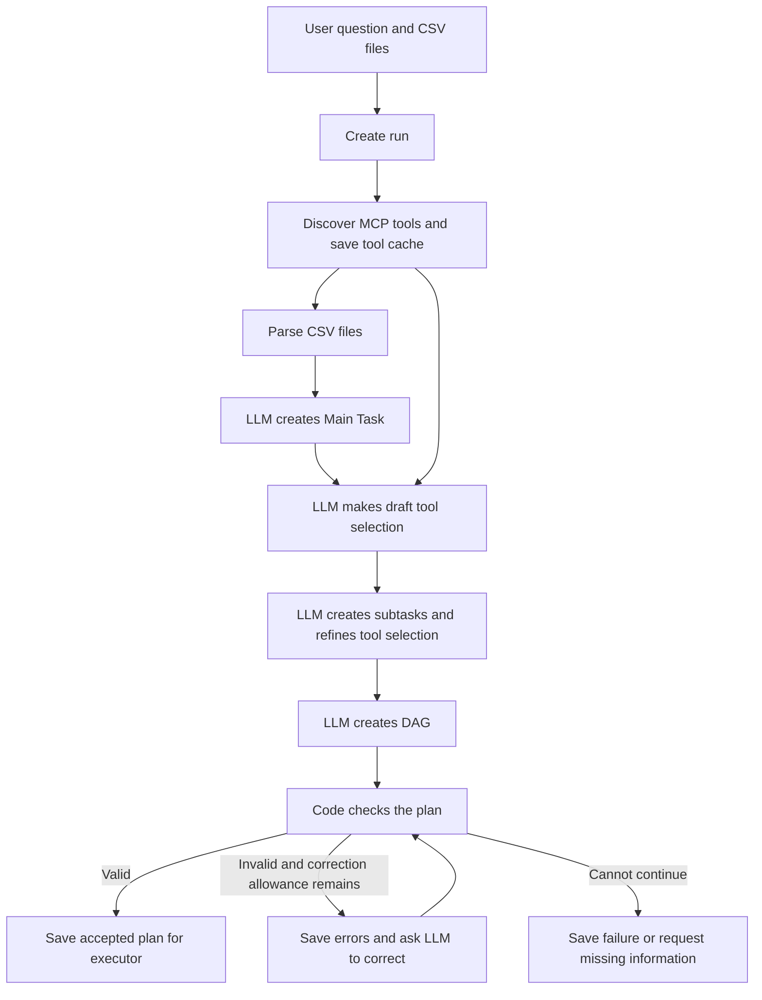

# Planner: design and implementation plan

Date: 2026-10-09

Implementation update, 2026-10-23: the D1/D2 planner and six agents are implemented. CSV P1/P2 remain future work. The older pricing implementation has been removed. See [Running.md](Running.md). The design below distinguishes implemented DAG planning from the planned Python treatments.

## 1. Purpose

Turn the user's question and attached CSV files into a clear, valid plan that an executor can follow.

The main LLM chooses the required tools, assigns their jobs, and decides the connections between the jobs. The application checks the plan and saves the planning history as it happens.

The planner ends when a validated plan has been saved and is ready for the executor. Running agents, scheduling their work, and handling execution-time recovery belong to the executor design, which comes later.

## 2. Agreed flow

1. Create a run and save the original user request.
2. Ask the configured MCP servers for all their available tools.
3. Build and save the tool cache for this run.
4. Parse the attached CSV files and save a basic description of their contents.
5. Ask the LLM to create the Main Task from the user request and file descriptions.
6. Give the Main Task and tool cache to the LLM for a draft tool selection.
7. Ask the LLM to create subtasks, assign tools, and refine its selection where needed.
8. Ask the LLM to create the DAG from those subtasks and their required inputs and outputs.
9. Check the DAG using code. Return specific errors to the LLM for a limited correction attempt if necessary.
10. Save the accepted plan and mark it ready for the executor.

These are logical stages. They do not require one separate LLM call per stage. We will choose the call grouping during implementation, record it, and keep it consistent during comparisons. No agent needs to be executed to complete these planning stages.

## 3. Who decides what

| Part | Responsibility |
|---|---|
| Application code | Create the run, discover tools, read CSV structure, save records, and check the plan |
| Main LLM | Interpret the user's goal, choose tools, create subtasks, and decide their connections |
| MCP worker agents | Later carry out the jobs assigned by the plan |
| Executor | Later decide when a planned step is ready and request its execution through the shared tool gate |

The planner does not clean, combine, investigate, or predict as a side effect of making a plan. Those jobs belong to the selected workers during execution.

## 4. Tool discovery and the run's tool cache

At the start of each run, use the official MCP SDK through the application's adapter to discover tools from the MCP servers configured for this project. Read the complete list, including additional pages when supplied.

This is discovery from the project's configured servers, not a search for every service installed on the computer.

For each tool, save:

| Field | What it means |
|---|---|
| Server ID and tool name | The exact identity used to call the tool; names on different servers remain distinct |
| Original description | What the MCP server says the tool does |
| Simple explanation | A short explanation of its job in plain English |
| Capabilities | The actions it is documented to support |
| Required inputs | The names and rules for the inputs it accepts |
| Expected outputs | The published output rules, where available |
| Stated limits | Relevant restrictions and declared behavior, where available |
| Version information | Server, tool, and interface versions where supplied; unavailable information stays unknown |
| Discovery record | When discovery happened and whether each configured server responded successfully |

Keep the raw MCP definitions as well as the readable descriptions. Prefer clear descriptions supplied by our own workers. If an LLM is used to simplify a description, save that request and reply, check the explanation against the original, and count its usage. A simple explanation cannot add an unsupported capability.

MCP descriptions may not contain every detail our agents need. Missing output rules or capabilities must be supplied by an explicit, versioned worker definition or left unknown. Do not silently invent them.

The cache has a saved ID and a content fingerprint: a value that changes if its contents change. Every tool selection and plan points to that exact cache.

- Refresh discovery at run start. Do not silently use an old cache when discovery fails.
- Keep the saved cache unchanged for that run.
- Record discovery failures before stopping planning or requesting a configuration fix.
- Treat discovery as evidence that a tool was listed, not a guarantee that its future execution will succeed.
- A change discovered later must be recorded and handled explicitly; it cannot silently rewrite the accepted plan.

## 5. CSV parsing and the Main Task

### Basic reading before planning

Ordinary code reads each attached CSV and saves a basic file description:

- Dataset and file IDs, original filename, size, and content fingerprint.
- Column names, sample rows, and observed data types.
- Row count when known, with a clear indication if information came from a sample.
- Basic missing-value counts and parsing problems, with the same full-file versus sample distinction.
- The reading settings used, such as encoding and column separator.

Keep the original files unchanged. Do not silently clean data during this stage. A file-reading problem should be reported rather than hidden by dropping rows.

The LLM receives a bounded description and selected examples. Calculations and later worker operations can access the full registered dataset. File contents and tool descriptions are information to inspect, not instructions that can override the user's request or the application's rules.

### Main Task

The LLM creates a structured Main Task using the original request and the saved file descriptions.

| Field | Meaning |
|---|---|
| Main Task ID and run ID | The identity of the task and its owning run |
| Original request | The user's words, preserved unchanged |
| Goal | A clear statement of what the user wants answered |
| Input datasets | Exact references to the supplied file versions |
| Required outputs | For example, an answer, a table, a chart, or a forecast |
| User constraints | Relevant limits or definitions supplied by the user |
| Public completion requirements | What a complete answer must contain, based on the request |
| Assumptions and open questions | What remains uncertain and whether it prevents useful planning |

The Main Task must preserve the user's goal. It must not quietly narrow the goal to fit the available tools. If a required dataset, definition, or capability is missing, save the issue and request clarification when it materially affects the answer.

Public completion requirements do not include private grading cases or answers.

## 6. Tool selection and subtasks

Once the Main Task exists, the LLM reads the saved tool cache and chooses a draft set of tools. It gives a brief, useful reason for each selected tool.

The LLM then breaks the Main Task into subtasks and assigns each agent job to a selected tool. While doing this, it can revise the draft selection. For example, it may discover that two tables must be combined before an investigation can answer the question.

Rules:

- Select only tools that help satisfy the Main Task.
- There is no requirement to use all six proposed data-analysis agents.
- A tool can serve more than one subtask. Cleaning two separate datasets can be two steps using the same cleaning tool.
- A selected tool needs an assigned purpose. Remove selections that have no remaining job.
- A subtask must have a clear job, inputs, expected outputs, and a selected tool that can perform it.
- The final selection and subtask assignments must agree before the plan is accepted.
- If no available tool can perform a required job, report the gap. Do not invent a tool name or pretend the goal has been met.

Each subtask stores its ID, Main Task ID, run ID, assigned tool identity, job description, input references, expected outputs, and relevant limits. Save changed drafts as new versions instead of overwriting the planning history.

## 7. LLM-created DAG

The LLM decides which subtasks require earlier results. Those relationships become the arrows in the DAG.

Each agent step needs:

- A step ID and a link to its subtask.
- The exact selected tool identity.
- Valid inputs from attached datasets or named outputs of earlier steps.
- Required earlier steps, recorded as `depends_on`.
- An optional condition explaining when the step should run.
- Its named outputs.

The whole plan declares its final outputs. The handoff also carries the two task-defined review rules. The LLM does not choose the number or placement of those review rules.

The DAG must allow independent work where the LLM finds it appropriate. It must also support optional work. If cleaning is conditional, later steps need an explicit choice between the original dataset and the cleaned output. They cannot refer to an output that was never produced.

The proposed six agent names describe the available jobs, not a required pipeline. A known, clean, single-file task could select investigation and reporting only. This is an illustration, not a sequence to put into every planner prompt.

### No hardcoded tool sequence

The system prompt may describe:

- The required response format.
- Available tools and their input/output rules.
- How to reference datasets and earlier results.
- Work limits and rules for valid conditions.
- The requirement to preserve the user goal and use only needed tools.

It must not prescribe a data-analysis order such as "always understand, clean, combine, investigate, predict, report."

The application must not silently insert agents, sort agents into a preferred workflow, or add a default six-agent chain. Required input rules constrain which plans are valid; the LLM still chooses a valid plan.

## 8. Validation and limited correction

Code checks the full candidate plan before handing it to the executor:

- IDs are unique and references exist.
- Each tool belongs to this run's saved tool cache and is permitted by the application.
- Required arguments and expected output types agree with the worker definitions.
- Inputs belong to the correct run or its explicitly registered input datasets.
- Each referenced earlier output has a matching dependency path.
- Arrows do not form a circle.
- Conditional paths provide valid input choices, including when an optional step is skipped.
- Selected tools, subtasks, and DAG steps agree.
- Declared final outputs are supported by the plan.
- The configured plan-size, call, and time limits are respected.
- Any agreed pause points are present without forcing an unrelated agent call.

Validation checks the structure. It does not prove that the chosen analysis will answer the question correctly; the later independent evaluation checks the result.

For an invalid candidate, save the candidate and exact errors. The LLM may make a correction within the configured allowance. Save each correction and count its AI use. The validator does not rewrite the plan itself. When the allowance is exhausted, retain the failure instead of executing an invalid plan.

These correction calls happen before execution. They are distinct from D2/P2 replanning after work has started.

## 9. Save planning records during the run

Use PostgreSQL installed directly on the user's computer. This document does not install or configure it.

Proposed planning records are:

| Record | Required connections and contents |
|---|---|
| Run | Original request, selected D1/D2/P1/P2 case, settings, code version, status, and timestamps |
| Dataset records | Input versions, file details, parsing settings, and saved descriptions |
| Tool cache and tool entries | Complete discovery results, definitions, readable descriptions, and cache fingerprint |
| Main Task versions | Owning run, original request, interpreted goal, inputs, constraints, and outputs |
| Planning stages | Owning run, stage name, inputs, produced records, status, and timestamps |
| Tool-selection versions | Owning run, Main Task version, cache ID, selected tools, and short selection reasons |
| Subtask versions | Owning run, Main Task, assigned tool, job, inputs, and outputs |
| Plan versions and plan steps | Owning run, exact candidate source, subtask links, dependencies, conditions, and final outputs |
| LLM calls | Owning run and stage, model settings, request, reply, usage, timing, and errors |
| Validation results | Candidate plan version, each failed check, correction attempt, and final outcome |
| Events | An ordered record of planning progress, changes, and failures within the run |

These are proposed records; the final database table definitions will be written during implementation.

Save a stage's start before doing its work. Save each LLM request before sending it, and its reply or error when it finishes. Save completed outputs and the stage outcome before beginning a dependent stage. Related state and history changes should be committed together so they agree.

Every planning record must belong to the correct run. Database checks must prevent a plan from linking to another run's subtasks, selection, or intermediate outputs. The same original dataset may be registered for several runs, while each run's planning and generated outputs remain separate.

Suggested overall outcomes are `READY_FOR_EXECUTION`, `NEEDS_CLARIFICATION`, `PLANNING_FAILED`, and `INTERRUPTED`. Detailed progress is recorded through stage records and events.

If the database cannot save required progress, stop starting further work. Do not continue making unrecorded AI calls. An interrupted request may have an unknown outcome; recording during the run does not by itself provide automatic restart or guarantee that a request was not billed.

Store model usage as unknown when it is unavailable. Retain failed attempts. Do not put credentials in saved requests or logs.

## 10. Keep the four-case comparison intact

The preparation, tool discovery, Main Task rules, tool-selection rules, and subtask rules apply to all four cases.

| Case | Final initial planning output | Main-planner changes after execution starts |
|---|---|---|
| D1 | DAG | Disabled |
| D2 | DAG | Allowed at the agreed pause points |
| P1 | Python program | Disabled |
| P2 | Python program | Allowed at the same pause points |

P1/P2 must generate Python directly from the shared planning information. Do not force them to produce a DAG first and then translate it.

For matched research runs, use the same input data, tool definitions, model settings, prompt rules, worker abilities, and configured limits. Check that freshly discovered tool definitions match across the compared runs. Record a mismatch as a setup problem rather than silently mixing different tool sets.

Count every AI call used for Main Task creation, tool explanations when needed, selection, task breakdown, plan generation, and corrections. Record the roles separately from later worker and replanning calls. A cache of tool information is not a cache of answers to user tasks. Do not reuse generated task answers across measured runs.

Future representations must use one shared CSV broker/runtime and the official MCP adapter. Private evaluator checks must remain unavailable to planning and generated work. There is currently no generated-code executor; future executable code requires an isolated design and must never run in the host process.

The exact pause points for data analysis will be defined with the executor. The old pricing-task sequence must not become a hidden requirement in the new planner.

## 11. Planner handoff

The accepted handoff contains:

- Run ID and selected case.
- Main Task ID and version.
- Dataset IDs and exact file versions.
- Saved tool-cache ID and fingerprint.
- Final tool selection and assigned subtasks.
- Accepted DAG ID, version, source, and validation result for D1/D2.
- Declared final outputs.
- Configured limits, usage already spent during planning, and the remaining allowance.
- Agreed pause-point definitions when the executor design supplies them.

The handoff uses registered references. It does not give the planner or generated runner unrestricted database or filesystem access.

Creating this handoff does not start execution. The later executor consumes it through an explicit boundary.

## 12. Current module map

| Current area under `src/mcp_execution_lab/orchestration/` | Responsibility |
|---|---|
| `mcp.py` | Official-SDK discovery, sessions, tool definitions, and calls |
| `models.py` | Dataset, Main Task, selection, subtask, DAG, and handoff records |
| `planner.py` | Four model stages, validation/correction, saved handoff |
| `graph.py`, `schemas.py` | Dependency, binding, and schema checks |
| `model.py`, `model_clients.py`, `budget.py` | Audited structured requests, provider bridge, shared allowance |
| `storage.py`, `files.py` | Live PostgreSQL records and registered disk files |
| `service.py` | Plan/execute composition and settings checks |

The old pricing source, fixtures, and tests were removed on 2026-10-23. Existing run files, databases, batches, and reports remain as historical evidence.

## 13. Later implementation checklist

- [x] Define the planning record formats and relationships, including run ownership.
- [x] Add PostgreSQL storage and schema versioning while retaining existing SQLite records and saved files.
- [x] Add MCP discovery and a saved, versioned tool cache for each run.
- [x] Add CSV registration, basic parsing, and bounded file descriptions.
- [x] Add Main Task creation with explicit assumptions and missing-information handling.
- [x] Add draft selection, subtask assignment, and selection refinement.
- [x] Add LLM-created DAGs without a prescribed tool sequence.
- [x] Add structural validation, saved errors, and limited LLM correction.
- [x] Add the saved planner handoff without automatically running the executor.
- [x] Count planning calls and preserve source/configuration identities and previous run evidence.
- [ ] Extend the new data-analysis path to P1/P2 using the same worker and runtime rules.
- [x] Verify deterministic planning with genuine MCP discovery before the bounded real Codex smoke.

Important verification cases:

- A task needs only two available tools; the remaining tools are not inserted.
- One tool is assigned to multiple distinct subtasks.
- Task breakdown reveals a missing tool and the LLM revises its draft selection.
- A server lists tools over multiple pages, or two servers use the same tool name.
- Discovery fails or tool definitions change between matched runs.
- A missing capability is reported without inventing a tool or changing the user's goal.
- A malformed CSV and a materially unclear request retain their errors and pause appropriately.
- Invalid arguments, circles, missing dependency paths, and unavailable conditional outputs are rejected.
- The validator reports errors but never chooses a tool order or silently repairs a plan.
- Correction allowance exhaustion and missing model-usage reports remain visible.
- Database records exist before an LLM call begins and after each completed stage, including failures.
- Another run's task, output, or plan cannot be attached accidentally.
- Planning performs discovery and basic CSV reading without executing the selected worker agents.
- P1/P2 preparation does not require generating a DAG.
- The planner receives no private grading cases, fault schedule, or effect ledger.

## 14. Details left for later design

- Exact inputs, outputs, and per-job limits for the six data-analysis agents.
- How many LLM calls the logical planning stages use, with fair limits and full accounting.
- CSV and generated-file bytes stay on disk, with versions and links in PostgreSQL. This choice is now resolved.
- The executor implements task-defined review thresholds, scheduling, cancellation, and interruption records. Automatic replay after a host crash remains outside this phase.

Implementation decisions now made: files stay on disk with PostgreSQL records and links; the planner and executor are built first with real MCP test fixtures; and two fixed task review rules are shared across matching runs. Review thresholds are task settings, with reached and unreached points retained. The six workers and new Python path remain separate work. See Running.md for the current implementation and boundaries.
