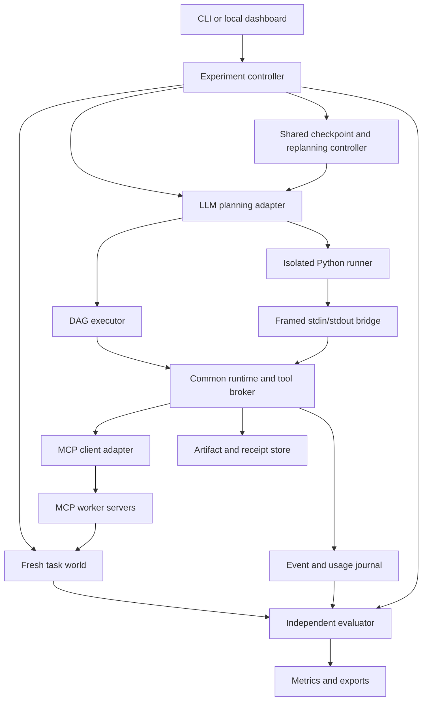

# Build guide: adaptive execution with DAG plans and generated Python

**Project:** independent execution-engine research app  
**Selected topic:** Topic 2  
**Prepared:** 6 October 2026  
**Status:** implementation blueprint. The app has not been built; the project-specific commands, schemas and interfaces below are proposed contracts.

This guide makes implementation choices so that development can begin without redesigning the whole project. Library documentation was checked for the stack choices. Version ranges are starting constraints; the actual installed versions must be locked and recorded.

Related context: [Topic 2 research exploration](C:/Users/Samarthya/Documents/Codex/2026-09-30/i-x20/outputs/Topic_2_DAG_vs_Generated_Programs_2026-10-06.md).

## Contents

1. [What we are building](#1-what-we-are-building)
2. [Research contract](#2-research-contract)
3. [MVP and deferred scope](#3-mvp-and-deferred-scope)
4. [Technology decisions](#4-technology-decisions)
5. [System architecture](#5-system-architecture)
6. [Repository layout](#6-repository-layout)
7. [Core contracts](#7-core-contracts)
8. [Artifacts and stale results](#8-artifacts-and-stale-results)
9. [Persistence and state](#9-persistence-and-state)
10. [Common tool broker and recovery](#10-common-tool-broker-and-recovery)
11. [DAG execution](#11-dag-execution)
12. [Python execution](#12-python-execution)
13. [Replanning and checkpoints](#13-replanning-and-checkpoints)
14. [MCP workers](#14-mcp-workers)
15. [LLM adapter and prompts](#15-llm-adapter-and-prompts)
16. [Benchmark fixtures](#16-benchmark-fixtures)
17. [Fault injection](#17-fault-injection)
18. [Evaluation and analysis](#18-evaluation-and-analysis)
19. [CLI, API and dashboard](#19-cli-api-and-dashboard)
20. [Setup and configuration](#20-setup-and-configuration)
21. [Meaningful verification](#21-meaningful-verification)
22. [Implementation sequence](#22-implementation-sequence)
23. [Cost and time planning](#23-cost-and-time-planning)
24. [Completion criteria and research deliverables](#24-completion-criteria-and-research-deliverables)
25. [References and decision record](#25-references-and-decision-record)

## 1. What we are building

Build a local research application, provisionally named **MCP Execution Lab**, that:

1. Loads an independently written task and an isolated task world.
2. Asks an LLM to create a declarative DAG or a Python program.
3. Executes it through a shared runtime and the same MCP capabilities.
4. Reveals relevant information through actual tool observations.
5. Either continues the original strategy or permits LLM replanning.
6. Records plans, calls, artifacts, effects, model usage and outcomes.
7. Independently checks task completion and compares the four execution modes.

The main user is you as a researcher. A CLI is sufficient for the first complete version. A small dashboard is useful for understanding traces and demonstrating the project later.

The app's first successful demonstration should show the same task running in all four modes, including a case where execution changes an earlier assumption. It must also show a case where the original plan handles the observation successfully; otherwise the benchmark may simply reward adaptation by construction.

Keep this independent of the employer's product. Write new contracts, prompts, fixtures and code from public sources and general engineering knowledge. Employer repositories, proprietary standards, logs, client data and internal prompts are outside this implementation.

## 2. Research contract

### Main question

> When execution reveals information that requires changing the plan, how much does LLM replanning help, and does DAG versus Python representation change that benefit?

Two factors define the main experiment:

| Mode | Representation | LLM replanning after execution begins |
|---|---|---|
| D1 | Declarative DAG | Disabled |
| D2 | Declarative DAG | Enabled at defined checkpoints |
| P1 | Generated Python | Disabled |
| P2 | Generated Python | Enabled at the same checkpoints |

All four use an LLM for initial planning. D1/P1 can contain predefined conditions, bounded fallback paths and runtime retries. The difference is whether the LLM can create a new strategy after observing execution.

Worker agents can use LLMs later, but their roles, prompts and access must remain the same across treatments. The factor being manipulated is **orchestrator replanning**, not all reasoning anywhere in the system.

### Primary controls

Hold constant the model version, exposed model settings, task information, tool catalogue, tool descriptions, worker implementations, allowed operations, artifact access, checkpoint observations, runtime recovery policy, concurrency cap and maximum budget.

Representation-specific prompts and validation necessarily differ; document them. Do not claim that every implementation detail is identical.

Use two evaluation lanes:

- **Controlled lane:** tasks and action primitives can be expressed by both representations.
- **Later practical lane:** allow richer Python processing and measure extra task coverage. Describe this as a capability comparison.

The controlled lane is the MVP. General-purpose Bash and package installation are deferred.

### What we cannot claim from this design

Holding runtime support constant does not measure its causal benefit. A separate runtime ablation is needed for that claim. A comparison of these implementations also does not establish that all DAG systems or all code agents behave alike.

Broad orchestration and adaptation ideas have substantial prior art. The research contribution, if any, must come from reproducible findings and careful separation of factors, not merely from building this app.

## 3. MVP and deferred scope

### Required for the first research-ready pilot

- One orchestrator model behind a provider-neutral adapter.
- Four modes using one shared runtime.
- A small, versioned MCP tool catalogue.
- Deterministic worker services first.
- Typed tool inputs/results and immutable artifact references.
- DAG validation, conditional guards and dependency-aware scheduling.
- Isolated Python runner with a restricted runtime SDK.
- Two shared replanning checkpoints per initial task family.
- Operation receipts, input-aware result reuse and conservative recovery.
- Fresh task worlds for every episode.
- A handful of fixtures with independent acceptance checks.
- Event traces, total model usage and machine-readable metrics.
- Batch execution and export through the CLI.

### Add after the pilot is interpretable

- LLM-backed analysis/patch workers.
- More held-out fixtures and repeated runs.
- A second orchestrator model.
- A small dashboard.
- Focused runtime ablations or a hybrid treatment justified by results.

### Defer

Agent marketplaces, automatic agent routing, A2A alongside MCP, Kubernetes, Redis/Celery, distributed deployment, enterprise SSO, a vector database, model fine-tuning, arbitrary shell access and a polished commercial UI.

These are outside the initial research question and would consume time without necessarily improving the evidence.

## 4. Technology decisions

These are engineering recommendations for a single-developer local project, not measured claims that this stack outperforms alternatives.

| Component | Initial choice | Reason |
|---|---|---|
| Language | Python 3.12 | One language for host, workers, evaluators and generated programs; compatible with the checked MCP SDK requirements |
| Package/environment management | uv, with committed uv.lock | Reproducible dependency resolution and project commands |
| MCP | Official Python SDK, v2 release line | Standard server/client interfaces; keep SDK details inside one adapter |
| Schemas | Pydantic 2 | Validate configuration and internal contracts; produce model-facing schemas |
| Concurrency | asyncio; host-side semaphore | Small local scheduler without a distributed queue |
| Graph validation | Standard-library graphlib | Cycle/topology checks without introducing a large graph framework |
| Persistence | SQLite, SQLAlchemy 2.x, aiosqlite | Sufficient for low-concurrency local runs and structured queries |
| Artifacts | Local immutable files plus DB metadata | Cheap, inspectable storage with content hashes |
| Generated-code isolation | Linux container runner; Docker Desktop/WSL2 on Windows | Separate generated execution from host credentials and files |
| CLI | argparse and structured JSON output | Minimal dependency burden |
| Optional web layer | FastAPI, Jinja2, small JavaScript | A local trace viewer without a second full frontend project |
| Verification | pytest, pytest-asyncio, Ruff | Runtime invariants and cross-mode integration checks |
| Analysis | pandas, matplotlib, scipy | Offline result tables, plots and paired analyses |

The checked MCP documentation identifies v2 as its current stable line and Python 3.10+ as supported. Use its v2 interfaces rather than mixing old FastMCP v1 examples into the adapter. [Official SDK](https://py.sdk.modelcontextprotocol.io/), [repository](https://github.com/modelcontextprotocol/python-sdk).

uv records exact dependency resolutions in its lockfile; preserve that file for each experiment release. [uv project guide](https://docs.astral.sh/uv/guides/projects/).

Use Pydantic for contract validation and FastAPI only once the CLI path works. [Pydantic documentation](https://docs.pydantic.dev/latest/), [FastAPI documentation](https://fastapi.tiangolo.com/).

Do not use a high-level agent framework to implement only one treatment. If a framework supplies retries, summarization or planning for one side, the comparison becomes a framework comparison. A small explicit runtime is easier to inspect for this study.

## 5. System architecture



The DAG executor and Python SDK both call the same broker. Neither can bypass it to mutate the task world.

Keep three visibility boundaries:

| Boundary | Accessible material |
|---|---|
| Planner/executor | User intent, public tool contracts, legitimate observations, permitted artifacts, operational receipts |
| Worker service | Scoped fixture workspace and the inputs needed for its defined role |
| Evaluator/controller | Hidden assertions, fault schedule, committed-effect ledger, experiment labels and full grading state |

Do not expose evaluator capabilities as MCP tools. Hidden grading state must not appear in replanning bundles, generated-code mounts or worker prompts.

## 6. Repository layout

The following is a proposed future repository structure, not files created by this document.

```text
mcp-execution-lab/
  pyproject.toml
  uv.lock
  README.md
  .env.example
  src/mcp_execution_lab/
    cli.py
    config.py
    contracts/
      tasks.py
      tools.py
      artifacts.py
      plans.py
      events.py
      metrics.py
    llm/
      base.py
      provider_adapter.py
      usage.py
      prompts/
    runtime/
      controller.py
      broker.py
      budgets.py
      checkpoints.py
      lineage.py
      recovery.py
      persistence.py
    executors/
      dag.py
      dag_validation.py
      python_runner.py
      runner_bridge.py
    runner_sdk/
      client.py
      protocol.py
      entrypoint.py
    mcp_adapter/
      clients.py
      registry.py
    workers/
      repository_server.py
      checks_server.py
      deterministic.py
      llm_workers.py
    benchmark/
      loader.py
      worlds.py
      faults.py
      evaluator.py
      analysis.py
    web/
      app.py
      templates/
      static/
  fixtures/
    public/
    evaluator_only/
  configs/
    pilot.yaml
  tests/
    unit/
    integration/
    parity/
  containers/
    runner.Dockerfile
  docs/
    experiment_protocol.md
    contracts.md
    limitations.md
  runs/                     # ignored by default
  reports/
```

Evaluator-only files stay on the host and are never mounted in runner containers or fixture-test containers. Credentials and local run data are ignored by Git; publish only deliberately prepared research artifacts.

## 7. Core contracts

Implement typed contracts before executors.

| Contract | Required content |
|---|---|
| TaskSpec | Public intent, initial inputs, published constraints, tool-catalogue version, public checkpoint rules |
| EvaluationSpec | Hidden assertions and task-world checks; controller-only |
| ToolSpec | Tool ID, argument/result schemas, effect class, resource scope, retry/idempotency contract |
| ToolRequest | Request ID, tool ID, validated arguments and artifact references; broker attaches run scope |
| ToolResult | Observed status, outputs, receipt reference and structured diagnostics |
| ArtifactRef | Immutable ID, type, hash, revision and provenance |
| PlanVersion | Representation, source content, version, parent version, generation metadata |
| CheckpointSnapshot | Valid receipts, current artifact bindings, facts, errors and remaining budget |
| ReplanDecision | KEEP, REVISE or STOP, with the replacement plan when required |
| Event | Sequence number, run/operation IDs, event type, timestamps and validated payload |
| RunMetrics | Checked outcomes, costs, latency and classified failure information |

Example observed tool result:

```json
{
  "status": "success",
  "outputs": {
    "workspace": {
      "artifact_id": "artifact_workspace_02",
      "type": "WorkspaceSnapshot",
      "revision": 2,
      "sha256": "aaaaaaaaaaaaaaaaaaaaaaaaaaaaaaaaaaaaaaaaaaaaaaaaaaaaaaaaaaaaaaaa"
    }
  },
  "receipt_id": "receipt_apply_02",
  "diagnostic": null
}
```

Example ambiguous response:

```json
{
  "status": "outcome_unknown",
  "outputs": {},
  "receipt_id": null,
  "diagnostic": {
    "code": "ACK_TIMEOUT",
    "message": "No acknowledgment was received within the tool deadline."
  }
}
```

An observed timeout must not say whether a hidden commit occurred. The evaluator can know that; the planner cannot unless the public service contract provides a way to find out.

Use distinct diagnostic codes for syntax/schema failure, capability rejection, stale input, deterministic tool failure, unknown outcome, budget exhaustion and infrastructure failure. A model-written success flag is not an evaluation result.

## 8. Artifacts and stale results

### Immutable values

Store outputs as immutable artifacts. A mutable workspace is represented by a sequence of immutable snapshots, with a service-owned current-revision pointer.

For every artifact, record:

- Content hash and media/schema type.
- Run and producing operation.
- Exact input artifact IDs/hashes.
- Worker/tool implementation version.
- Current validity classification for the relevant task state.

A hash proves which bytes were used; it does not prove semantic correctness.

### Record actual lineage

DAG-declared edges are useful, but they are not sufficient evidence of what a worker actually consumed. Every worker request must explicitly identify its input artifacts. The broker records resolved arguments and the worker returns provenance for additional scoped reads.

Both representations receive the same artifact handles and accessors. Python must not obtain hidden files directly while the DAG sees only summaries.

### Invalidation

If workspace revision 2 replaces revision 1:

1. Tests that consumed revision 1 remain historical evidence about revision 1.
2. They are invalid evidence for verifying revision 2.
3. Mark affected descendants stale for the new target revision.
4. Keep unrelated results valid when their actual inputs are unchanged.
5. Prevent final recording from presenting stale checks as current.

Do not delete history or blindly invalidate every artifact in the run. The evaluator should separately identify unsafe reuse and unnecessary recomputation.

The common runtime owns this validity mechanism in the main experiment. Its benefit cannot be attributed to the DAG representation alone.

### Shared local computation

For the controlled lane, provide small common operations for field selection, filtering, merging, comparison and artifact reads. Keep large payloads outside the model context in both modes.

Define a finite expression language for DAG arguments/guards. Python can use equivalent SDK helpers. Arbitrary additional Python algorithms belong to the later practical lane.

## 9. Persistence and state

Use a host-owned SQLite database for operational research records and a separate service-owned world database or fixture directory per episode.

| Table | Main fields |
|---|---|
| runs | ID, task version, mode, repeat, status, configuration hash, source commit |
| plan_versions | Run, version, parent, representation, source artifact, model-call ID |
| operations | Stable operation key, tool, input fingerprint, state, current receipt |
| attempts | Operation key, attempt number, dispatch/result times, observed outcome |
| artifacts | ID, type, hash, revision, storage location, producing operation |
| artifact_inputs | Artifact ID, consumed artifact ID and hash |
| events | Run, monotonic sequence, event type and payload |
| model_calls | Role, model, settings, prompt/response hashes, usage, price snapshot |
| metrics | Run, metric schema version, checked outcomes and costs |

The service's private world store includes committed effects and idempotency receipts. The evaluator reads those after execution.

### States

- Run: CREATED, PLANNING, EXECUTING, PAUSED, REPLANNING, COMPLETED, FAILED, UNCERTAIN, BUDGET_EXHAUSTED or INFRA_ERROR.
- Operation: PENDING, DISPATCHED, SUCCEEDED, FAILED_KNOWN or OUTCOME_UNKNOWN.
- Plan node: PENDING, RUNNING, SUCCEEDED, FAILED, BLOCKED, SKIPPED or STALE.

Allow state transitions only through the runtime; append an event when a transition occurs. Use monotonic time for durations and UTC time for human-readable records.

Use short transactions. Do not keep a database transaction open while waiting for an MCP tool or an LLM. Give concurrent tasks their own SQLAlchemy session scope; a session must not be a shared mutable global. [SQLAlchemy async documentation](https://docs.sqlalchemy.org/en/20/orm/extensions/asyncio.html).

Start with default rollback journaling and serialized journal writes. WAL is an optional optimization: use a local filesystem, record the actual SQLite library version, and check that it includes the documented WAL-reset fix before enabling it. The official page identifies 3.51.3+ and specific older backports as fixed. An orchestration checkpoint and a SQLite WAL checkpoint are different mechanisms. [SQLite WAL documentation](https://www.sqlite.org/wal.html).

Do not assume a worker commit and a host journal entry are atomic across separate databases. Reconciliation exists precisely because those records can disagree after interruption.

## 10. Common tool broker and recovery

The broker is the most important shared component.

### Dispatch sequence

1. Bind the request to the host-controlled run and capability scope.
2. Validate the tool name, arguments, artifact ownership and input revisions.
3. Enforce call, time, concurrency and resource limits.
4. Derive the semantic operation fingerprint.
5. Check for a valid reusable receipt or unresolved prior attempt.
6. Persist an intent/attempt record before dispatch.
7. Invoke the tool through the MCP adapter.
8. Validate the observed result and persist output artifacts/receipt.
9. Update lineage and publish an event.
10. Return the same result shape to either executor.

Model code cannot choose another run ID or manufacture a valid artifact handle simply by sending an arbitrary string.

### Operation identity

Do not use DAG node IDs as idempotency keys. A replanned graph may rename nodes, and Python has no equivalent node naming discipline.

For the initial fixtures, derive keys from host-controlled run scope, tool, target, normalized semantic arguments and exact input versions. Exclude retry attempt numbers and representation-specific labels. Define normalization per tool rather than applying a vague universal hash rule.

A retry of the same intended write keeps the same key. A genuinely changed patch has a different payload/input fingerprint. If a key is reused with a different payload, the service must reject it.

Identical legitimate repeated effects require distinct intent/occurrence scopes. Avoid such tasks in the MVP, document that limitation, and add explicit occurrence contracts before supporting them.

### Service-side idempotency

For controlled write tools, commit the world change, service receipt and effect-ledger entry in one service-side transaction. Repeating the key returns the original receipt without applying the effect again.

Client-side caching alone cannot guarantee that a timed-out remote write did not happen.

### Recovery policy

| Observed outcome | Default action |
|---|---|
| Known failure before a write | Apply the documented bounded retry policy |
| Successful operation with valid unchanged inputs | Reuse its receipt |
| Read result whose input world revision changed | Recompute |
| Timeout with documented idempotency support | Reconcile or repeat with the same key, within budget |
| Timeout without enough contract support | Preserve uncertainty; do not label it a known failure or blindly retry |
| Malformed output | Record a contract error; do not fabricate an artifact |

Use the same recovery policy in all modes. Record attempts and committed effects separately.

For pilot defaults, allow at most one automatic transport retry. Semantic failure can activate a predefined fallback or adaptive replanning; the runtime itself must not secretly ask an LLM how to fix it.

On host restart, reconcile unresolved operations before dispatching them again. Crash recovery is a later integration test, not a claim that this small runtime provides universal distributed exactly-once execution.

## 11. DAG execution

### Representation

A plan contains a schema version, named nodes, input bindings, dependency edges, optional guards, output bindings and declared checkpoint barriers.

Below is a minimal binding example, not the complete repair workflow:

```json
{
  "schema_version": "dag.v1",
  "nodes": [
    {
      "id": "inspect",
      "tool": "repo.inspect",
      "depends_on": [],
      "args": {
        "workspace": {"input": "workspace"},
        "issue": {"input": "issue"}
      }
    },
    {
      "id": "analyze",
      "tool": "issue.analyze",
      "depends_on": ["inspect"],
      "args": {
        "workspace": {"node": "inspect", "output": "workspace"},
        "issue": {"input": "issue"}
      }
    }
  ],
  "checkpoints": [
    {"id": "after_inspection", "after": ["inspect"]}
  ],
  "outputs": {
    "analysis": {"node": "analyze", "output": "analysis"}
  }
}
```

Define one unambiguous binding grammar: literal, initial input, node output, existing receipt output, or a supported expression. Reject unknown fields and implicit string interpolation.

For v1, use pure guard operators eq, ne, lt, lte, gt, gte, and, or, not and exists, with explicitly typed operands. Resolve any artifact-field reads through the common artifact-access mechanism. A guard has no side effects and cannot call a model or tool.

The complete healthy repair plan is inspection → analysis → patch proposal → patch application → concurrent tests/static checks → verification → recording. Its shared checkpoints occur after inspection and after the concurrent checks. The small JSON example above only illustrates the first two bindings.

### Validation before effects

Check unique node IDs, existing dependencies, acyclicity, catalogue membership, argument keys, known output paths, compatible artifact types, guard grammar, size limits and checkpoint requirements.

Every referenced node output needs an appropriate dependency path. Distinguish an ordering dependency from a data dependency in stored metadata.

Use graphlib for topology/cycle checking. A prepared TopologicalSorter cannot simply be mutated to incorporate a replacement graph; construct a new validated plan version. [Python graphlib](https://docs.python.org/3.12/library/graphlib.html).

### Scheduler

Dispatch ready nodes up to the common semaphore limit. Resolve arguments from validated artifact bindings immediately before dispatch.

Treat topological readiness as only one condition. Required producers must have successful, valid outputs. Failed dependencies block their consumers. A guard can skip a node; skipped output references are invalid unless an explicit conditional selection chooses an available branch.

Define merge/guard semantics before adding complex branches. Do not silently convert a skipped or failed result into an empty string.

A finite DAG has no action cycle. Bounded fallback paths can be unrolled into nodes; replanning creates a new remaining DAG. Dynamic fan-out is deferred until both representations have an equivalent bounded contract.

The executor does not reinterpret user intent or invent repair steps. That belongs to the initial planner, predefined plan logic or shared replanning controller.

## 12. Python execution

### Entry contract

Generated Python implements an async entry function receiving the runtime SDK, initial inputs and a validated snapshot. It returns named artifact references and an observed completion report.

Illustrative project-specific interface:

```python
async def run(sdk, inputs, snapshot):
    inspected = await sdk.call(
        "repo.inspect",
        {"workspace": inputs["workspace"], "issue": inputs["issue"]},
    )
    await sdk.checkpoint("after_inspection")
    analyzed = await sdk.call(
        "issue.analyze",
        {"workspace": inspected.outputs["workspace"], "issue": inputs["issue"]},
    )
    return {"analysis": analyzed.outputs["analysis"]}
```

This is an interface sketch; sdk.call and sdk.checkpoint are functions to implement. They are not MCP SDK methods.

The SDK should expose:

- call(tool, args): invoke a capability through the broker.
- parallel(calls): bounded concurrent invocation.
- read_artifact(ref): fetch permitted artifact data with access recorded.
- select/filter/merge/compare: common local operations.
- checkpoint(id): participate in the shared observation barrier.
- log(message): emit a bounded diagnostic.

No direct provider API access, generic think tool, hidden evaluator access or independent MCP connection is available inside generated code.

### Isolation

Run generated code in a separate Linux container before enabling model-generated execution. Use a small prebuilt image with the runner SDK, no provider credentials, no host repository mount and no Docker socket.

Initial controls: non-root user, read-only root filesystem, bounded temporary scratch space, no network, dropped capabilities, no-new-privileges, process/memory/CPU limits and a host wall-clock deadline. These controls limit the execution environment; they are not a proof of perfect isolation. [Docker run reference](https://docs.docker.com/engine/containers/run/).

On Windows, use Linux containers with Docker Desktop's supported backend; check local prerequisites during setup. [Docker Desktop Windows setup](https://docs.docker.com/desktop/setup/install/windows-install/).

Use an attached stdin/stdout bridge: the container emits framed JSON requests, and the host broker returns framed responses. The host makes MCP calls, so the container does not need network access.

The runner entrypoint first accepts a bounded BOOT frame containing source code and permitted initial/snapshot data. It validates that frame, executes the source inside the container and then exchanges request/result frames. Implement this entrypoint and the SDK before building the image.

Reserve stdout for protocol frames and stderr for logs. Include request IDs, message-size limits and timeouts. Support multiple outstanding calls if implementing parallel execution. Treat frames as untrusted broker requests.

Build subprocess commands with argument arrays. The generated source is data passed to the runner, never interpolated into a host shell command.

### Validation and limits

Parse syntax/AST before execution and reject unsupported SDK imports/capabilities according to the declared experimental contract. AST checks improve conformance and diagnostics; they are not the security boundary.

Do not execute generated code with exec inside the host process. If container execution is unavailable, continue with handwritten fixtures and adapter development; do not silently fall back to unrestricted host execution.

The controlled lane limits external actions and transformations to shared operations. Predefined bounded action sequences must be representable by an unrolled guarded DAG. Do not compare arbitrary Python libraries with an impoverished graph catalogue.

### Replanning

At a shared barrier, save permitted artifact bindings and receipts. A revised Python plan starts in a fresh runner with that snapshot and implements the remaining work. Arbitrary interpreter memory is not promised to survive.

Reuse broker receipts by semantic identity. Do not require P2 to repeat earlier effects, and do not grant it free invisible model calls to reconstruct its strategy.

## 13. Replanning and checkpoints

### Start with explicit shared barriers

For the repair family, define:

1. After inspection/discovery.
2. After the initial verification checks finish, before final recording.

Both plans must participate in the same barriers. For concurrent checks, drain the in-flight batch before presenting a stable snapshot. Do not inject a special checkpoint only when the evaluator knows a hidden surprise occurred.

The runtime freezes new dispatch while a barrier is active. Cancellation of a caller is not proof that a worker has not committed; reconcile unresolved calls before replacing the remaining plan.

### Checkpoint snapshot

Provide the same logical content to D2 and P2:

- Original user request and published constraints.
- Current valid artifacts and named bindings.
- Successful and unresolved operation receipts.
- Legitimate new facts and structured diagnostics.
- Results that are stale for the current target revision.
- Remaining call, time and model budgets.
- Available tools and their contracts.

Keep raw large data in the artifact store and provide equal access to both modes. Do not include hidden expected answers, fault labels or evaluator assertions.

### Decision

```json
{
  "decision": "REVISE",
  "reason_summary": "The checks show that an earlier interface assumption is invalid.",
  "preserve_receipts": ["receipt_inspect_01"],
  "replacement_plan_artifact": "artifact_plan_v2"
}
```

KEEP continues the current remaining plan. REVISE proposes new remaining work. STOP records why completion is unavailable or uncertain.

The host validates any claimed preserved receipt against actual inputs and current validity. The model cannot declare a stale result valid.

For D1/P1, no planning model is called at execution checkpoints. They continue using their original guards/fallbacks or terminate according to that plan. Runtime transport recovery remains available equally.

For D2/P2, use the same maximum number of checkpoint planning opportunities. Initially call the replanner at each public barrier, even in healthy cases; KEEP is a valid outcome and its cost is counted. Event-triggered replanning can be a later policy study.

### Planning versus format repair

Allow a small identical limit on initial output-format repair before any task action begins. Count those calls as planning cost.

After execution starts, an LLM-generated correction is replanning and is unavailable to fixed modes. Non-LLM validation and deterministic retries are still permitted.

The final reporting model, if used, has no execution tools and cannot repair the outcome after the fact.

## 14. MCP workers

Start with two local MCP servers: repository/analysis capabilities and checks/result capabilities. Multiple tools per server are sufficient; one separate process per tool is unnecessary.

| Capability | Input | Output/effect |
|---|---|---|
| repo.inspect | Workspace and issue references | Workspace snapshot, facts and relevant file references |
| issue.analyze | Workspace and issue references | Structured analysis artifact |
| patch.propose | Workspace and analysis references | Patch artifact; no world mutation |
| repo.apply_patch | Workspace revision and patch reference | New workspace snapshot; idempotent scoped write |
| checks.test | Exact workspace revision | Published test-report artifact |
| checks.lint | Exact workspace revision | Static-check artifact |
| checks.verify | Workspace and check-report references | Verification artifact for that exact revision |
| results.record | Workspace and verification references | One final local result record; scoped write |

The hidden acceptance evaluator is separate from checks.test/checks.verify. Published checks may be useful without being a complete grading oracle.

Workers must accept scoped IDs/references rather than arbitrary host paths. Test execution of fixture code also belongs in an isolated worker environment.

First implement deterministic workers with explicit domain rules and stable seeded variation where needed. Avoid a worker that simply returns the evaluator's correct answer or solves the entire orchestration problem.

Later replace analysis/proposal workers with role-scoped LLM implementations. Keep service contracts unchanged. They should not choose the whole workflow or invoke other roles freely, which would hide orchestrator replanning inside a worker.

Record worker model calls separately and include their cost. Give workers the same inputs in all treatments for an equivalent operation.

The MCP adapter discovers/contracts tools, manages client lifetimes and normalizes SDK results into ToolResult. Keep protocol-version details there. Use the official transport implementations, not a custom imitation of MCP.

For development use local stdio servers. Move to Streamable HTTP only if the local process topology or later transfer study requires it; record transport as an experimental setting.

## 15. LLM adapter and prompts

Use a small provider-neutral interface:

```python
class PlannerClient:
    async def generate(self, *, messages, response_schema, settings, budget):
        """Return response data, usage metadata, request ID and timing."""
        raise NotImplementedError
```

Choose one provider/model you can afford and access consistently. Use its documented SDK/API in a dedicated adapter and lock that dependency separately. This guide does not assume current pricing or require a particular brand.

Record exact model identifier, provider-exposed reasoning settings, temperature, output limit, request ID, timestamps and reported usage. A seed or temperature zero should not be treated as a guarantee of identical external model responses.

### Shared prompt content

User intent, published constraints, tool contracts, allowed operations, completion-report schema, artifact access, checkpoint rules and budgets.

### Representation-specific content

- DAG: binding/guard grammar, node schema and output/checkpoint requirements.
- Python: entry function, runtime SDK, allowed imports/operations and output requirements.

Use equivalent worked examples, with the same task information. Freeze prompt versions before evaluation. Do not add hidden task solutions to prompts after inspecting held-out failures.

### Replanning prompt

Explain the current snapshot, preserved valid work, observed errors, target revision and remaining budget. Require a remaining-work proposal and short rationale. Ask for a decision and actionable plan, not private chain-of-thought.

Treat tool output as task data, not instructions that override the experiment contract.

### Model budget

Reserve budget before sending a request and settle it using actual reported usage. Track all formatting repairs, replans, final reports and workers. Record provider retries rather than treating them as free.

If exact usage or pricing is unavailable, label the estimate and its method. Do not report a precise total dollar cost from guessed token counts.

## 16. Benchmark fixtures

Use independently written small repositories and workflow fixtures. Begin with two families:

1. Dependency-rich repair/check/record workflows.
2. Discovery and revision workflows where an observation may change the needed sequence or invalidate previous work.

Each fixture has:

- Public request, initial world and published constraints.
- Tool-accessible discovery facts.
- Public checks that resemble the intended student project workflow.
- Hidden acceptance assertions and effect constraints.
- A clean reset mechanism and versioned fixture hash.
- At least one handwritten valid DAG/program pair.

### Initial fixture ideas

| Case | Observation | What makes it useful |
|---|---|---|
| Healthy repair | Original assumptions hold | Measures adaptation overhead without an expected benefit |
| Known branch | Inspection identifies a documented alternative | Tests predefined conditional handling |
| Interface discovery | A dependency's actual contract differs from the initial assumption | Tests whether a new strategy is needed |
| Verification contradiction | Tests reveal a valid-input edge case missed by analysis | Tests repair after semantic failure |
| Stale result | A revised patch changes the workspace after checks ran | Tests invalidation and selective recomputation |
| Independent analyses | One of several independent outputs needs replacement | Tests preservation of unaffected work |

Information can be initially unknown without being withheld unfairly. Put it behind a legitimate inspection/test operation available to every mode. Do not change the world after planning just to punish a particular representation unless environment change is an explicitly declared condition.

Fixed plans may successfully anticipate some surprises. Report that outcome; do not design every case so replanning must win.

### Development and evaluation split

Use separate fixture IDs and distinct underlying cases, not only renamed copies of the same code. Keep evaluation assertions inaccessible to agents.

For the first pilot use approximately six base fixtures and two conditions per fixture, such as normal execution and a declared challenge. Four modes and two repetitions give 96 episodes:

```text
6 base fixtures × 2 conditions × 4 modes × 2 repeats = 96 episodes
```

This is a debugging/cost pilot, not sufficient statistical power for small differences. Development episodes are not final held-out results.

Verify each fixture with handwritten reference plans and deliberately wrong artifacts. References establish that the task is solvable within exposed contracts; they are not necessarily optimal-cost upper bounds.

## 17. Fault injection

Keep semantic surprises separate from transport faults in metadata and analysis.

| Condition | Injection location | Required observable behaviour |
|---|---|---|
| Failure before commit | Worker boundary before its transaction | Known failure; no committed effect |
| Lost acknowledgment after commit | After service commit, before response delivery | Unknown outcome; no hidden commit hint |
| Malformed result | Response boundary | Contract failure; no fabricated valid result |
| Partial independent completion | One branch while other branches succeed | Correct retention of unaffected results |

Use a private fault schedule keyed by semantic operation/target, input revision and logical occurrence. Avoid matching “the third tool call” or a wall-clock instant; schedules differ across treatments.

Record whether the target operation was reached and the fault fired. A failed plan that never reaches the fault is still an end-to-end failure. Report conditional recovery among fired cases separately; do not silently exclude unreached faults.

Use a small simulation layer for controlled faults and label it as simulation. Raising a structured timeout observation is not the same experiment as inducing a real HTTP packet loss. Actual network resilience can be a later test.

The service ledger records true committed effects; the observed trace records what the orchestrator learned. Keep both.

Generic fault injection, idempotency evaluation and ledger grading have direct prior art; see [Limbo](https://arxiv.org/html/2609.29095v1). The study's proposed focus is representation/adaptation under controlled workflow conditions.

## 18. Evaluation and analysis

### Primary outcomes

| Metric | Definition |
|---|---|
| Task success | All hidden output/state assertions and required effect constraints pass |
| Valid completion | Reports/effects refer to the correct final workspace revision |
| Recovery success | Correct completion under the declared fault, with valid reuse/invalidation |
| Unsafe reuse | Count attempted stale-evidence use separately from accepted use; broker rejection may prevent a final-state error |
| Duplicate effects | Additional committed effects beyond permitted intent slots |
| Unnecessary work | Repeated operations whose inputs/evidence remained valid |
| Latency | Total episode duration, plus planning/tool/replanning breakdown |
| Model usage/cost | All calls, separated by initial planner, replanner, worker and reporter |
| Reporting accuracy | Structured final claims agree with checked completed/failed/uncertain operations |

Do not score one canonical graph as the only correct solution. Several workflows can satisfy the same intent.

Keep LLM judging optional for qualitative explanation. Independent executable assertions and effect checks are primary.

### Failure classification

Initial representation/format error, invalid plan bindings, wrong strategic decomposition, worker/tool failure, stale evidence, recovery error, budget exhaustion, infrastructure error and misleading final report.

Do not classify every final failure as a planner failure. Preserve evidence for the classification and allow multiple contributing causes.

### Comparisons

Let S denote a task-success measure:

```text
DAG adaptation benefit = S(D2) - S(D1)
Python adaptation benefit = S(P2) - S(P1)
Representation difference with replanning = S(D2) - S(P2)
Adaptation interaction = [S(D2) - S(D1)] - [S(P2) - S(P1)]
```

These contrasts describe this factorial comparison; they do not remove implementation limitations by themselves. Calculate analogous cost/latency contrasts and inspect success-versus-cost trade-offs.

Use fresh worlds, paired task/condition IDs and randomized treatment order within blocks. Start one episode at a time to avoid local resource contention and provider-rate-limit differences. Parallelism within each episode remains available equally.

Aggregate repeated runs at the base-task level and use task-cluster uncertainty estimates when appropriate. A small number of base tasks gives weak uncertainty estimates even with many repeated episodes. Predefine the final analysis after the pilot and before held-out evaluation.

Do not treat unavailable significance as proof of equivalence. Report confidence intervals, observable effect sizes and limits.

Record model/service failures separately. Keep all attempted episodes. Any rerun rule must be predetermined, and original records remain in the export.

### Exports

- Per-run JSON with configuration/source/fixture hashes.
- Per-event JSONL with stable IDs and sequence numbers.
- Model-call usage CSV.
- Task/mode summary CSV.
- Source plans/programs and valid artifact metadata.
- Offline plots for success, cost, latency and failure categories.
- A Markdown experimental report with limitations.

Cross-run caching of model responses is disabled during measured evaluation. Receipt reuse within a run is permitted and counted. Repeated-workflow amortization is a separate condition that must reuse both saved graphs and saved programs.

## 19. CLI, API and dashboard

### Proposed CLI

Implement these interfaces; they are not currently executable:

```text
python -m mcp_execution_lab.cli doctor
python -m mcp_execution_lab.cli fixture-check --task repair_01
python -m mcp_execution_lab.cli run --task repair_01 --mode D1 --config configs/pilot.yaml
python -m mcp_execution_lab.cli compare --task repair_01 --config configs/pilot.yaml
python -m mcp_execution_lab.cli batch --config configs/pilot.yaml
python -m mcp_execution_lab.cli inspect --run RUN_ID
python -m mcp_execution_lab.cli export --batch BATCH_ID --output reports/pilot
```

doctor checks dependency/runtime versions, container availability, database migration/schema, tool discovery and credential presence without printing secrets.

compare launches four independent worlds, not four modes sharing one mutable world.

### Optional API

| Endpoint | Purpose |
|---|---|
| GET /health | Local app/runtime readiness |
| GET /tasks | Public task catalogue |
| POST /runs | Start a single episode |
| POST /comparisons | Start a paired four-mode group |
| GET /runs/{id} | Run status and public operational snapshot |
| GET /runs/{id}/events | Trace for researcher inspection |
| POST /runs/{id}/cancel | Request cancellation and reconciliation |
| GET /comparisons/{id}/metrics | Checked post-run comparison |

Persist jobs before execution; a browser request must not be the only record of a running episode. Use one controller process for the local MVP. UI actions do not change an active measured run's configuration.

### Dashboard

Show task/condition, mode, status, plan versions, timeline, artifact lineage, valid/stale results, replanning decisions, usage/cost and verified outcomes.

For Python, distinguish an observed call/dependency graph from the complete source program. A runtime trace is not automatically a static DAG.

Allow manual debugging in a visibly separate exploratory mode. Label those episodes and exclude them from the primary batch. Do not modify a plan manually during a measured run.

Bind the local API to localhost. Enterprise authentication is outside the MVP. The generated runner still has no network route to the app/evaluator.

## 20. Setup and configuration

### Bootstrap

Use a new independent directory. The following are proposed setup commands, not commands executed while preparing this guide. Install uv/Python/container prerequisites through their official setup instructions.

```powershell
uv init --package --python 3.12 mcp-execution-lab
Set-Location mcp-execution-lab
uv add "mcp[cli]>=2,<3" "pydantic>=2,<3" pydantic-settings "sqlalchemy[asyncio]>=2,<3" aiosqlite pyyaml httpx
uv add --dev pytest pytest-asyncio ruff
uv lock
uv sync --locked
```

Add web and analysis dependencies only when those stages begin:

```powershell
uv add fastapi "uvicorn[standard]" jinja2
uv add --dev pandas matplotlib scipy
```

Review the resolved versions and lockfile. If installation reveals an incompatible published release, adjust the declared constraint explicitly and record why; do not mix SDK major-version examples.

### Runner image template

After implementing the standard-library-only runner SDK and entrypoint, start from this proposed containers/runner.Dockerfile:

```dockerfile
FROM python:3.12-slim
WORKDIR /app
ENV PYTHONDONTWRITEBYTECODE=1
ENV PYTHONUNBUFFERED=1
COPY src/mcp_execution_lab/runner_sdk/ /app/runner_sdk/
USER 65532:65532
ENTRYPOINT ["python", "-u", "-m", "runner_sdk.entrypoint"]
```

Build from the independent repository root:

```powershell
docker build -f containers/runner.Dockerfile -t orchestration-runner:dev .
```

The template alone does not implement isolation. The host launcher applies network/resource/filesystem controls at run time, attaches the framed bridge and enforces the deadline. Its argument array should include --network=none, --read-only, --cap-drop=ALL, --security-opt=no-new-privileges, --pids-limit, --memory and --cpus, plus bounded temporary scratch storage. Use --interactive for the bridge without allocating a terminal. Verify the actual configuration through isolation tests. [Docker CLI run reference](https://docs.docker.com/reference/cli/docker/container/run/).

The base tag is a development convenience. Pin the base and final image digests and record them before measured evaluation.

### Example pilot configuration

The numbers below are starter caps to measure in the pilot, not recommended production limits or a promised cost.

```yaml
experiment:
  id: pilot-v1
  modes: [D1, D2, P1, P2]
  task_manifest: fixtures/public/pilot_manifest.json
  repeats: 2
  episode_concurrency: 1
  shuffle_seed: 20261006

model:
  provider: choose-provider
  model_id: choose-exact-model-id
  temperature: 0
  max_output_tokens_per_call: 4096
  settings_version: model-settings-v1

runtime:
  max_tool_concurrency: 2
  max_plan_nodes: 32
  max_program_chars: 32768
  max_broker_requests_per_episode: 128
  max_tool_attempts_per_episode: 32
  max_episode_seconds: 180
  max_transport_retries: 1
  max_replanning_calls: 2
  max_initial_format_repairs: 1
  max_total_model_tokens: 30000
  max_estimated_cost_usd: null

artifacts:
  root: runs/artifacts
  max_protocol_message_bytes: 1048576
  max_observation_chars: 8000

sandbox:
  image: orchestration-runner:dev
  network: none
  memory_mb: 512
  cpus: 1
  process_limit: 64

evaluation:
  judge_enabled: false
  primary: executable_assertions
```

Before paid batch execution, choose an exact accessible model and an explicit spend ceiling based on observed pilot usage. Track money using a dated provider price snapshot; null means a monetary cap has not been configured.

Do not expose private manifests or evaluator paths in the model-facing configuration. Record their hashes in host metadata instead.

doctor should record Python, SQLite, MCP package/protocol, dependency lock hash, container image ID/digest and platform. Use an immutable runner image digest for final experiments rather than relying on a mutable dev tag.

### Environment secrets

Use a dedicated local environment file or equivalent credential storage. Expose credentials only to the host provider adapter. The runner and fixture-test containers receive none.

An example environment file contains placeholders, never real keys. Public exports redact secrets and any accidental credential-like content in logs.

## 21. Meaningful verification

These tests protect research conclusions and external-action semantics; avoid tests that only repeat field definitions.

| Test | What it must establish |
|---|---|
| Cross-mode parity | Handwritten DAG/Python perform equivalent permitted work on the same fixture |
| Isolation | Runner cannot reach host secrets, evaluator files or forbidden network/tool capabilities |
| Cycle/binding rejection | Invalid graph cannot produce effects before validation fails |
| Program conformance | Unsupported generated-code behaviour fails with an auditable diagnostic |
| Fixed-mode policy | No planning model call occurs after task execution begins |
| Checkpoint parity | Adaptive modes see the same logical snapshot and barrier opportunities |
| Idempotent lost acknowledgment | Retry preserves operation key; service commits at most the intended effect |
| Stale evidence | Checks on an old revision cannot verify a new revision |
| Selective reuse | Unchanged independent results remain usable after partial repair |
| Concurrent dispatch | Limits are obeyed and receipt/session state is not corrupted |
| Budget enforcement | Hidden worker/retry/replan usage cannot bypass caps or accounting |
| Oracle independence | Deliberately incorrect results fail even if the model claims success |
| Reset isolation | One episode cannot inherit another's changed world or cache |
| Cancellation/reconciliation | An interrupted caller cannot cause an untracked duplicate write |
| Export consistency | Export totals reconcile with attempts, model-call records and committed effects |

First run tests without model access using stub planner responses and deterministic workers. Then run a small paid smoke test. Do not use expensive model calls for every unit test.

Use a CI path for schema/runtime tests and handwritten parity fixtures. Container tests require a suitable runner environment. Real provider evaluation is a deliberately budgeted job, not an automatic step on every commit.

## 22. Implementation sequence

Build in this order. Complete the exit condition before expanding scope.

| Milestone | Work | Exit condition |
|---|---|---|
| 0: contracts and fixture | Task/world loader, public/hidden split, one acceptance evaluator | A good handwritten result passes and a deliberately wrong one fails |
| 1: common runtime | Events, artifacts, lineage, broker, receipts, budgets | Direct handwritten calls form a complete auditable episode |
| 2: MCP workers | Two servers, typed catalogue, deterministic workers | Calls work through genuine MCP and reset cleanly between worlds |
| 3: DAG mode | Validation, guards, scheduler, fixed executor | Handwritten DAG solves the initial healthy and known-branch cases |
| 4: Python mode | Container image, bridge, SDK, fixed executor | Equivalent handwritten Python solves them through the same broker |
| 5: initial planner | Provider adapter, schemas, prompts, format repair | D1/P1 generate and execute plans with complete cost records |
| 6: adaptation | Shared barriers, snapshots, revised plan versions | D2/P2 can revise unfinished work without replaying valid effects |
| 7: research pilot | Challenge fixtures, controlled faults, parity checks, batch export | Four-mode results are interpretable and reproducible |
| 8: transfer and presentation | LLM workers, held-out study, optional dashboard/report | Findings distinguish measured behaviour from assumptions and limitations |

During milestones 3/4, avoid interpreting handwritten executor results as evidence about LLM-generated plans. During milestone 6, use predetermined stub replans before spending money on model diagnosis.

### First ten working sessions

1. Initialize the independent repository and record the experiment contract.
2. Define task/tool/artifact/result schemas.
3. Write one tiny fixture and independent acceptance checks.
4. Implement fresh-world creation and cleanup within an owned run directory.
5. Implement artifact storage and event sequencing.
6. Implement broker dispatch with a deterministic local capability.
7. Add service-side receipts/idempotent recording.
8. Put that capability behind MCP and test the client adapter.
9. Complete one healthy handwritten direct-call episode.
10. Add one deliberately wrong/stale result and verify that grading catches it.

Then build the DAG and Python executors. Do not begin with a dashboard or an LLM that can run arbitrary shell commands.

For cleanup, verify the resolved absolute run path is inside the owned run root before recursive deletion. Preserve measured run evidence by default; cleanup should target disposable development worlds explicitly.

## 23. Cost and time planning

### Model cost

Use actual per-role usage and the dated provider rate:

```text
Episode model cost =
  initial-planning calls
  + format-repair calls
  + checkpoint replanning calls
  + worker model calls
  + final-report calls
  + billed provider retries
```

Handle cached/uncached input and any separately reported billable token classes according to the provider's accounting without double counting. Report local execution time/resources separately from API spend.

Before a batch, run approximately eight inexpensive smoke episodes and measure actual call counts, usage and duration. Estimate the remaining batch cost from observed per-mode distributions, including an allowance for failures/retries. Do not assume all modes cost the same.

No cross-run response cache should make one treatment appear cheaper during measured evaluation.

### Time

At roughly two hours per day, plan around milestones, not a promised publication date. A reasonable initial planning allowance is roughly 80–140 focused hours for a controlled pilot, with substantial variation from container/bridge complexity and fixture quality. At ten hours per week that is roughly eight to fourteen weeks.

This is an estimate, not a commitment. LLM-worker transfer, a statistically useful final study and a polished dashboard add work.

If time becomes tight, reduce the number of task families and UI features. Preserve independent grading, treatment controls and trace/cost accounting.

## 24. Completion criteria and research deliverables

### Pilot app complete

- All four modes run end to end from the CLI.
- Same tools, snapshots, runtime facilities and caps are demonstrated.
- Plans/programs, receipts, artifacts and usage are retained.
- Healthy, known-branch, changed-assumption and stale-result cases exist.
- At least one controlled ambiguous-effect test is graded correctly.
- Handwritten parity and isolation checks pass.
- World reset and exports work.
- Limitations and simulation boundaries are documented.

### Research study ready

- Pilot findings guide the final difficulty range without leaking evaluation answers.
- Prompts, code, configurations and fixture versions are frozen.
- Held-out base tasks and repeated runs are planned with realistic uncertainty.
- Primary metrics and infrastructure-rerun rules are defined in advance.
- All attempted episodes are accounted for.
- Conclusions identify whether adaptation, representation or their interaction explains observed differences.

### Public deliverables

Independent source repository, setup instructions, fixture/contracts documentation, experiment protocol, permitted traces and results, analysis scripts, a limitations report and a short demonstration.

A publication is not guaranteed. A strong result can be conditional or negative: for example, replanning helps mainly when observations invalidate assumptions, or graph/code differences shrink under equal runtime support. Accept those outcomes rather than designing the study to favour a chosen architecture.

### Initial decisions to keep

Python-first, official MCP, CLI-first, deterministic workers first, shared broker/runtime, immutable versioned artifacts, two public checkpoints, isolated generated code and executable grading.

The immediate implementation target is **one independently checkable fixture running through the common runtime**, followed by equivalent handwritten DAG and Python executions.

## 25. References and decision record

These sources support technical/library choices; they do not prove an experimental winner.

- [MCP architecture](https://modelcontextprotocol.io/docs/2026-07-28/learn/architecture): protocol scope; orchestration policy belongs to the application.
- [Official Python SDK](https://py.sdk.modelcontextprotocol.io/): checked release line, requirements, servers/clients and transports.
- [uv project guide](https://docs.astral.sh/uv/guides/projects/): project/dependency management and lockfiles.
- [Pydantic](https://docs.pydantic.dev/latest/): typed validation.
- [Python graphlib](https://docs.python.org/3.12/library/graphlib.html): DAG topology and cycle checks.
- [Python asyncio](https://docs.python.org/3.12/library/asyncio-task.html): task/concurrency primitives.
- [SQLAlchemy async](https://docs.sqlalchemy.org/en/20/orm/extensions/asyncio.html): async persistence/session guidance.
- [SQLite WAL](https://www.sqlite.org/wal.html): local-filesystem constraints and documented version fixes.
- [Docker run](https://docs.docker.com/engine/containers/run/): container execution/resource configuration.
- [Docker Windows setup](https://docs.docker.com/desktop/setup/install/windows-install/): local backend prerequisites.
- [FastAPI](https://fastapi.tiangolo.com/): optional local API layer.
- [Limbo](https://arxiv.org/html/2609.29095v1): prior art for ambiguous effects, recovery contracts and effect-ledger evaluation.
- [Topic 2 literature assessment](C:/Users/Samarthya/Documents/Codex/2026-09-30/i-x20/outputs/Topic_2_DAG_vs_Generated_Programs_2026-10-06.md): closest graph/code/adaptation research and novelty limits.

When changing a major decision, record the date, reason, affected treatments and whether old results remain comparable. An experiment configuration is part of the scientific record, not a mutable convenience setting.
